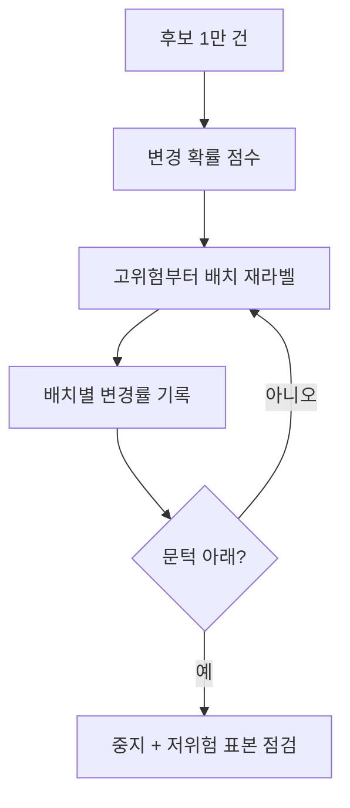
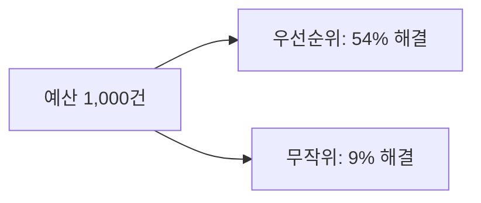

# 재라벨 우선순위

> 재라벨 우선순위는 규칙 변경으로 다시 봐야 할 후보가 많은데 예산이 한정될 때, 라벨이 바뀔 가능성이 큰 샘플부터 재라벨하도록 순서를 정하는 일이다. 같은 예산으로 더 많은 오류를 고칠 수 있다.

## 쉽게 말하면
시험지 1만 장을 다시 채점할 시간이 없다면, 채점 기준 변경에 걸릴 가능성이 높아 보이는 답안부터 먼저 본다. 무작위로 보는 것보다 훨씬 많은 변경 사항을 일찍 잡는다.

## 자세히
- **직접 시뮬레이션(후보 1만 건: 변경 확률 50%인 고위험 1,000건, 10%인 중위험 3,000건, 2%인 저위험 6,000건, 실제 변경은 총 947건)**:

| 재라벨 예산 | 우선순위 순(고위험부터)으로 고친 건수 | 무작위 순으로 고친 건수 |
| --- | --- | --- |
| 1,000건 | 515건(54%) | 86건(9%) |
| 2,000건 | 610건(64%) | 181건(19%) |
| 4,000건 | 826건(87%) | 381건(40%) |

  예산 1,000건에서 우선순위를 쓰면 무작위의 약 6배를 고친다. 이 이득은 우선순위 점수(변경 확률)가 실제와 맞는다는 가정에 달려 있다. 점수가 부정확하면 이득이 줄어든다.
- **우선순위 신호(해석)**: ① 검색식에 더 많이 걸리는 단서(반어 키워드 등) ② 모델이 다른 클래스를 강하게 예측하는 샘플([모델 유도 층화 점검](#model-guided-audit-sampling)) ③ 이중 라벨에서 원래 불일치가 컸던 샘플 ④ 경계 근처 클래스 쌍([규칙 변경 영향 분석](#impact-analysis-for-rule-change)의 변경 행렬에서 큰 칸).
- **운영(해석)**: ① 점수로 정렬해 상위부터 배치(예: 500건씩) 재라벨 ② 배치마다 변경률을 기록 ③ 변경률이 문턱 아래로 떨어지면 멈춘다([검수 정지 규칙](#review-stopping-rule)) ④ 점수가 얼마나 맞는지 배치 변경률과 점수를 비교해 보정한다. 앞의 [precision@k 검수 효율](#precision-at-k-review)과 같은 원리다.
- **주의(해석)**: 저위험 구간을 아예 안 보면 예상 못 한 변경이 남는다. 저위험에서 소량 무작위 표본으로 점검한다([재라벨 표본 시험](#relabel-sample-test)).

## 그림으로 보기

## 예시
- 반어 키워드가 있고 모델 의심도 0.8 이상인 후보부터 500건씩 재라벨, 배치 변경률이 5% 미만이면 멈추고 저위험 100건을 표본 점검한다.
- 교육 활용: 위 시뮬레이션을 직접 돌려 예산에 따른 해결 비율 표를 만든다.

## 헷갈리는 것과 비교
| 개념 | 차이 |
| --- | --- |
| 재라벨 우선순위 | 어떤 순서로 고칠지 |
| [재라벨 표본 시험](#relabel-sample-test) | 전체 재라벨 여부 결정 |
| [규칙 변경 영향 분석](#impact-analysis-for-rule-change) | 영향 범위 정의 |
| [precision@k 검수 효율](#precision-at-k-review) | 점수 상위부터 검수 |

## 더 읽을거리
- [cleanlab filter 문서](https://docs.cleanlab.ai/stable/cleanlab/filter.html) — 점수 순위로 후보를 뽑는 방식
