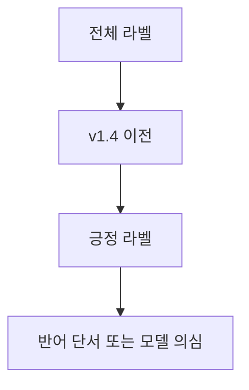

# 재검토 검색식

> 재검토 검색식은 가이드 규칙이 바뀌었을 때 그 변경의 영향을 받는 기존 라벨만 골라내는 조건(SQL·pandas 등)이다. 전체를 다시 라벨링하지 않고 영향 범위만 재검토 큐에 올려 비용을 줄인다.

## 쉽게 말하면
법이 바뀌었을 때 모든 옛 판결을 다시 보는 대신, 바뀐 조항과 관련된 사건만 골라 다시 보는 것이다. 어떤 사건이 해당되는지 가려내는 검색 조건이 필요하다.

## 자세히
- **조건의 재료(해석)**: ① 버전 조건: 개정 이전 지침 버전으로 붙은 라벨([라벨 메타데이터 기록](#annotation-metadata-tracking)) ② 라벨 조건: 규칙이 영향을 주는 클래스 ③ 내용 조건: 키워드·패턴 ④ 모델 조건: 모델이 다른 클래스를 강하게 예측하는 샘플([모델 유도 층화 점검](#model-guided-audit-sampling)) ⑤ 라벨러 조건: 해당 규칙을 오해한 것으로 알려진 라벨러.
- **직접 실행해 확인한 SQL(sqlite, 가상 5건. 규칙 "반어법은 부정으로"가 v1.4에 추가됨)**:

```sql
select id, text from labels
where guideline_ver < 'v1.4' and label = '긍정'
  and (text like '%ㅋㅋ%' or text like '%대단하군%' or pred_prob_other >= 0.5)
order by pred_prob_other desc;
```

  결과는 id 3, id 1 두 건이었다(모델 의심도 순). 이미 v1.4로 붙은 id 4와 확실히 긍정인 id 2는 제외됐다.
- **직접 실행해 확인한 pandas(같은 조건)**:

```python
m = (df.guideline_ver < "v1.4") & (df.label == "긍정") & (df.text.str.contains("ㅋㅋ|대단하군") | (df.pred_prob_other >= 0.5))
df[m]
```

  pandas 문서(Boolean indexing)는 `&`·`|` 조건을 각각 괄호로 감싸라고 한다. 문자열 조건 `str.contains`는 결측이 있으면 `na=False`를 주어야 오류가 안 난다(문서 요약, 해당 페이지 발췌에는 없는 일반 사용법).
- **버전 문자열 비교 주의(해석)**: 'v1.10'은 문자열 비교에서 'v1.4'보다 작게 나올 수 있으므로 버전은 숫자 열(major, minor)로 저장한다.
- **운영(해석)**: ① 검색 결과 건수를 먼저 보고 너무 많으면 모델 의심도로 상위만 ② 재검토 결과 변경률을 기록해 검색식의 정밀도를 평가 ③ 변경률이 낮으면 조건을 좁히고, 높으면 범위를 넓힌다([규칙 변경 전파](#rule-change-propagation)).

## 그림으로 보기



## 예시
- 위 SQL을 실제 테이블에 적용하고, 재검토 후 40%가 부정으로 바뀌었다면 조건 정밀도가 높다고 보고 범위를 넓힌다.
- 교육 활용: 규칙 개정안을 정하고 검색 조건을 직접 써 보게 한다.

## 헷갈리는 것과 비교
| 개념 | 차이 |
| --- | --- |
| 재검토 검색식 | 영향받는 기존 라벨 찾기 |
| [규칙 변경 전파](#rule-change-propagation) | 전체 개정 절차 |
| [라벨 메타데이터 기록](#annotation-metadata-tracking) | 검색에 필요한 열을 제공 |
| [모델 유도 층화 점검](#model-guided-audit-sampling) | 모델 의심도를 표본 설계에 사용 |

## 더 읽을거리
- [pandas Boolean indexing 가이드](https://pandas.pydata.org/docs/user_guide/indexing.html#boolean-indexing) — 조건 결합과 isin
