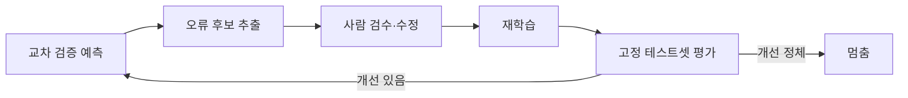
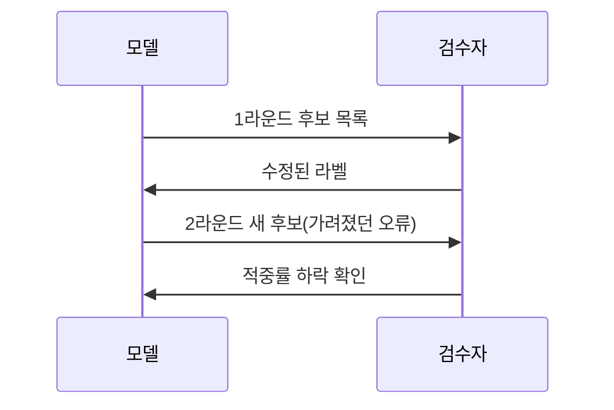

# 정리→재학습 라운드

> 정리→재학습 라운드는 라벨 오류 후보를 찾아 검수·수정하고, 고친 데이터로 모델을 다시 학습해 점수를 새로 매기는 과정을 한 바퀴로 보고 몇 바퀴 반복하는 운영 방식이다. 한 번 정리한 뒤 모델이 달라지면 의심 샘플 목록도 달라지기 때문이다.

## 쉽게 말하면
시험지 채점 오류를 고치는 일과 비슷하다. 가장 눈에 띄는 오류를 먼저 고치고 다시 보면, 그전에는 큰 오류에 가려 보이지 않던 작은 오류가 드러난다. 다만 같은 조교(같은 모델)의 눈으로만 계속 보면 그 조교의 습관적 실수는 끝내 못 찾는다.

## 자세히
- **한 바퀴의 구성(해석)**: ① 교차 검증으로 샘플별 out-of-sample 예측 확률을 얻는다 ② 라벨 오류 후보를 점수순으로 뽑는다 ③ 사람이 검수해 라벨을 수정·삭제·보류한다 ④ 수정된 데이터로 재학습한다 ⑤ 신뢰할 수 있는 테스트셋에서 성능을 잰다.
- **Cleanlab 문서가 설명하는 부분**: `find_label_issues`가 out-of-sample 예측 확률로 후보를 표시하고, `CleanLearning`은 후보 샘플의 가중치를 0으로 두고 학습한다. 이미 계산한 `label_issues`를 `fit()`에 넘기면 탐지를 건너뛰어 더 빠르다. 문서는 반복 라운드 자체의 횟수·효과는 다루지 않는다.
- **성능 측정의 함정(문서 내용)**: 노이즈 있는 테스트셋은 측정 정확도를 왜곡하므로 테스트셋도 정리해야 한다. 문서의 장난감 예제는 참 라벨을 알고 있어서 정확도 83%→86% 개선을 보였지만, 실제 프로젝트는 참 라벨이 없으므로 신뢰할 수 있게 검수한 테스트셋으로만 개선을 판단할 수 있다.
- **과대 탐지**: 같은 문서에서 건강 점수는 라벨의 약 28%를 의심했지만 실제 오류는 약 20%였다. 클래스가 겹치는 샘플이 많이 걸리므로 후보 전부를 오류로 단정하면 안 된다([모호한 샘플 vs 오류 라벨](#ambiguous-vs-wrong-label)).
- **반복 여부 판단(해석, 직접 검증하지 않음)**: 라운드마다 ① 새로 발견된 실제 오류 비율(검수 적중률) ② 고정 테스트셋 점수 변화를 기록한다. 둘 다 거의 변하지 않으면 멈춘다([검수 정지 규칙](#review-stopping-rule)).
- **주의(해석)**: 같은 모델 구조로만 반복하면 그 모델이 자신 있게 틀리는 오류는 계속 남는다. 가끔 다른 구조·다른 시드의 모델로 후보를 교차 확인한다. 라벨 오류 탐지의 원리와 CIFAR·ImageNet·아마존 리뷰 실험은 [Confident Learning 논문](https://arxiv.org/abs/1911.00068)에 있다.

## 그림으로 보기

## 예시
- 고객 문의 분류 데이터: 1라운드에서 상위 500건을 검수해 적중률 60%, 2라운드 적중률 25%, 3라운드 8%이면 3라운드에서 멈춘다(숫자는 가정한 예).
- 교육 활용: 라운드별 적중률 표를 직접 채우게 하고 "언제 멈출 것인가"를 토론한다.

## 헷갈리는 것과 비교
| 개념 | 차이 |
| --- | --- |
| 정리→재학습 라운드 | 정리와 재학습을 한 바퀴로 묶어 반복 |
| [이중 검수](#double-annotation-review) | 한 샘플을 어떻게 판정할지 |
| [검수 정지 규칙](#review-stopping-rule) | 반복을 언제 끝낼지 |
| [모호한 샘플 vs 오류 라벨](#ambiguous-vs-wrong-label) | 후보의 원인 구분 |

## 더 읽을거리
- [Cleanlab in-depth tutorial](https://docs.cleanlab.ai/stable/tutorials/indepth_overview.html) — find_label_issues·CleanLearning 사용과 테스트셋 정리 주의
- [Confident Learning (arXiv 1911.00068)](https://arxiv.org/abs/1911.00068) — 노이즈 라벨 가지치기와 재학습 효과
