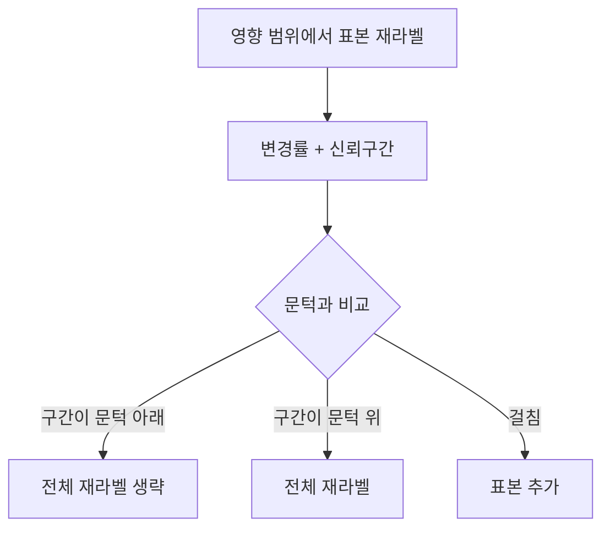
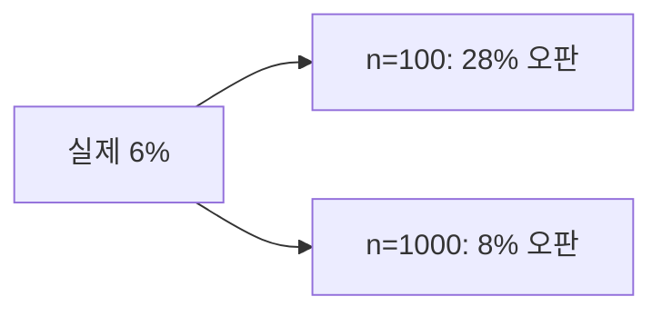

# 재라벨 표본 시험

> 규칙이 바뀐 뒤 기존 라벨을 전부 다시 라벨링하기 전에, 영향 범위에서 표본(예: 10%)만 재라벨해 "라벨이 실제로 바뀌는 비율"을 추정하고 그 값으로 전체 재라벨 여부를 결정하는 시험이다.

## 쉽게 말하면
창고 물건 1만 개를 전부 다시 검사하기 전에 몇 백 개만 뽑아 불량이 얼마나 나오는지 본다. 불량이 많으면 전수 검사, 적으면 그냥 둔다.

## 자세히
- **표본 크기 공식(Wikipedia, Sample size determination)**: 비율 추정에서 n = z²·p(1−p)/E². 95% 신뢰는 z=1.96, 최악의 경우 p=0.5, 올림해서 쓴다. 층화 표본도 가능하다([품질 표본 추출 계획](#quality-sampling-plan)).
- **직접 시뮬레이션(실제 변경률 true, 표본 n, 윌슨 95% 신뢰구간의 평균 범위, 결정 규칙 "표본 변경률 5% 이상이면 전체 재라벨", 각 2,000회)**:

| 실제 변경률 | 표본 n | 평균 신뢰구간 | 전체 재라벨로 결정할 확률 |
| --- | --- | --- | --- |
| 2% | 100 | [0.6%, 6.9%] | 0.05 |
| 2% | 300 | [1.0%, 4.3%] | 0.00 |
| 2% | 1000 | [1.3%, 3.1%] | 0.00 |
| 6% | 100 | [2.8%, 12.3%] | 0.72 |
| 6% | 300 | [3.8%, 9.3%] | 0.80 |
| 6% | 1000 | [4.7%, 7.7%] | 0.92 |
| 15% | 100 | [9.4%, 23.3%] | 1.00 |
| 15% | 300 | [11.4%, 19.5%] | 1.00 |
| 15% | 1000 | [12.9%, 17.3%] | 1.00 |

  실제 변경률이 문턱(5%) 바로 위인 6%일 때는 표본 100개로 결정하면 28%가 "재라벨 불필요"로 잘못 판단한다. 문턱에서 먼 2%나 15%는 100개로도 거의 맞는다. 즉 문턱 근처일수록 표본이 커야 한다. (가정된 시뮬레이션이다.)
- **결정 방식(해석)**: 신뢰구간 전체가 문턱 아래면 재라벨 불필요, 전체가 위면 재라벨, 걸치면 표본 추가. 재라벨 비용(건당 단가×대상 수)과 놓칠 때의 피해를 비교해 문턱을 정한다([라벨링 비용 모델](#annotation-cost-model)).
- **표본 설계(해석)**: 영향 범위(검색식으로 찾은 후보) 안에서 무작위 추출, 영향 범위 밖에서도 소량 추출해 검색식의 누락(미탐)을 점검한다([재검토 검색식](#relabel-query)).

## 그림으로 보기

## 예시
- 영향 후보 4,000건에서 300건을 재라벨했더니 변경 21건(7%)이고 신뢰구간이 [4.6%, 10.5%] 정도라면 문턱 5%와 걸치므로 300건을 더 뽑는다(계산 예).
- 교육 활용: 문턱 근처 변경률에서 표본 크기에 따른 판단 오류 표를 직접 만든다.

## 헷갈리는 것과 비교
| 개념 | 차이 |
| --- | --- |
| 재라벨 표본 시험 | 전체 재라벨 여부 결정용 |
| 전수 재라벨 | 영향 범위 전부 다시 |
| [규칙 변경 영향 분석](#impact-analysis-for-rule-change) | 영향 범위를 정의 |
| [품질 표본 추출 계획](#quality-sampling-plan) | 일반적인 표본 설계 |

## 더 읽을거리
- [Sample size determination (Wikipedia)](https://en.wikipedia.org/wiki/Sample_size_determination) — 비율 추정 표본 크기 공식
