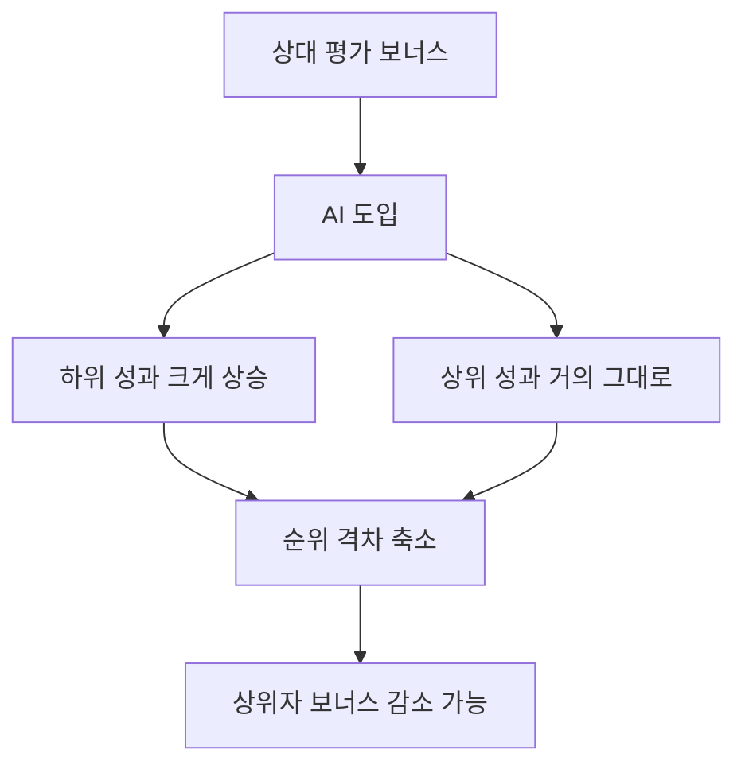

# 상대 평가 보상 효과

> 보너스가 "다른 사람 대비 순위"로 정해지는 회사에서 AI를 도입하면 보상이 어떻게 변하는지의 문제. 모두의 성과가 오르면 순위 보상은 도입 효과가 희석되고, AI가 하위자를 더 끌어올리면 상위자의 순위·보너스가 오히려 내려갈 수 있다.

## 쉽게 말하면
달리기 대회에서 상금이 등수로 정해진다고 하자. 모두가 같은 신발을 신어 기록이 똑같이 빨라지면 등수는 그대로라 상금도 그대로다. 그런데 신발이 느린 선수에게 더 크게 도움이 된다면 느렸던 선수들이 앞 등수를 따라잡고 원래 1등은 상금이 줄 수 있다. 상대 평가 보너스 체계에서 AI 도입은 바로 이런 모양이 될 수 있다.

## 자세히
출처: NBER 31161 §2.2와 결론(PDF 직접 읽음), 토너먼트 이론은 검색 결과 요약(Lazear-Rosen 1981 논문은 직접 열지 못함). 이 연구는 임금 변화를 관측하지 못했다고 저자가 직접 밝힌다.
- **연구 회사의 보상 구조**: 상담사는 시급과 **다른 상담사 대비 성과에 따른 보너스**를 받는다(NBER 31161 §2.2).
- **저자의 우려**: 최상위자는 AI 학습 데이터에 많은 사례를 제공하지만 자신의 생산성은 거의 오르지 않는다. 회사의 현행 보상 방식에서는 보너스가 다른 상담사 성과 대비로 계산되므로 오히려 보수가 **줄 수도 있다**. 그러면 "AI 학습에 기여한 데이터에 대해 상위자를 어떻게 보상할 것인가"라는 질문이 생긴다(저자의 문제 제기이며 실제로 줄었는지 데이터로 보이진 않음).
- **관측하지 못한 것**: 임금, 전체 노동 수요, 채용되는 숙련 구성의 변화는 자료에 없다. 기업이 신입을 더 뽑거나, 직무를 단순화하거나, 더 강한 AI로 하위 인력을 대체할 가능성은 열려 있다고 논문이 말한다.
- **토너먼트 이론(일반론, 검색 요약)**: 순위 기반 보상(Lazear-Rosen 1981)은 모든 참가자에게 똑같이 오는 공통 충격을 걸러 낸다. 그래서 전원의 성과가 똑같이 오르면 순위·보너스는 바뀌지 않는다. 반대로 도구가 사람마다 다르게 작동하면 순위가 재편된다. 이 마지막 연결은 이 글의 추론이다.
- **설계 선택지(제안)**: 절대 성과 기준 보너스로 일부 전환, AI 도입 전후 기준선을 달리 잡기, 상위자의 모범 사례 기여에 별도 보상, AI 의존도가 높은 지표와 품질 지표를 섞기.
- 한 회사 사례이므로 일반화는 어렵다.

## 그림으로 보기

## 예시
- 영업팀 인센티브가 팀 내 순위로 정해진다면 AI 제안서 도구 도입 후 신입 실적이 올라 베테랑의 순위 보너스가 줄어든다. 절대 매출 기준이나 신입 육성 기여 점수를 섞는 안을 검토(제안).
- 콜센터 코칭 영상에 자기 통화가 쓰인 상위 상담사에게 "모범 사례 기여 수당" 지급 검토(제안).

## 헷갈리는 것과 비교
| 개념 | 차이 |
|---|---|
| 상대 평가(순위) 보상 | 남과 비교한 순위로 정함 |
| 절대 기준 보상 | 정해진 목표 달성 여부로 정함 |
| [숙련도 격차 축소](#skill-gap-compression) | 상대 평가 체계를 흔드는 현상 |
| [숙련자 기여 보상](#knowledge-capture-credit) | 상위자의 지식이 AI에 쓰이는 보상 문제 |

## 더 읽을거리
- [NBER Working Paper 31161](https://www.nber.org/system/files/working_papers/w31161/w31161.pdf) — §2.2 보상 구조, 결론의 보상 논의(직접 읽음)
- [Rank-Order Tournaments as Optimum Labor Contracts (Lazear & Rosen, JPE 1981)](https://kylewoodward.com/blog-data/pdfs/references/lazear+rosen-journal-of-political-economy-1981A.pdf) — 원 논문(검색 결과로만 확인, 열지 못함)
