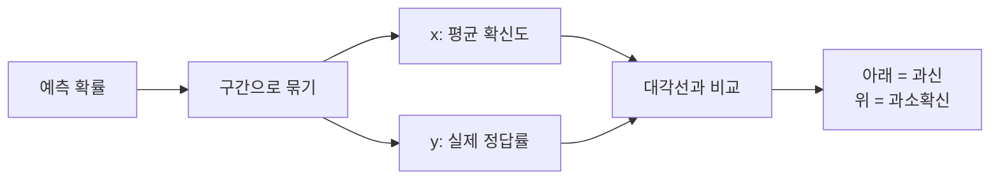

# 신뢰도 곡선(reliability diagram)

> 신뢰도 곡선은 모델이 말한 확신도(예측 확률)를 구간별로 묶어, 그 구간에서 실제로 맞은 비율과 비교해 그린 그림이다. 대각선에 붙어 있으면 "80% 확신"이 실제 80% 정답이라는 뜻으로 잘 보정된 모델이다.

## 쉽게 말하면
일기예보관이 "비 올 확률 80%"라고 한 날들만 모아서 실제로 몇 번 비가 왔는지 세는 것과 같다. 100번 중 80번쯤 왔다면 믿을 만한 예보관이다. 50번밖에 안 왔다면 허풍이 심한 예보관(과신)이다.

## 자세히
- 만드는 법(scikit-learn 문서): 샘플별 y값은 못 구하니 **구간(bin)으로 묶는다.** 구간마다 ① 평균 예측 확률(x축) ② 실제 양성 비율(y축)을 구해 점을 찍는다. `calibration_curve(y, proba, n_bins=10, strategy="quantile")`.
- `strategy`: `uniform`은 폭이 같은 구간이라 데이터가 드문 구간이 불안정하고, `quantile`은 구간별 샘플 수를 비슷하게 맞춰 안정적이다. `n_bins` 기본값은 5.
- 읽는 법:
  - 대각선 위 = 잘 보정됨.
  - **대각선 아래** = 말한 것보다 덜 맞음 → **과신(overconfident)**. 확률을 극단(0·1)으로 몰아 준다.
  - **대각선 위쪽** = 말한 것보다 더 맞음 → 과소 확신.
- 예(문서): GaussianNB는 0·1로 몰아 과신, RandomForest는 평균내기 때문에 양 끝에서 과소 확신(S자), LogisticRegression은 대체로 잘 보정됨.
- 요약 지표: **ECE** = Σ (구간 샘플 비중 × |정답률 − 평균 확신도|). 구간 설정에 따라 값이 달라진다. **Brier 점수**(예측 확률과 결과의 제곱 오차)는 보정·변별력·데이터 잡음이 섞여 있어 보정만 보기에는 부적절하다.
- 교정: `CalibratedClassifierCV`의 `sigmoid`(Platt, 소량 데이터에 적합, 순위 보존) 또는 `isotonic`(유연, 약 1,000개 이상일 때 적합, 작은 데이터에선 과적합). 딥러닝에서는 [온도 스케일링](#temperature-scaling)을 흔히 쓴다.
- LLM에서는 "말로 표현한 확신도"나 토큰 확률로 같은 그림을 그려 과신 여부를 본다(일반적 활용).

## 그림으로 보기


## 예시
```python
from sklearn.calibration import calibration_curve
frac_pos, mean_pred = calibration_curve(y_test, proba, n_bins=10, strategy="quantile")
ece = sum(w*abs(a-c) for w,a,c in zip(weights, frac_pos, mean_pred))
```
점이 대각선 아래에 몰려 있으면 확률을 그대로 믿지 말고 보정한 뒤 임계값을 정한다.

## 헷갈리는 것과 비교
| 개념 | 차이 |
| --- | --- |
| 신뢰도 곡선 | 보정 상태를 그림으로 봄 |
| ECE | 그 그림을 숫자 하나로 요약 |
| Brier 점수 | 보정+변별력이 섞인 점수 |
| [과신](#overconfidence) | 곡선이 대각선 아래로 내려간 상태 |
| [모델 보정](#model-calibration) | 곡선을 대각선에 맞추는 일 |

## 더 읽을거리
- [Probability calibration (scikit-learn)](https://scikit-learn.org/stable/modules/calibration.html) — 곡선 작성·해석·교정 방법
