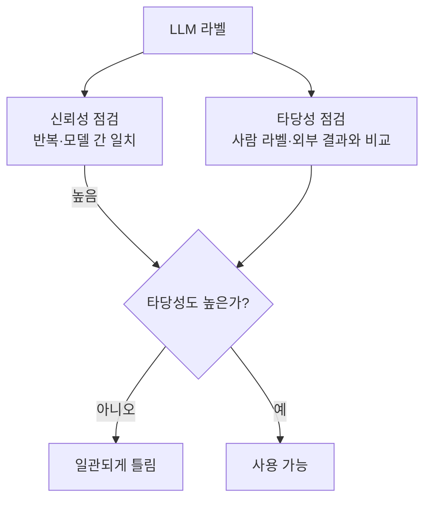
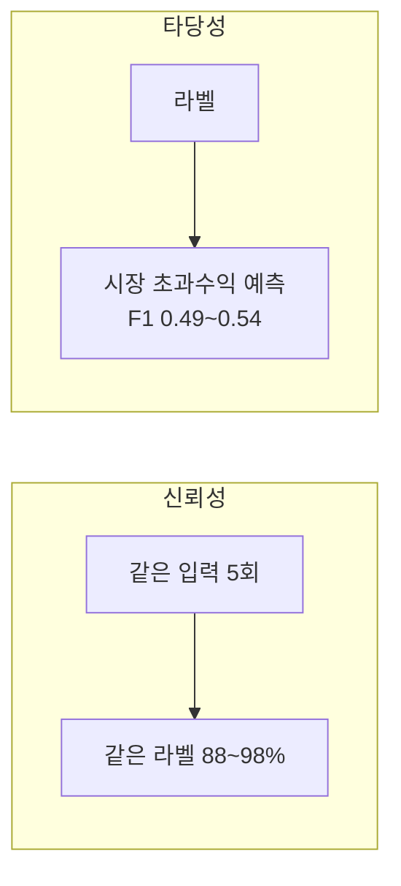

# 신뢰성과 타당성

> **신뢰성**은 같은 일을 반복했을 때 결과가 같은가, **타당성**은 그 결과가 재려던 것을 정말 재는가다. LLM 라벨이 매번 똑같이 나와도(신뢰성) 정답과는 멀 수 있다(타당성 부족).

## 쉽게 말하면
늘 2kg 빠르게 나오는 고장 난 체중계는 매번 같은 값을 보여 주니 신뢰성은 높다. 하지만 실제 몸무게를 못 맞히니 타당성은 낮다. 신뢰성은 타당성의 필요조건이지만 충분조건이 아니다.

## 자세히
- 심리측정의 원칙: 측정이 믿을 수 없으면(신뢰성 낮음) 타당할 수 없다. 거꾸로 일관되다고 타당한 것은 아니다.
- 사례(Megahed 외, arXiv 2505.14918, 2025-05, 직접 읽음): 주식 뉴스 기사 1,350건을 이진 분류(긍정/부정)하는 LLM 여러 개를 평가했다.
  - **신뢰성**: 5회 반복에서 대부분 모델이 기사의 88~98%에 같은 라벨을 냈고 평균 일치율은 모든 모델에서 0.93을 넘었다. 모델 간 일치 계수도 대체로 0.70 이상이었다.
  - **벤치마크 타당성**: StockNewsAPI 라벨 대비 정확도 0.76~0.88(gemma3:1B 0.88, llama3.2:1B 0.86, claude-3-5-haiku 0.85). 작은 모델이 큰 모델을 이긴 경우도 있었다.
  - **실제 시장 타당성**: S&P500 대비 초과 수익률과 비교하면 정밀도 0.50~0.54, F1 0.49~0.54로 **우연 수준**. 저자들은 LLM 라벨이 일관되지만 시장 결과를 예측하지는 못했다고 해석한다.
  - 약 2.37%의 출력은 허용된 라벨 밖이었고 이를 따로 보고하라고 권한다.
- 권고(같은 논문): 계획 단계에서 표본 크기 산정(추정치 216~1,317, 일치도 지표에 따라 다름), 여러 신뢰성 지표 병용, 코드북 작성과 프롬프트 반복 개선, 벤치마크와 외부 기준 모두로 타당성 검증, 작은 모델도 과제별로 평가.
- 온도 0이나 시드 고정만으로 신뢰성을 증명했다고 보기 어렵다는 지적도 있다(검색에서 확인한 논의, 본문 미확인).
- 이 노드의 맥락: [일관되지만 틀린 주석](#consistent-but-wrong)에서 본 함정을 지표로 나눠 말한 것이다. 반복 일치만 보고 "믿을 만하다"고 결론짓지 않는다.

## 그림으로 보기

## 예시
| 점검 | 결과(논문) |
|---|---|
| 5회 반복 일치 | 평균 0.93 이상 |
| 벤치마크 라벨 정확도 | 0.76~0.88 |
| 시장 초과수익 예측 F1 | 0.49~0.54 |
- 업무 장면: 고객 리뷰 감정 라벨이 매번 같게 나온다고 안심하지 말고, 사람이 단 라벨 100건과 비교하고 실제 재구매율과도 맞춰 본다.

## 헷갈리는 것과 비교
| 개념 | 질문 |
|---|---|
| 신뢰성 | 반복해도 같은가 |
| 타당성 | 재려던 것을 재는가 |
| [일관되지만 틀린 주석](#consistent-but-wrong) | 신뢰성만 높은 실패 사례 |
| [사람 정답 세트 점검](#gold-set-check) | 타당성을 보는 대표 방법 |

## 더 읽을거리
- [Reliable Decision Support with LLMs (arXiv 2505.14918)](https://arxiv.org/abs/2505.14918) — 일관성 vs 타당성 4단계 프레임워크와 수치(직접 읽음).
