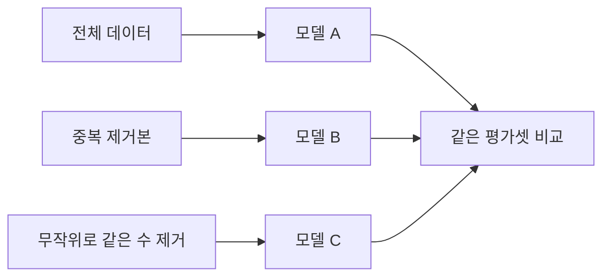
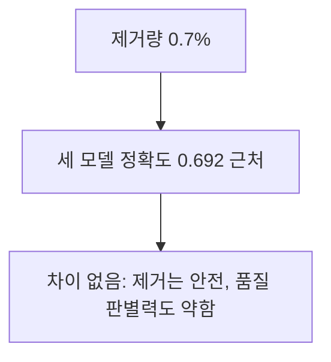

# 제거·보존 집합 비교 실험

> 중복 제거가 제대로 됐는지 확인하는 한 방법은 **제거한 집합과 남긴 집합(또는 전체·무작위 제거)으로 작은 모델을 각각 학습해 성능을 비교**하는 것이다. 단, 제거량이 작으면 차이가 측정 잡음 안에 묻힌다.

## 쉽게 말하면
교재에서 "중복 문제"라고 뺀 문제들이 정말 빼도 되는 문제였는지 확인하려고, 뺀 교재와 안 뺀 교재로 학생 두 명을 가르쳐 시험을 보게 한다. 점수 차이가 없으면 뺀 것은 불필요했다는 뜻이다. 비교를 공정하게 하려면 "같은 수의 아무 문제를 뺀 교재"도 대조군으로 둔다.

## 자세히
- **설계(제안)**: ① 전체 데이터 ② 중복 제거본 ③ 같은 수의 문서를 **무작위로** 뺀 대조군(여러 시드)로 같은 모델·같은 설정을 학습 ④ 같은 평가셋 점수 비교. 중복 제거본이 무작위 제거와 같거나 낫다면 제거된 문서가 "정보가 없는 것"이었다는 근거가 된다. Lee 외(2021)도 중복 제거가 퍼플렉서티를 해치지 않았다고 보고했다([Lee 논문](#lee-2021-dedup-paper)).
- **직접 실행**(20 newsgroups 20개 분류, 학습 11,314글. 단어 5-그램 MinHash LSH 임계 0.8로 10단어 이상 글 10,707개에서 근접 중복 군집을 만들고 군집당 1개만 남김 → **74개 제거(0.7%)**. TF-IDF + 로지스틱 회귀, 시험셋 7,532글 정확도):

| 학습 데이터 | 정확도 |
|---|---|
| 전체 | 0.6920 |
| 중복 제거본(74개 제거) | 0.6916 |
| 무작위로 74개 제거(3시드 평균) | 0.6922 |

  세 값의 차이는 0.0006 이하로, 이 정도 제거는 **성능에 영향이 없다**는 결론이다. 거꾸로 말하면 이 실험은 제거 품질을 구별해 주지 못한다. 제거가 0.7%뿐이라 무작위 제거와도 차이가 안 난다. 또 제거된 74개로만 학습하면 20개 클래스가 다 들어 있지 않아 비교 자체가 불가능했다(대조: 무작위 74개 학습은 정확도 0.13).
- **교훈**: ① 제거량이 작으면 학습 비교로는 차이를 못 본다. 큰 제거(수십 %)나 오염 평가셋처럼 민감한 평가가 필요하다. ② 시드를 여러 개 돌려 변동 폭을 알아야 0.0006이 잡음인지 판단할 수 있다. ③ 제거본 vs 무작위 제거 대조군이 없으면 "중복 제거 덕분"이라는 해석이 불가능하다. ④ 제거된 문서를 직접 읽는 정성 점검([이름표 가린 검수](#blind-quality-review))이 이 경우 더 정보가 많다.
- 한계: 영어 소규모 분류 문제의 선형 모델 하나다. 언어 모델 학습이나 대규모 코퍼스에서는 결과가 달라질 수 있다.

## 그림으로 보기

## 예시
- 사내 문서 20% 제거를 검증할 때 같은 20%를 무작위로 뺀 대조군을 함께 학습.
- 교육: 시드를 5개로 늘려 정확도의 평균과 표준편차를 표로 만드는 과제.

## 헷갈리는 것과 비교
| 개념 | 차이 |
|---|---|
| 제거·보존 비교 | 학습 결과로 제거 품질을 간접 확인 |
| [이름표 가린 검수](#blind-quality-review) | 사람이 직접 읽고 판단 |
| [중복 제거 품질 점검](#dedup-quality-check) | 상위 개념 |
| ablation | 요소를 빼고 성능을 보는 일반적 실험 |

## 더 읽을거리
- [Deduplicating Training Data Makes Language Models Better](https://ar5iv.labs.arxiv.org/html/2107.06499) — 중복 제거가 퍼플렉서티를 해치지 않았다는 결과(열어 확인).
- [scikit-learn 실제 데이터셋 문서](https://scikit-learn.org/stable/datasets/real_world.html) — 20 newsgroups(열어 확인).
