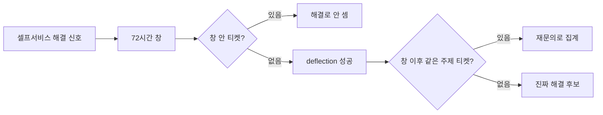

# 재문의율 (Reopened-as-ticket)

> 챗봇·셀프서비스로 "해결"된 것으로 집계된 사용자가 **창이 닫힌 직후 같은 주제로 티켓을 여는 비율**. 해결이 아니라 연락을 뒤로 미룬 것은 아닌지를 잡는 안전장치(guardrail) 지표다.

## 쉽게 말하면
식당에서 "만족해서 돌아간 손님"으로 센 사람이 사흘 뒤 같은 문제로 다시 전화한다면 그때 센 것은 성공이 아니었다. 재문의율은 그런 "성공으로 세었는데 다시 온 사람"의 비율이다.

## 자세히
출처: Metabase "Deflection rate" 지표 페이지(본문 확인, 2026-11-18). 이 페이지가 재문의율의 공식 표준은 아니며 한 분석 도구 문서의 정의다.
- **정의(Metabase)**: "deflected" 처리된 사용자 중 창이 닫힌 뒤 곧 같은 질문으로 티켓을 만든 사용자의 비율. 같은 사용자, 같은 주제, 창 직후라는 개념으로만 설명된다.
- **역할**: deflection이 문의를 해결한 것이 아니라 **지연**시킨 경우를 찾는다.
- **계산 주의**: 페이지는 재문의율의 수식이나 SQL을 주지 않는다. deflection SQL은 72시간 창 안의 티켓을 이미 제외하므로, 재문의 점검은 그 창 **이후**를 보고 **주제를 맞춰야** 한다. 페이지의 `ticket_anyway` 열은 창 안 티켓만 세고 주제 매칭도 하지 않아 재문의율이 아니다.
- **짝 지표**: deflection = 셀프서비스 해결 ÷ (셀프서비스 해결 + 생성된 티켓). 해결은 "도움이 됐다" 같은 명시 신호와 72시간 내 티켓 없음이 필요하다. 이 두 지표는 같이 봐야 한다.
- **기준값 없음**: 페이지는 허용 가능한 재문의율 임계값을 주지 않는다. 72시간은 "합리적 기본값"일 뿐 벤치마크가 아니다.
- **구현 방법(제안)**: ①해결 이벤트 시각과 사용자·주제 라벨 저장 ②창 종료 후 N일(예: 7일) 동안 같은 사용자의 티켓을 주제로 매칭 ③매칭 건수 ÷ 해결로 센 건수. 주제 분류가 부정확하면 비율도 흔들리므로 샘플로 정확도를 점검한다.
- **한계**: 사용자 식별 없이는 못 잰다. 다른 채널(전화)로 돌아온 문의는 놓칠 수 있다.

## 그림으로 보기

## 예시
- 해결로 센 1,000건 중 창 종료 후 7일 안에 같은 주제로 티켓이 70건 → 재문의율 7%(가상 값).
- 교육 활용: "챗봇 성과 보고서에 재문의율이 있는가"를 점검 항목으로 쓴다.

## 헷갈리는 것과 비교
| 개념 | 차이 |
|---|---|
| 재문의율 | 해결로 센 뒤 같은 주제로 다시 온 비율 |
| `ticket_anyway`(Metabase) | 창 안에서 바로 티켓을 만든 수 |
| [해결률](#resolution-rate) | 해결 신호로 센 성공 비율 |
| [응대 전환율 deflection](#deflection-rate) | 사람에게 안 닿은 비율 |

## 더 읽을거리
- [Metabase: Deflection rate](https://www.metabase.com/metrics/deflection-rate) — 공식, 72시간 창, 안전장치 지표, 함정
