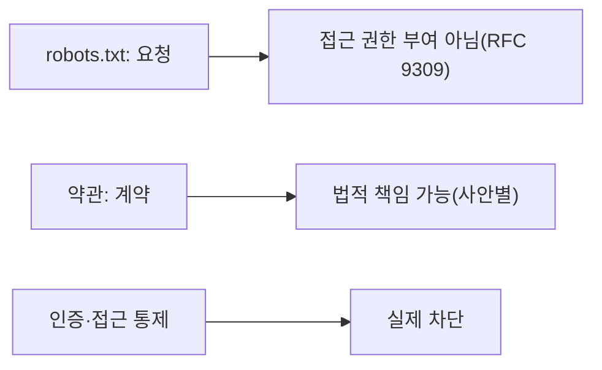
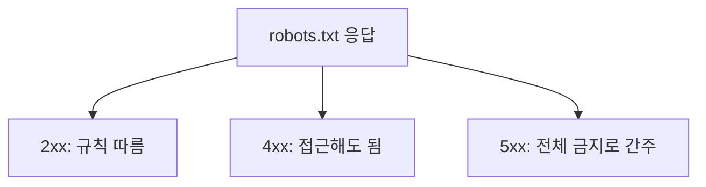

# 요청과 계약의 차이

> robots.txt는 크롤러에 대한 "요청(지침)"이고, 이용약관은 당사자 간 "계약"이다. RFC 9309는 robots.txt 규칙이 접근 권한 부여(authorization)가 아니라고 명시한다.

## 쉽게 말하면
현관 앞 "신발을 벗어 주세요"라는 쪽지는 부탁이고, 임대차 계약서는 약속이다. 쪽지가 없다고 마음대로 들어와도 된다는 뜻도, 쪽지가 법적 구속력이라는 뜻도 아니다.

## 자세히
(RFC 9309 Robots Exclusion Protocol을 직접 열어 확인.)
- **성격**: 1절 "These rules are not a form of access authorization." 보안 고려 절은 이 프로토콜이 실제 접근 통제를 대체하지 않으며 접근 통제는 HTTP 인증 같은 **애플리케이션 계층**에서 해야 한다고 한다.
- **크롤러 의무(RFC)**: user-agent 이름을 대소문자 구분 없이 매칭해 해당 그룹을 따라야 하고, 파싱 가능한 줄은 사용해야 한다(MUST). 캐시는 24시간 넘게 쓰지 않기를 권고(SHOULD).
- **응답 코드**: 4xx(없음)면 크롤러는 자원에 접근해도 된다(허용이지 의무가 아님). 5xx(접근 불가)면 **전체 금지로 간주해야 한다(MUST)**. 장기간(예: 30일) 지속되면 없는 것으로 보거나 캐시를 쓸 수 있다. 리다이렉트는 최소 5회 따라간다. 파싱 한도는 최소 500KiB를 지원해야 한다.
- **계약과의 관계**: 약관은 법적 합의이므로 위반 시 계약상 책임이 문제 될 수 있으나 크롤러가 약관을 읽지 않는 경우가 많다([약관 vs robots.txt](#tos-vs-robots-txt)). 법적 효력은 관할과 사실관계에 따라 다르며 이 노드는 법률 자문이 아니다.
- **의미(제안)**: robots.txt는 선의에 기대는 신호다. 민감 자료 보호에는 인증·차단 같은 기술적 통제가 필요하다.

## 그림으로 보기

## 예시
- 비공개 데이터는 robots.txt가 아니라 로그인·IP 제한으로 보호.
- 교육 활용: 요청·계약·접근 통제 3층 구조를 정리하는 도식.

## 헷갈리는 것과 비교
| 개념 | 차이 |
|---|---|
| robots.txt | 크롤러 지침, 접근 권한 아님 |
| 이용약관 | 계약, 집행은 별도 |
| 접근 통제 | 기술적으로 막음 |

## 더 읽을거리
- [RFC 9309](https://www.rfc-editor.org/rfc/rfc9309.html) — 프로토콜 규정.
