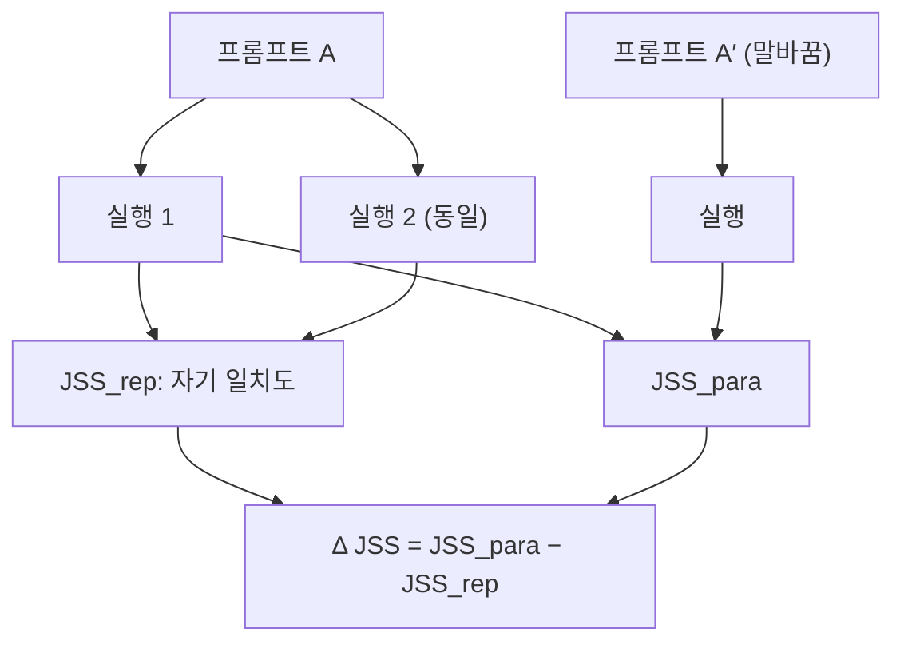
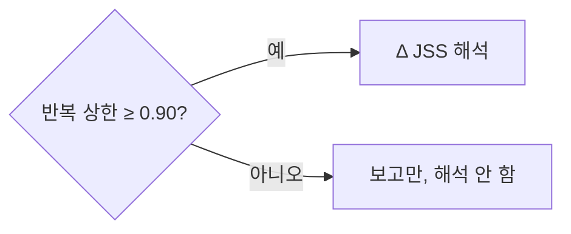

# 반복 상한

> **반복 상한(repeat ceiling)**은 **똑같은 프롬프트를 두 번 보냈을 때 모델(심사위원)이 자기 자신과 일치하는 비율**이다. 표현을 바꿨을 때 일치도가 떨어지는 정도를 해석할 때 "무작위 노이즈 때문에 이 이상은 안 나온다"는 천장이 된다.

## 쉽게 말하면
같은 사람이 같은 시험지를 두 번 채점해도 점수가 조금 다를 수 있다. 말투를 바꿨을 때 점수가 달라졌다고 해서 모두 말투 탓은 아니다. 먼저 "같은 지시로 두 번 해도 어긋나는 정도"를 재서 기준선으로 삼아야 공정하다.

## 자세히
(JudgeSense 논문, arXiv 2604.23478 HTML 버전 본문 앞 10만 자를 WebFetch로 직접 확인. 뒤 4.6만 자는 읽지 못함.)
- **정의(논문)**: **JSS_rep** = 같은 템플릿을 **변경 없이 한 번 더** 보냈을 때의 일치도. 심사위원의 **재현성 상한**이다. 말바꿈 일치도 JSS_para와 비교해 **주 지표 Δ JSS = JSS_para − JSS_rep**을 쓴다. 말바꿈이 재샘플링보다 더 많은 일치를 깎으면 음수가 된다.
- **0.90 규칙(논문)**: 반복 상한이 **0.90 미만인 칸은 보고하되 해석하지 않는다**. 상한이 낮으면 Δ JSS가 0에 가까워져 보이는데, 이는 안정적이라는 뜻이 아니라 **디코딩 노이즈가 효과를 삼킨 것**이므로 "안정성이 아닌 정보 없음"으로 취급한다. 98칸 중 11칸이 기준 미달이라 **87칸만 읽을 수 있었다**(논문 기술).
- **기준의 유래(논문)**: 사전 시험에서 잘못 설정한 디코딩 파라미터가 상한을 0.864로 만들어 전체 효과를 흡수한 일이 있어 0.90을 정했다고 밝힌다.
- **디코딩 설정(논문)**: 모든 심사위원이 temperature 0이었고, 예외로 Claude Opus 4.7은 명시적 temperature를 거부해 제공사 기본값을 썼다. 출력 한도는 1,024 토큰. 에이전트 하네스 실행은 temperature를 노출하지 않아 설정이 불명이다.
- **활용(해석)**: LLM 평가에서 "말을 바꾸니 점수가 달라졌다"고 주장하기 전에 같은 프롬프트의 재실행 일치도를 먼저 측정해 보고한다. → [Judge Sensitivity Score](#judge-sensitivity-score)

## 그림으로 보기

## 예시
- LLM 심사위원 A가 같은 지시로 두 번 채점해 88% 일치라면 0.90 미만이므로 말바꿈 실험 결과를 안정성 근거로 쓰지 않는다.
- 교육 활동: 같은 질문을 같은 설정으로 5번 묻고 일치도를 먼저 재어 본 뒤 말바꿈 실험을 한다.

## 헷갈리는 것과 비교
| 개념 | 차이 |
|---|---|
| 반복 상한 | 동일 프롬프트 재실행 일치도 |
| JSS_para | 말바꿈 프롬프트 간 일치도 |
| [Judge Sensitivity Score](#judge-sensitivity-score) | 위 두 값을 함께 쓰는 지표 |
| 재현성(reproducibility) | 실험을 다시 돌려 같은 결과가 나오는 일반 개념 |

## 더 읽을거리
- [JudgeSense (arXiv 2604.23478)](https://arxiv.org/abs/2604.23478) — JSS_rep, Δ JSS, 0.90 규칙(HTML 본문 직접 확인).
