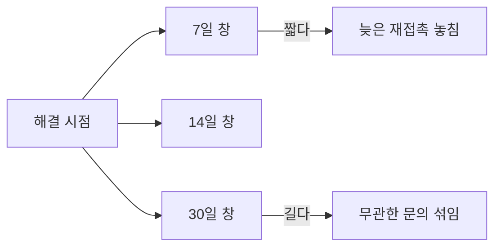
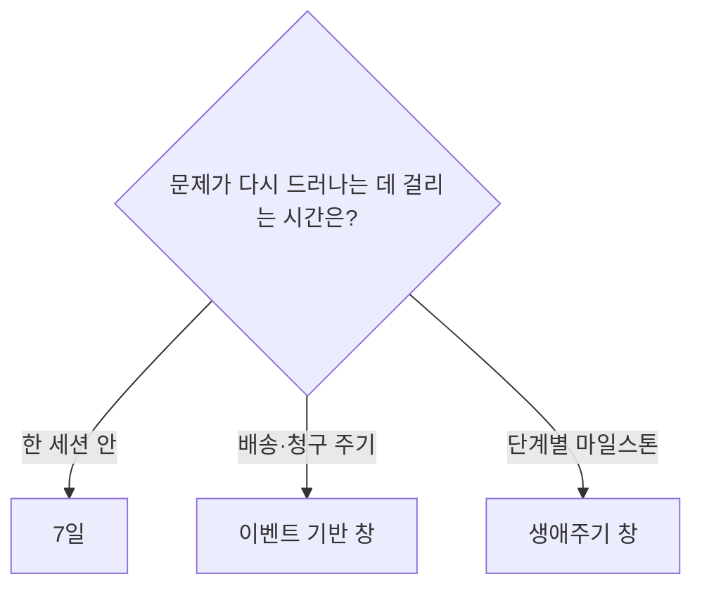

# 반복 접촉 창

> 반복 접촉(같은 문제로 다시 연락)을 셀 때 "해결 후 며칠까지를 볼 것인가"를 정한 기간이다. 창이 짧으면 늦게 드러나는 재접촉을 놓치고, 길면 무관한 문의까지 섞여서 반복률이 부풀려진다.

## 쉽게 말하면
세탁소에서 "맡긴 옷 얼룩이 다시 보여요"라는 항의를 하루 안에만 받으면 며칠 뒤에야 보이는 얼룩은 못 잡는다. 반대로 3개월을 인정하면 다른 옷에 대한 불만까지 섞인다. 문제가 보통 언제쯤 다시 드러나는지에 맞춰 기간을 정해야 한다.

## 자세히
- **일반 범위**: 보통 7~30일(Kustomer 용어집 확인). 7일을 표준으로 보는 곳과 B2B는 14일 이상을 권하는 곳이 있다(검색 결과 기준).
- **Voiso 글(직접 열어 확인) 요지**:
  - 7일 창: 해결이 늦게 드러나는 업종에서는 반복을 **과소 집계**. 빠르게 끝나는 문제에 적합.
  - 14일 창: SaaS는 해결 후 7~14일이 기준. 더 길면 무관한 후속 문의·라이프사이클 체크인이 섞여 반복률이 **부풀려진다**.
  - 생애주기 기반 창: 가장 정확하다고 하지만 마일스톤 정의가 필요.
  - 선택 원칙: 응답이 걸리는 시간이 아니라 **근본 원인이 해결되는 데 보통 걸리는 시간**에 맞춘다.
- **업종별 제안(Voiso)**: SaaS는 해결 후 7~14일, 핀테크는 생애주기(KYC 후·입금 후 등), 물류는 배송 확인까지, 통신은 청구 주기+7일.
- **다중 창 권고**: 창마다 보는 실패가 다르므로 여러 창을 같이 보라는 의견이 있다(검색 결과 기준). 창을 줄이면 보고 수치가 바로 바뀐다.
- **같은 문제 판정이 전제**: 기간만 정해서는 부족하고 문의 사유 태그·케이스 ID와 고객 식별이 필요하다([지연 재접촉](#deferred-contact)).
- 고정 숫자는 벤더·실무자 제안일 뿐 법적·학술적 표준이 아니다.

## 그림으로 보기

## 예시
- 배송 지연이 평균 10일인 물류 챗봇에 7일 창을 쓰면 반복 문의의 상당수를 놓친다 → "배송 확인까지"로 변경(Voiso 예시).
- 비밀번호 재설정은 한 세션에서 끝나므로 7일 창이면 충분.
- 보고 시 7일·14일 두 수치를 함께 표기하고 창 정의를 각주로 적는다.

## 헷갈리는 것과 비교
| 개념 | 차이 |
|---|---|
| 반복 접촉 창 | 재접촉을 세는 기간 |
| [지연 재접촉](#deferred-contact) | 창 안에서 다른 채널로 재연락하는 현상 |
| 세션 타임아웃 | 한 대화의 종료 기준(분 단위) |
| [봉쇄율의 함정](#containment-rate-trap) | 창이 닫히기 전 수치는 잠정값 |

## 더 읽을거리
- [Voiso: Repeat Contact Rate](https://voiso.com/articles/repeat-contact-rate/) — 창 길이 트레이드오프와 업종별 제안(직접 열어 확인, 벤더 글).
- [Kustomer: Repeat Contact Rate](https://kustomer.com/glossary/repeat-contact-rate/) — 정의·공식·7~30일 범위(직접 열어 확인).
