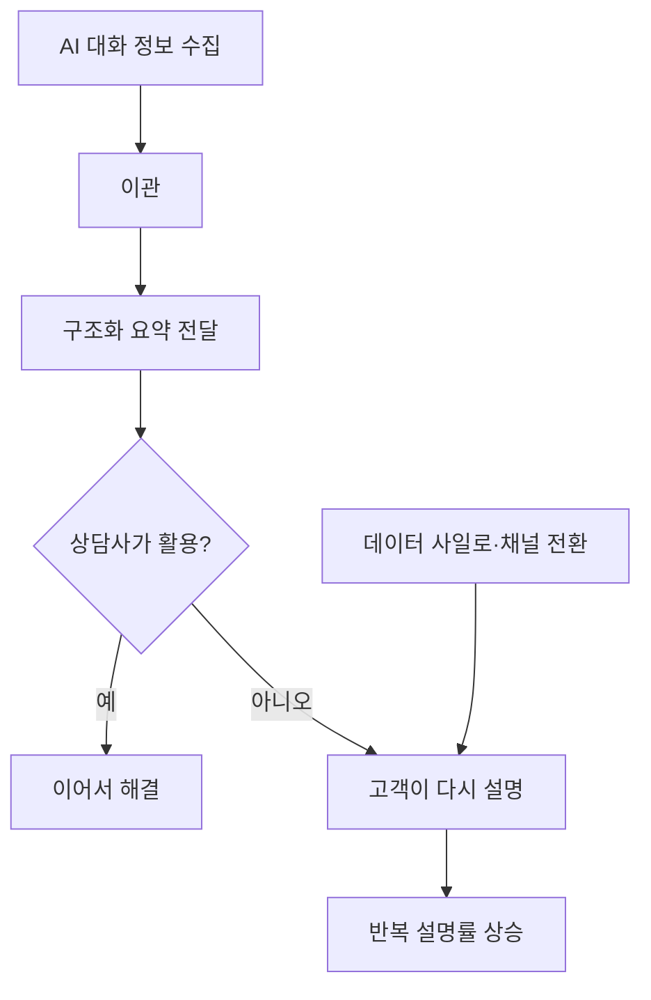

# 반복 설명률 (Repeat Explanation Rate)

> AI에서 사람으로 이관된 뒤 **고객이 이미 말한 내용을 다시 설명해야 하는 비율**. 이관 품질의 핵심 지표로, 이관 시 맥락(요약·이력)이 제대로 전달됐는지를 간접적으로 보여 준다.

## 쉽게 말하면
병원에서 접수 때 증상을 설명했는데 진료실에서 의사가 "어디가 불편하세요?"라고 처음부터 다시 묻는 상황이다. 환자는 접수가 의미 없었다고 느낀다. 이관은 고객 이야기를 이어받는 일이어야 한다.

## 자세히
출처: Five9 블로그와 검색 요약(Medallia, Zendesk, Parloa 인용). **모두 AI·컨택센터 벤더가 낸 설문이며 질문 문구·표본·가중치가 공개되지 않은 경우가 많아 증거 수준이 낮다.** 원 보고서는 직접 확인하지 못했다.
- **Five9(벤더, 2026 보고서 인용)**: 소비자의 83%가 AI→사람 이관 후 정보를 적어도 가끔 다시 말해야 한다고 응답, 88%는 이관 시점에 이미 불만, 3명 중 1명은 매우·극도로 불만이라고 한다. 반면 CX 의사결정자의 96%는 이관이 맥락을 보존한다고 믿어 **13%p 인식 격차**를 보인다. 채널 전환 시 맥락이 사라진다는 응답 34%.
- **표본**: 페이지가 인용한 보고서는 미국·영국·독일의 CX 리더 600명 기반이라고 적혀 있고 소비자 표본은 명시되지 않았다. 검색 요약은 소비자 3,000명이라고 서술해 서로 맞지 않는다. 직접 확인이 필요하다. "35% 자주·항상"이라는 수치는 이 페이지에 없었다.
- **다른 설문(검색 요약, 재인용)**: Medallia(2026-03) 44%가 지난 상호작용에서 같은 정보를 두 번 이상 제공, Zendesk CX Trends 2026 74%가 반복 입력에 불만, Parloa 60%가 한 번만 반복하고 포기. 정의가 서로 다르다.
- **정의의 중요성(Five9)**: "반복"은 AI에서 사람으로 넘어간 뒤 정보를 다시 제공해야 하는 것. 정의에 따라 비율이 달라진다.
- **원인(Five9)**: 데이터 사일로, AI-사람 인수 단절, 채널 간 이력 부재. 글은 요약 전달을 명시적으로 권하지는 않았다.
- **측정 방법(제안)**: ①이관 후 상담사의 첫 N발화 중 이미 수집된 정보를 다시 묻는 질문 비율(대화 분석) ②이관 후 설문 한 문항("같은 내용을 다시 설명하셨나요") ③상담사가 이관 요약을 열람·사용했는지 로그 ④반복 입력 필드 수. 층화 표본으로 사람이 확인.
- **개선 수단(제안)**: 이관 시 구조화 요약(이름·주문번호·문제·시도한 해결책·감정) 자동 전달과 상담사 화면 상단 노출, 상담사 인사에 확인 문구("주문번호 ○○ 환불 문의로 이해했습니다"). 요약의 정확성은 별도 검증([원문 링크형 요약](#source-linked-summary)).
- **한계**: 대기 시간과 얽혀 해석하기 어렵다([예상 대기 안내 메시지](#estimated-wait-message)). 고객의 주관 설문은 상담 건 기록과 불일치할 수 있다.

## 그림으로 보기

## 예시
- 이관된 300건 중 상담사가 이미 수집된 주문번호·문제 내용을 다시 물은 건이 84건 → 반복 설명률 28%(가상 값).
- 교육 활용: 자사 이관 대화 20건을 직접 읽고 "다시 묻는 질문"을 표시해 비율을 계산하는 실습.

## 헷갈리는 것과 비교
| 개념 | 차이 |
|---|---|
| 반복 설명률 | 이관 후 같은 정보를 다시 제공하는 비율 |
| [평균 처리 시간 AHT](#average-handle-time) | 처리 속도 지표(반복 설명 시간 포함) |
| [예상 대기 안내 메시지](#estimated-wait-message) | 대기 시간 기대 관리 |
| 고객 노력 점수(CES) | 문제 해결에 든 노력에 대한 고객 평가 |

## 더 읽을거리
- [Five9: 고객이 같은 말을 반복하는 이유](https://www.five9.com/blog/why-do-customers-keep-repeating-themselves-and-what-it-costing-your-business) — 벤더 설문 수치와 원인(수치 출처 불명확)
