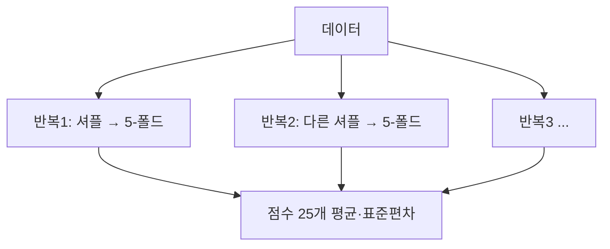
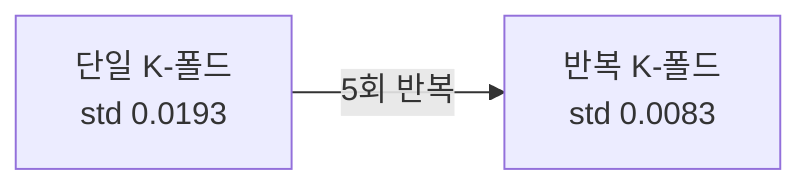

# 반복 교차 검증

> **K-폴드를 분할(시드)만 바꿔 여러 번 반복**하고 점수를 평균내는 방법이다. 한 번의 우연한 분할에 결과가 좌우되는 정도(분산)를 줄인다. scikit-learn에서는 `RepeatedKFold`, `RepeatedStratifiedKFold`.

## 쉽게 말하면
학생 반을 조 편성해 한 번 퀴즈를 보면 "운 좋은 조"에 따라 점수가 달라진다. 조를 5번 새로 짜서 5번 보고 평균을 내면 우연이 상쇄된다.

## 자세히
- **구성**: `RepeatedKFold(n_splits=5, n_repeats=5, random_state=0)`는 5-폴드를 서로 다른 셔플로 5번, 총 25번 학습한다. 분류에서 클래스 비율을 지키려면 `RepeatedStratifiedKFold`(공식 가이드·API에서 "Stratified K-Fold를 n번 반복"으로 소개).
- **직접 실험(scikit-learn 1.9.1, digits 300샘플, 결정 트리, 시드 20개)**: 1회 5-폴드의 평균 정확도는 0.791이고 시드별 표준편차 0.0193. 5×5 반복은 평균 0.795이고 표준편차 0.0083. **추정치의 흔들림이 절반 이하**로 줄었다. 평균은 거의 그대로다.
- **비용**: 학습 횟수가 반복 수만큼 곱해진다(25배가 아니라 5-폴드 대비 5배). 그래서 데이터가 작고 모델이 가벼울 때 가장 효과적이다([비용](#cv-compute-cost)).
- **주의**: 반복 폴드끼리 학습 데이터가 겹쳐 점수가 독립이 아니다. 반복 횟수를 늘려도 **편향은 줄지 않으며** 표준오차를 `std/√(k·r)`로 계산하면 지나치게 낙관적이다(통계적 주의, 일반 지식).
- **쓰임**: 모델 A와 B의 차이가 우연인지 비교할 때, 작은 데이터셋 보고서에서 평균±표준편차를 신뢰도 있게 낼 때.
- 그룹이 있는 데이터에는 `RepeatedKFold`를 쓰면 [누수](#stratification-vs-leakage)가 생긴다. 그룹 분할기를 직접 반복해야 한다.

## 그림으로 보기



## 예시
```python
from sklearn.model_selection import RepeatedStratifiedKFold, cross_val_score
cv = RepeatedStratifiedKFold(n_splits=5, n_repeats=5, random_state=0)
scores = cross_val_score(model, X, y, cv=cv)
print(scores.mean(), scores.std())
```
- 표본 300개 분류 모델 두 개를 비교할 때 평균 차이가 표준편차보다 큰지 본다.

## 헷갈리는 것과 비교
| 개념 | 차이 |
|---|---|
| K-폴드 | 분할 1회 |
| 반복 K-폴드 | 분할을 바꿔 r회 → 분산↓ |
| [Leave-P-Out](#leave-p-out) | 모든 조합(전수) |
| 부트스트랩 | 복원추출 표본 반복 |

## 더 읽을거리
- [scikit-learn 교차검증 가이드](https://scikit-learn.org/stable/modules/cross_validation.html) — RepeatedStratifiedKFold 소개.
- [RepeatedKFold API](https://scikit-learn.org/stable/modules/generated/sklearn.model_selection.RepeatedKFold.html) — 파라미터 `n_splits`, `n_repeats`.
