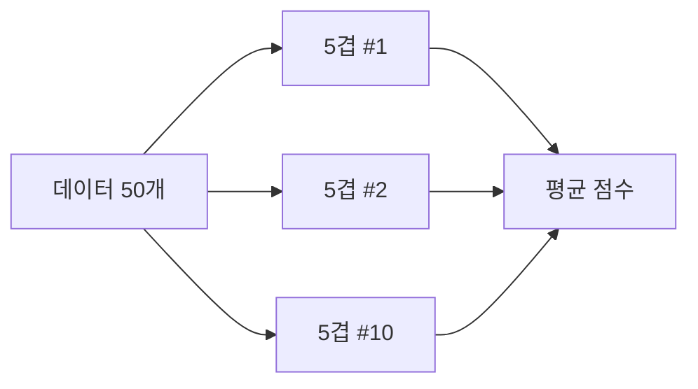
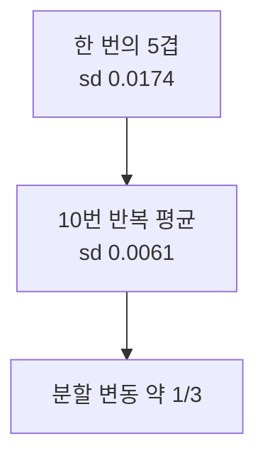

# RepeatedKFold

> RepeatedKFold는 K겹 교차검증을 데이터 섞는 방식만 바꿔서 여러 번 반복해 점수를 평균하는 방법이다. 한 번의 분할이 우연히 만든 점수의 흔들림을 줄여 비교를 더 안정적으로 만든다.

## 쉽게 말하면
조 편성을 한 번만 하면 운 좋은 조가 걸렸을 수 있다. 조 편성을 열 번 바꿔 평균을 내면 어느 조 편성에도 크게 흔들리지 않는 점수가 된다.

## 자세히
- **정의(scikit-learn 교차검증 문서, 열람)**: `RepeatedKFold`는 KFold를 n번 반복하며 매번 무작위를 다르게 한다. 층화가 필요하면 `RepeatedStratifiedKFold`를 쓴다([RepeatedStratifiedKFold](#repeated-stratified-kfold)). 반복을 위한 시드는 `random_state`로 재현할 수 있다.
- **직접 해 본 시뮬레이션(순수 파이썬, 시드 23)**: 표본 50개, 점수 하나로 학습 평균의 중점 규칙을 쓰는 분류기의 5겹 정확도를 본다. 한 번의 5겹 점수는 500번 다시 해 보면 평균 0.643, 표준편차 0.0174, 범위 0.60~0.68로 흔들렸다. 5겹을 10번 반복해 평균낸 점수는 200번 다시 해 보면 평균 0.644, 표준편차 0.0061로 약 3분의 1(0.0061÷0.0174 ≈ 0.35)로 줄었다. 반복 횟수 10의 제곱근(약 3.2)에 가까운 감소다. 이 실험은 분할 변동만 본 것이다.
- **해석**: 반복은 분할을 고르는 운에서 오는 변동을 줄인다. 그러나 같은 데이터를 재사용하므로 데이터가 작다는 불확실성은 그대로이고, 반복 점수의 표준편차를 신뢰구간으로 쓰면 안 된다([층화와 지표 퍼짐](#stratification-metric-spread)). 두 모델을 비교할 때는 같은 분할로 쌍으로 비교한다([같은 문항 쌍 비교](#paired-test-same-items)).
- **반복 횟수 선택(해석)**: 보통 3~10회. 분할 수를 늘릴수록 효과는 1/√(반복 수)로 체감한다([시뮬레이션 표본 수](#simulation-sample-size)). 분할 변동이 이미 작으면 더 반복하지 않는다.
- **분산과 편향의 관계**: K를 키우면 학습 크기가 커져 편향은 줄고 학습 시간이 늘며, 반복은 추정 분산을 줄이는 도구다(교차검증 일반론, 이 글에서는 직접 확인하지 않음).

## 그림으로 보기

## 예시
- 표본 150개 분류: `RepeatedKFold(n_splits=5, n_repeats=10, random_state=0)`로 50개 점수를 얻고 평균을 보고한다.
- 교육 활용: 5겹을 1번, 10번 반복했을 때 평균의 흔들림을 직접 비교해 보는 실습.

## 헷갈리는 것과 비교
| 개념 | 차이 |
| --- | --- |
| [교차검증의 분산·편향 절충](#cv-variance-bias-tradeoff) | 상위 주제 |
| [RepeatedStratifiedKFold](#repeated-stratified-kfold) | 층화를 더한 버전 |
| [ShuffleSplit](#shuffle-split) | 독립 무작위 분할(시험 세트 겹침 가능) |
| KFold | 한 번만 수행 |

## 더 읽을거리
- [scikit-learn: Cross-validation](https://scikit-learn.org/stable/modules/cross_validation.html) — 반복 분할기
