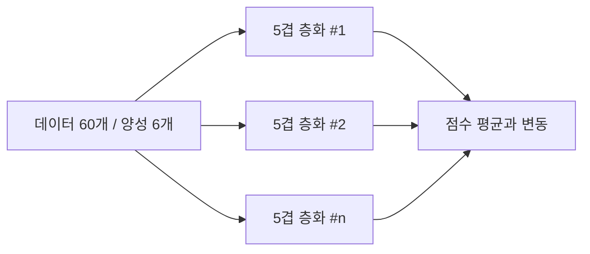
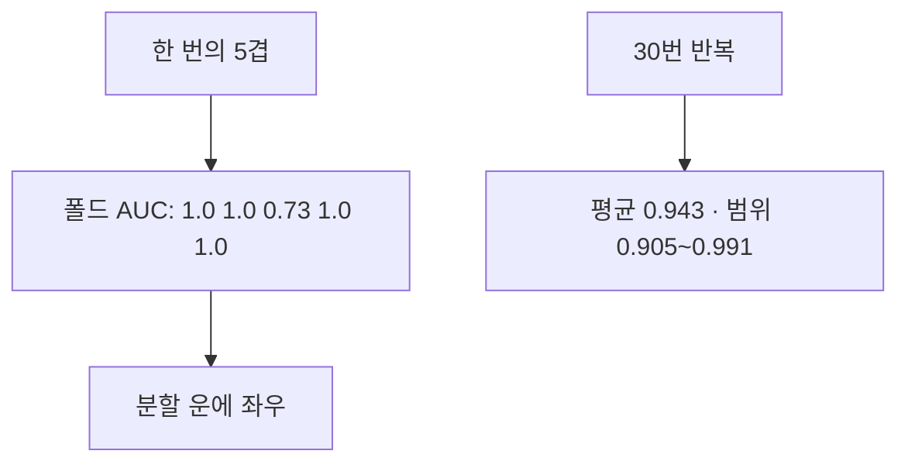

# RepeatedStratifiedKFold

> RepeatedStratifiedKFold는 층화 K겹 교차검증을 무작위를 바꿔 여러 번 반복해 얻은 점수들을 평균하는 방법이다. 희귀 클래스가 있는 작은 데이터에서 한 번의 분할이 우연히 만든 점수 변동을 줄이고 그 변동의 크기도 알려 준다.

## 쉽게 말하면
소수의 환자만 있는 시험에서 한 번 조 편성으로 평가하면 운 좋은 조가 걸렸을 수 있다. 조 편성을 열 번 바꿔 평균을 내면 어느 정도가 운이고 어느 정도가 실력인지 가늠할 수 있다.

## 자세히
- **정의(scikit-learn 교차검증 문서, 열람)**: `RepeatedKFold`는 KFold를 n번 반복하면서 매번 무작위를 다르게 한다. `RepeatedStratifiedKFold`는 같은 일을 `StratifiedKFold`로 한다. 층화는 폴드마다 전체와 비슷한 클래스 비율을 유지한다.
- **왜 반복하나**: 한 번의 K겹은 분할 하나의 결과일 뿐이다. 문서는 층화가 폴드 간 변동을 줄이므로 희귀 클래스에서는 보고된 변동이 실제 불확실성을 과소평가할 수 있다고 주의한다. 반복은 분할 선택에 따른 변동을 직접 보여 준다.
- **직접 해 본 실험(순수 파이썬, 시드 8)**: 표본 60개 중 양성 6개, 양성은 N(1,1), 음성은 N(0,1)에서 나온 점수 하나로 판단하는 단순 설정이다. 모델을 학습하지 않고 원점수 그대로의 AUC를 폴드별로 계산해 분할이 점수에 주는 영향만 봤다. 5겹 층화에서 양성 6개는 폴드에 2·1·1·1·1개로 나뉜다. 한 번의 실행에서 폴드 AUC는 [1.00, 1.00, 0.73, 1.00, 1.00]처럼 들쭉날쭉했다(양성 1개의 폴드는 AUC 값이 매우 불안정). 5겹을 30번 반복한 평균 AUC는 0.943(전체 데이터 AUC 0.944와 가까움), 한 번의 5겹 평균은 반복마다 0.905~0.991로 흔들렸고 표준편차는 0.017이었다. 한 번의 5겹으로 "AUC 0.99"를 보고했다면 운이 좋은 분할을 만난 것일 수 있다. 이 실험은 학습 없이 분할 효과만 보인 단순 모형이므로 실제 모델에서는 학습 변동이 추가된다.
- **사용법(해석)**: 보통 5겹을 3~10번 반복하고, 반복 전체 점수(예: 5×10=50개)의 평균과 표준편차 또는 분위수를 보고한다. 반복 점수는 서로 독립이 아니므로 표준편차를 신뢰구간처럼 쓰지 않는다(같은 데이터를 재사용).
- **한계(해석)**: 반복해도 데이터 자체의 크기는 늘지 않는다. 표본이 작다는 근본 문제는 남는다. 그룹 데이터는 `RepeatedStratifiedKFold`가 아니라 그룹 인식 분할기를 써야 한다([교차검증 분할기 고르기](#cv-splitter-selection)).

## 그림으로 보기

## 예시
- 사기 거래 50건뿐인 데이터: `RepeatedStratifiedKFold(n_splits=5, n_repeats=10, random_state=0)`로 50개 점수를 얻고 평균과 표준편차를 보고한다.
- 교육 활용: 한 번의 5겹과 10번 반복 결과를 비교해 보고 분할 운을 체감한다.

## 헷갈리는 것과 비교
| 개념 | 차이 |
| --- | --- |
| [층화 K겹과 희귀 클래스](#n-splits-vs-rare-class) | 상위 주제. 반복은 변동을 줄이는 방법 |
| StratifiedKFold | 한 번의 층화 K겹 |
| RepeatedKFold | 층화 없이 반복 |
| [클래스 누락 시 지표 미정의](#metric-undefined-missing-class) | 폴드에 양성이 없으면 지표를 못 구함 |

## 더 읽을거리
- [scikit-learn: Cross-validation](https://scikit-learn.org/stable/modules/cross_validation.html) — Repeated 분할기와 층화 주의
