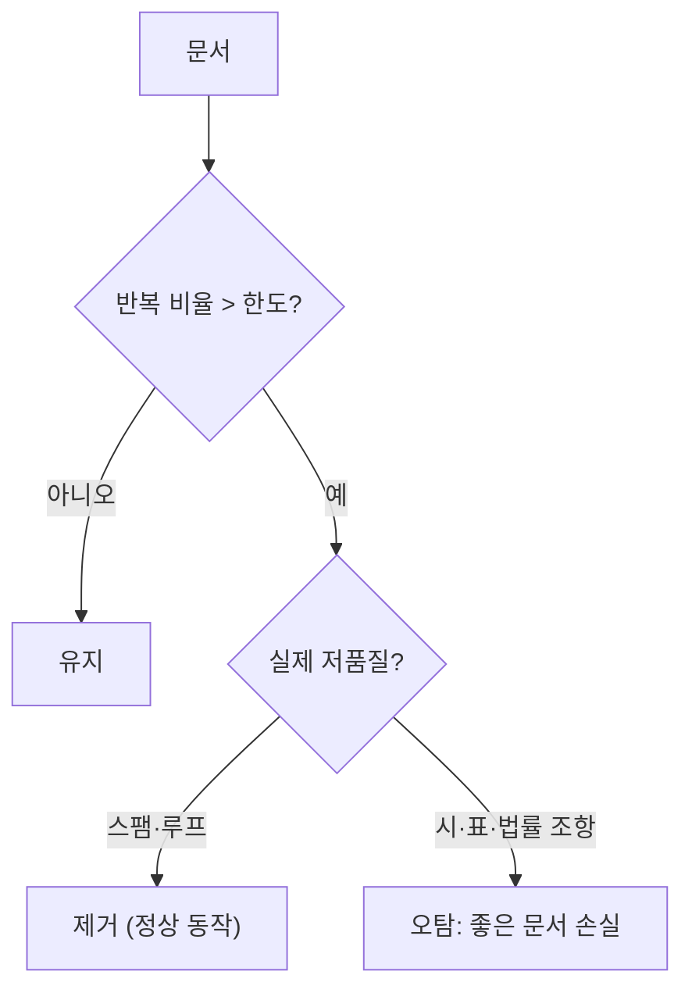
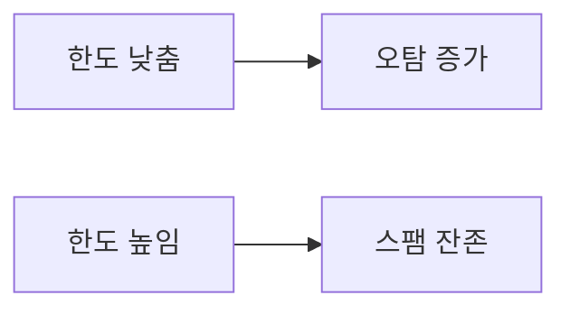

# 반복 필터 오탐

> 반복 비율이 높으면 버리는 규칙([반복 제거 임계값](#repetition-thresholds))이 **일부러 반복하는 정상 문서**(시의 후렴, 법률 조항, 표)까지 저품질로 잘못 버리는 현상이다.

## 쉽게 말하면
스팸 탐지기가 "같은 말을 여러 번 하는 사람은 수상하다"는 규칙으로 일하는데, 동요 "곰 세 마리"나 계약서 조항처럼 원래 같은 문장이 반복되는 글도 같이 걸러 버리는 것이다. 규칙은 문서의 **모양**만 보고 **내용의 가치**는 보지 않기 때문이다.

## 자세히
- 바탕: Gopher의 반복 필터는 영어 웹 문서(MassiveWeb)용으로 줄·문단·n-그램 반복 비율 한도를 정했다(arXiv 2112.11446, 부록 A.1). 시·법률·표 같은 형식은 고려 대상이 아니었다. 아래 오탐 사례 자체는 논문이 보고한 것이 아니라 **직접 실험으로 확인한 것**이다.
- **직접 실험**(2026-11-22, Gopher 정의를 단순화해 구현, 공백 기준 단어 n-그램): 비교 문서 5종에서 중복 줄 비율과 상위 2/3/4-그램 문자 비율.
  | 문서 | 중복 줄 비율 | 상위 2/3/4-그램 | 결과(한도 0.30, 0.20/0.18/0.16) |
  |---|---|---|---|
  | 동요 후렴 반복(10줄) | 1.00 | 0.11/0.16/0.22 | 줄 기준·4-그램 초과 → 제거 |
  | 계약 조항 반복(8줄) | 0.50 | 0.21/0.30/0.45 | 모두 초과 → 제거 |
  | 마크다운 표(8행) | 0.00 | 0.28/0.38/0.32 | n-그램 초과 → 제거 |
  | 스팸 5줄 | 0.80 | 0.31/0.58/0.84 | 제거(의도한 결과) |
  | 뉴스 3줄 | 0.00 | 0.06/0.11/0.16 | 유지 |
  스팸과 정상 정형 문서가 같은 숫자 범위에 놓여 한도 하나로는 구분이 안 된다. 표는 줄이 겹치지 않아도 `|`·`item` 같은 토큰이 n-그램을 반복시킨다.
- **완화 방향(제안, 실험으로 검증하지 않음)**: ① 문서 유형(시·표·법률·코드)을 먼저 분류해 별도 한도를 쓴다 ② 한도를 넘은 문서를 바로 버리지 말고 표본을 사람이 읽어 오탐 비율을 센다 ③ 언어별로 조정([다국어 필터 조정](#multilingual-filter-adaptation)) ④ 반복 구간만 잘라 내고 문서를 살린다.
- 한도 조정의 trade-off: 풀면 스팸이 남고, 조이면 정형 문서가 사라진다. 그래서 오탐 표본 점검이 필수다.

## 그림으로 보기

## 예시
- 한국 현대시·가사를 모은 코퍼스에서 반복 필터를 켜자 후렴이 있는 작품이 대거 사라지는 상황 → 문서 유형별 한도나 표본 점검으로 확인.
- 교육 소재: "필터는 내용이 아니라 모양을 본다"를 위 표의 숫자로 보여 주기.

## 헷갈리는 것과 비교
| 개념 | 차이 |
|---|---|
| 반복 필터 오탐 | 정상 정형 문서가 반복 한도에 걸림 |
| [반복 제거 임계값](#repetition-thresholds) | 한도 값 자체 |
| [근접 중복 제거](#near-duplicate-removal) | 문서 사이 중복(문서 안 반복 아님) |
| [모델의 반복 실패](#model-repetition-failure) | 출력 쪽 반복 문제 |

## 더 읽을거리
- [Scaling Language Models: Gopher (arXiv 2112.11446)](https://arxiv.org/abs/2112.11446) — 반복 필터 정의와 MassiveWeb 적용 범위.
- [The Lucie-7B LLM and Lucie Training Dataset (arXiv 2503.12294)](https://arxiv.org/abs/2503.12294) — Gopher 필터와 반복 제거를 다국어 코퍼스에 쓴 사례(PDF를 내려받아 확인, 반복 필터 사용 사실만 확인).
