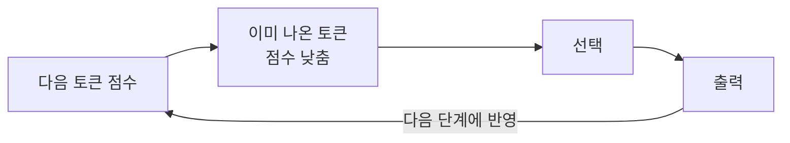
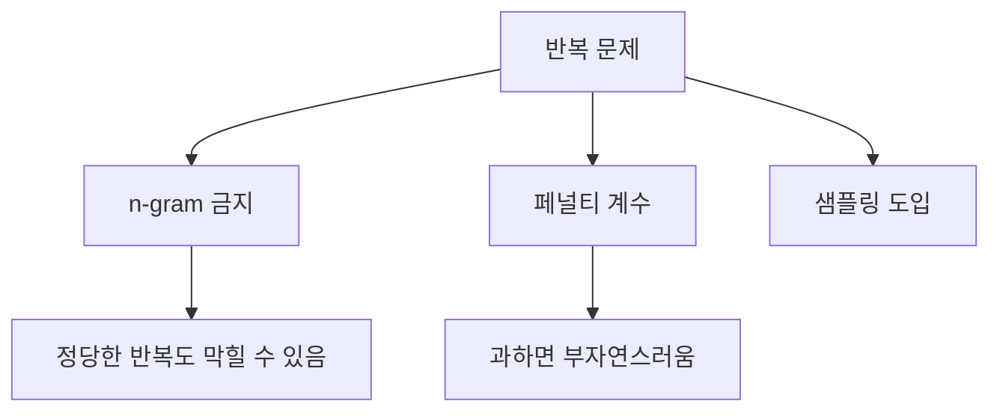

# 반복 억제 (Repetition control)

> 반복 억제는 모델이 같은 단어·문장을 되풀이하는 현상을 줄이려고, 이미 나온 토큰의 선택 가능성을 낮추거나 같은 n-gram의 재등장을 금지하는 설정이다.

## 쉽게 말하면
말버릇이 심한 사람에게 "같은 표현은 두 번 쓰지 마"라고 규칙을 주는 것이다. 너무 엄하면 "서울 서울" 같은 정당한 반복이나 고유명사도 못 쓰게 된다.

## 자세히
- **원인**: Greedy·Beam은 가장 그럴듯한 다음 토큰만 고르므로 루프에 빠지기 쉽다. HF 블로그는 greedy가 "빠르게 스스로 반복하기 시작한다"고, beam도 열린 생성에서 반복적이라고 한다. top-k·top-p 샘플링도 반복이 생길 수 있다고 덧붙인다.
- **`no_repeat_ngram_size=N`**(HF 블로그에서 확인): 같은 N-gram이 두 번 나오지 못하게 막는다. "New York"처럼 정당한 반복까지 막으므로 값을 조정해야 한다.
- **`repetition_penalty`**: 이미 나온 토큰의 로짓을 깎아 재선택을 억제하는 계수(1.0이 무변화, 보통 1.1~1.3 범위를 쓴다). 이번에 열어 본 HF 블로그에는 이 옵션 설명이 없었고, 아래 내용은 transformers `generate()`의 일반적 사용법에 대한 설명이다(출처 미확인 부분: 권장 범위).
- API형 모델은 `frequency_penalty`·`presence_penalty`라는 이름으로 비슷한 효과를 제공하는 경우가 있다(제공사별로 다름).
- 근본 대책은 프롬프트 개선과 [temperature·top-p](#sampling-temperature) 조정이며, 페널티를 과하게 올리면 문장이 부자연스러워진다.

## 그림으로 보기



## 예시
```python
out = model.generate(**inputs, max_new_tokens=80, num_beams=5, no_repeat_ngram_size=2)
```
요약 모델이 "…했다. …했다."를 되풀이할 때 `no_repeat_ngram_size`를 켜 보고, 고유명사가 잘리면 값을 3으로 올린다.

## 헷갈리는 것과 비교
| 개념 | 차이 |
|---|---|
| no_repeat_ngram_size | 같은 n-gram을 아예 금지 |
| repetition_penalty | 확률을 깎아 덜 나오게(금지는 아님) |
| [Greedy/Beam](#greedy-vs-beam) | 반복이 생기기 쉬운 원인 쪽 |
| [temperature](#sampling-temperature) | 무작위성 자체를 조절 |

## 더 읽을거리
- [How to generate text (HF 블로그)](https://huggingface.co/blog/how-to-generate) — 반복 문제와 n-gram 페널티.
- [HF Generation strategies](https://huggingface.co/docs/transformers/generation_strategies) — greedy가 길어지면 반복한다는 설명.
