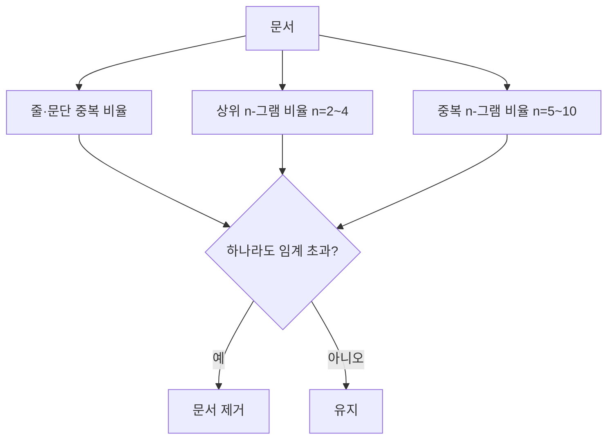
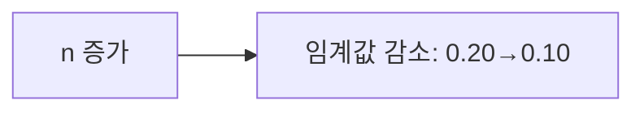

# 반복 제거 임계값

> 한 문서 안에서 같은 줄·문단·n-그램이 지나치게 반복되면 저품질로 보고 버리는 규칙과 그 한계값이다. Gopher 논문은 줄·문단·n-그램별로 13개 임계값을 표로 공개했다.

## 쉽게 말하면
"싸게 사세요 싸게 사세요 싸게 사세요"를 열 줄 반복한 광고 페이지는 정보가 거의 없다. 같은 말이 문서의 몇 퍼센트를 차지하는지 재서, 한도를 넘으면 버린다. 한도가 너무 낮으면 정상적인 후렴구·표도 버려지고, 너무 높으면 스팸이 남는다.

## 자세히
(Gopher 논문 arXiv 2112.11446의 부록 A.1과 표 A1을 직접 내려받아 확인하고, 측정 방식 일부를 직접 구현해 실행.)
- **이유(논문)**: 과도한 반복은 대체로 정보가 없는 내용과 연결되고, 언어 모델이 샘플링 중 스스로 반복하는 알려진 실패 양상도 반복적인 학습 데이터 때문일 수 있다.
- **두 종류 모두 잡기**: 짧은 중복 구절이 많은 문서와, 적지만 큰 중복 구간이 있는 문서를 다 잡도록 여러 방식으로 중복 비율을 계산한다(MassiveWeb에만 적용).
- **측정 방식**: ① 줄·문단 각각 중복인 비율과 그 중복에 포함된 문자 비율 ② n=2~4의 **가장 자주 나오는 n-그램**이 차지하는 문자 비율 ③ n=5~10의 **중복 n-그램 전체**가 차지하는 문자 비율(겹치는 n-그램의 문자는 한 번만 센다).
- **임계값(표 A1, 넘으면 문서 제거)**
  | 측정 | 임계값 |
  |---|---|
  | 중복 줄 비율 | 0.30 |
  | 중복 문단 비율 | 0.30 |
  | 중복 줄 문자 비율 | 0.20 |
  | 중복 문단 문자 비율 | 0.20 |
  | 상위 2-그램 문자 비율 | 0.20 |
  | 상위 3-그램 | 0.18 |
  | 상위 4-그램 | 0.16 |
  | 중복 5-그램 | 0.15 |
  | 중복 6·7·8·9·10-그램 | 0.14·0.13·0.12·0.11·0.10 |
  n이 커질수록 한도가 낮아진다 — 긴 n-그램이 반복되면 더 의심스럽다.
- **직접 실행(간단 구현)**: 정상 3줄 기사: 중복 줄 비율 0.0, 상위 2-그램 문자 비율 0.08. 스팸 5줄("Buy now cheap deals"가 4번 반복): 중복 줄 비율 **0.8**, 중복 줄 문자 비율 0.78, 상위 2-그램 0.28 → 임계 0.30·0.20을 모두 초과해 제거 대상. 위는 논문 정의를 단순화한 구현이라 정확한 값은 다를 수 있다.
- **주의(제안)**: 한도는 영어 웹 문서용 경험값이다. 시, 법률 조항, 표, 코드 같은 구조적 반복 문서는 오탐이 생길 수 있고, 언어별로 조정이 필요하다([다국어 필터 조정](#multilingual-filter-adaptation)).
- 이 필터는 "문서 안" 반복이고, 문서 사이 중복은 [근접 중복 제거](#near-duplicate-removal)와 [MinHash·LSH](#minhash-lsh)가 맡는다.

## 그림으로 보기



## 예시
```python
from collections import Counter
def dup_line_frac(text):
    lines = [l for l in text.split("\n") if l.strip()]
    c = Counter(lines)
    return sum(1 for l in lines if c[l] > 1) / len(lines)
drop = dup_line_frac(page) > 0.30     # Gopher 표 A1 기준
```
- 사내 웹 수집 데이터에서 반복 비율 상위 1% 문서를 먼저 읽어 보고 한도를 정한다(제안).

## 헷갈리는 것과 비교
| 개념 | 차이 |
|---|---|
| 반복 제거(문서 내) | 한 문서 안의 중복 비율로 저품질 판정 |
| [근접 중복 제거](#near-duplicate-removal) | 문서 사이 중복 |
| [정확 부분 문자열 제거](#exact-substring-dedup) | 전체 코퍼스에서 긴 동일 구간 제거 |
| [Gopher·MassiveText](#gopher-massivetext) | 이 임계값을 쓴 파이프라인 |

## 더 읽을거리
- [Gopher 논문 (arXiv 2112.11446)](https://arxiv.org/abs/2112.11446) — 반복 제거 방식과 표 A1(PDF 본문 확인).
