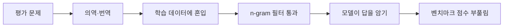
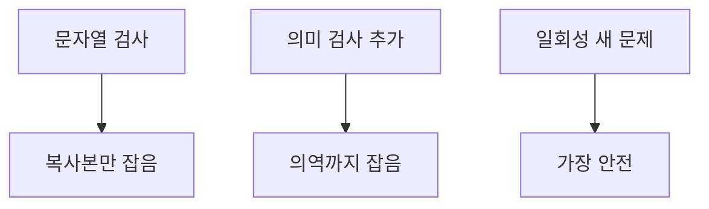

# 의역 샘플 오염

> 평가 문제를 의역하거나 다른 언어로 번역한 문장이 학습 데이터에 섞여 들어가는 오염이다. 글자가 달라서 n-gram 같은 문자열 검사를 통과하지만, 모델은 그 문제의 답을 외워서 벤치마크 점수가 부풀려진다.

## 쉽게 말하면
시험 문제를 그대로 베끼면 걸리니까, 문장만 살짝 바꿔 연습 문제집에 넣은 것과 같다. 감독관이 "같은 문장이 있나"만 확인하면 못 잡는다. 학생은 시험에서 같은 문제를 보고 외운 답을 쓴다.

## 자세히
- **연구 결과(Yang 외, arXiv 2311.04850 초록, 열람)**: 대부분의 오염 제거는 n-gram 겹침 같은 문자열 일치에 의존하고, 의역·번역 같은 단순 변형이 이를 쉽게 우회한다. 이런 의역 시험 데이터를 걸러내지 않으면 13B 모델이 MMLU, GSM8K, HumanEval에서 GPT-4와 비슷한 점수를 낼 수 있다고 보고한다. 논문은 이 점수가 일반 능력이 아니라 시험 세트 암기를 반영한다고 해석한다.
- **실제 오염 사례(같은 초록)**: 이 연구의 LLM 기반 도구는 RedPajama-Data-1T와 StarCoder-Data에서 HumanEval의 8~18%와 겹치는 샘플을 새로 찾았고, GPT-3.5/4가 만든 합성 데이터에도 오염이 있었다고 한다.
- **직접 확인한 것**: 같은 수학 문제를 원문과 의역으로 비교하면 13-gram은 한 개도 겹치지 않아 검사를 통과한다([n-gram 겹침 검사](#ngram-overlap-test) 실험).
- **오염 경로(해석)**: ① 의도적(점수를 올리려 의역 데이터를 넣음) ② 우연(웹에 퍼진 문제 해설, 풀이 블로그, 합성 데이터 생성 시 시험 문제가 시드로 쓰임) ③ 번역본이 다른 언어 코퍼스에 있음.
- **대응(해석)**: 문자열 검사만으로 안전하다고 보지 않는다. 의미 기반 검사(임베딩·LLM 판정, [LLM decontaminator](#llm-decontaminator))를 더하고, 가능하면 새로 만든 일회성 문제로 평가한다. 논문도 새로운 일회성 시험을 쓰자고 제안한다.

## 그림으로 보기

## 예시
- 모델 보고서의 높은 벤치마크 점수가 공개 데이터셋 하나에서만 두드러지게 높으면 오염을 의심하고 새 문제로 재측정한다.
- 교육 활용: 같은 문제를 의역 3개로 만들어 n-gram 검사가 얼마나 놓치는지 보게 한다.

## 헷갈리는 것과 비교
| 개념 | 차이 |
| --- | --- |
| 복사 오염 | 문장이 그대로 학습 데이터에 있음 |
| 의역 샘플 오염 | 뜻은 같고 글자는 다름 |
| [n-gram 겹침 검사](#ngram-overlap-test) | 복사 오염 탐지 |
| [LLM decontaminator](#llm-decontaminator) | 의역 탐지 도구 |

## 더 읽을거리
- [Rethinking Benchmark and Contamination for Language Models with Rephrased Samples (arXiv 2311.04850)](https://arxiv.org/abs/2311.04850) — 의역이 오염 제거를 우회하는 증거와 도구
