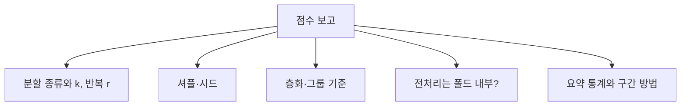
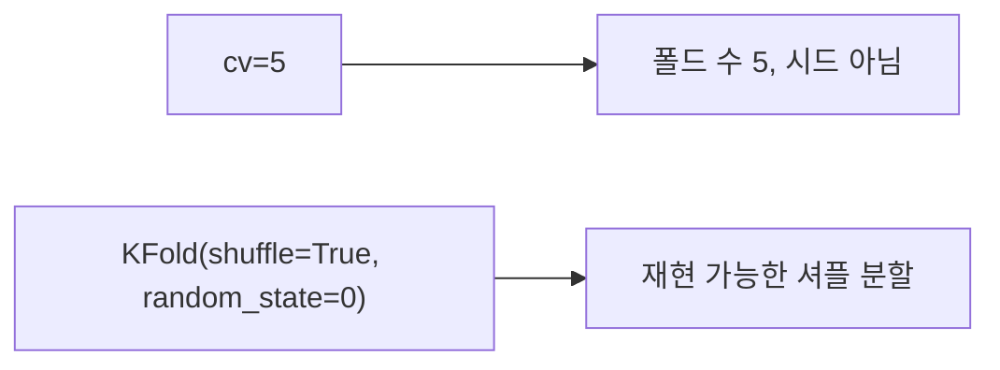

# 분할 방식 명시 보고

> 교차 검증·홀드아웃 점수를 보고할 때 **어떻게 나눴는지(층화 여부, 셔플, 시드, 폴드 수, 반복 횟수, 그룹 규칙)** 를 점수와 함께 적어야 한다. 분할 조건이 달라지면 점수와 변동 폭이 달라져 숫자를 비교할 수 없다.

## 쉽게 말하면
"이 반 평균이 82점"만 알려 주면 시험 범위·채점 방식을 모른다. 같은 학생들이라도 어떤 문제 묶음으로 쟀는지에 따라 점수가 다르다. 분할 방식은 시험 조건표다.

## 자세히
- **꼭 적을 항목**
  1. 분할 종류: KFold / StratifiedKFold / GroupKFold / 홀드아웃 / 시계열 분할.
  2. 폴드 수 k, 반복 횟수 r(RepeatedKFold).
  3. 셔플 여부와 시드(재현성).
  4. 층화 기준(클래스? 그룹?)과 그룹 단위(환자·사용자·문서).
  5. 전처리·특징 선택이 폴드 **안**에서 학습됐는지(파이프라인).
  6. 점수 요약: 평균, 폴드 간 표준편차, 어떤 구간 방법인지.
- **scikit-learn 공식 문서 요점(열어 확인)**
  - `cross_val_score(..., cv=5)`의 5는 **폴드 수이지 시드가 아니다.** 기본 분할기는 셔플 없는 `KFold`라 결정적이다. 셔플이 필요하면 `KFold(n_splits=5, shuffle=True, random_state=0)`처럼 명시한다.
  - 분할기의 `random_state`가 정수면 `split`을 부를 때마다 같은 폴드가 나와 **추정기 간 폴드별 비교가 유효**하다. `None`이면 호출마다 다른 폴드라 서로 다른 모델을 같은 폴드로 비교한다는 가정이 깨진다. 문서는 폴드를 비교할 분할기에는 정수를 권장한다.
  - **누수**: 전체 데이터로 특징 선택을 한 뒤 CV하면 무작위 라벨에서도 정확도 약 0.76(우연 수준 0.5)이 나온다. `Pipeline`으로 묶어 폴드 안에서 다시 학습한다.
  - 문서는 보고할 때 분할이 **고정인지 명시**하라고 한다. 고정 여부가 모델 간 성능 차이 추정의 분산을 바꾸기 때문이다.
- **재현성 이면**: 추정기의 `random_state`가 정수면 모든 폴드가 같은 무작위성을 쓰고, `RandomState` 인스턴스면 폴드마다 달라 더 견고한 추정이 된다(문서). 시드를 바꿔 여러 번 돌려 변동을 함께 보고하는 것도 좋다.
- **최소 보고 문장 예**: "층화 5겹 × 3회 반복(셔플, 시드 0·1·2), 전처리는 폴드 내 파이프라인, 정확도 평균 0.912, 폴드 간 sd 0.021, 부트스트랩 BCa 95% [0.89, 0.93]".

## 그림으로 보기



## 예시
```python
from sklearn.model_selection import RepeatedStratifiedKFold, cross_val_score
cv = RepeatedStratifiedKFold(n_splits=5, n_repeats=3, random_state=0)
scores = cross_val_score(pipe, X, y, cv=cv)   # pipe = 전처리+모델 Pipeline
print(f"층화 5겹x3, seed=0, mean={scores.mean():.3f}, sd={scores.std():.3f}")
```
- 논문·사내 보고서의 방법 절에 위 정보를 한 줄로 고정 서식화한다.

## 헷갈리는 것과 비교
| 항목 | 의미 | 흔한 오해 |
|---|---|---|
| `cv=5` | 폴드 수 | 시드로 착각 |
| 분할기 random_state | 폴드 구성 고정 | None이면 호출마다 다름 |
| 추정기 random_state | 모델 내부 무작위 | 정수면 폴드마다 동일 |
| [층화](#stratification-shrinks-variance) | 클래스 비율 유지 | 불확실성 감소로 오해 |

## 더 읽을거리
- [scikit-learn: Common pitfalls and recommended practices](https://scikit-learn.org/stable/common_pitfalls.html) — random_state·누수·재현성(열어 확인).
