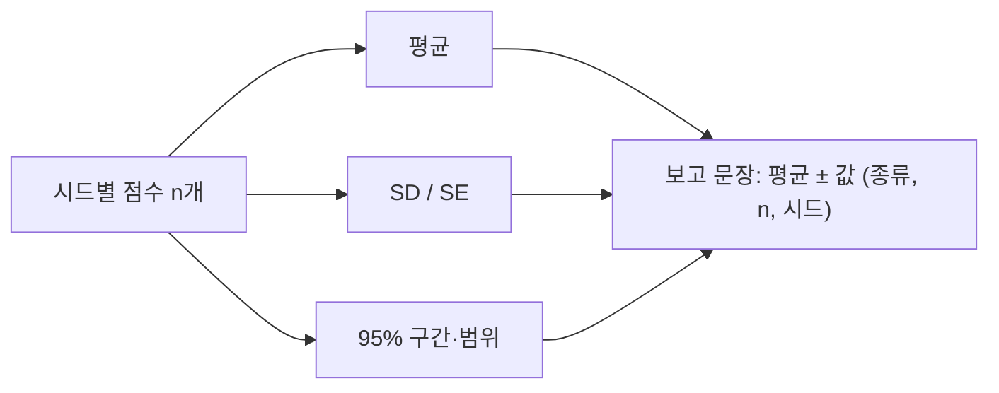

# 불확실성 보고 형식

> 여러 시드로 얻은 점수를 보고할 때 **평균 하나가 아니라 "평균, 흩어짐(SD 또는 SE), 시드 수 n, 시드 목록, 범위"** 를 함께 적는 표기 규칙. 독자가 점수를 얼마나 믿어야 할지 바로 알 수 있다.

## 쉽게 말하면
일기예보에서 "내일 기온 20도"보다 "18~22도, 비 올 확률 30%"가 더 쓸모 있다. 점수도 하나의 숫자보다 폭과 근거가 같이 있어야 판단할 수 있다.

## 자세히
- **예시 데이터**(시드 10개의 정확도: 0.861, 0.847, 0.872, 0.855, 0.839, 0.868, 0.851, 0.859, 0.844, 0.866; scipy로 계산):

| 항목 | 값 |
|---|---|
| 평균 | 0.856 |
| 표준편차(SD, ddof=1) | 0.0109 |
| 표준오차(SE=SD/√n) | 0.0035 |
| 95% 신뢰구간(t분포, df=9) | 0.848 ~ 0.864 |
| 최소~최대 | 0.839 ~ 0.872 |

- **표기 예**
  - 흩어짐을 보여 줄 때: `0.856 ± 0.011 (SD, n=10)`
  - 평균의 정확도를 보여 줄 때: `0.856 [0.848, 0.864] (95% CI, n=10)`
  - 최악·최선: `범위 0.839–0.872, 시드 0–9`
- **규칙**: ① ± 뒤가 SD인지 SE인지 반드시 쓴다, ② n과 시드 목록(또는 규칙)을 쓴다, ③ 소수 자릿수는 SE의 한두 자리까지(과도한 정밀도 금지), ④ 두 모델 비교는 차이의 구간으로 쓴다([시드별 짝지은 비교](#paired-seed-comparison)), ⑤ 최고 점수만 단독으로 쓰지 않는다([시드 골라 쓰기](#seed-cherry-picking)).
- 표준 규약은 학계·팀마다 다르므로 팀 규칙으로 정해 두는 것이 좋다.

## 그림으로 보기


## 예시
```python
t = stats.t.ppf(0.975, n-1)
print(f"{m:.3f} [{m-t*se:.3f}, {m+t*se:.3f}] (95% CI, n={n}, seeds 0-{n-1})")
```
- 표 형식 보고: 모델 | 평균 | SD | n | 95% CI 열을 고정.

## 헷갈리는 것과 비교
| 개념 | 차이 |
|---|---|
| 평균±SD | 시드별 흩어짐 |
| 평균±SE / CI | 평균 추정의 정밀도 |
| [점수 평균의 표준오차](#standard-error-of-mean-score) | SE 계산 방법 |
| [시드 스윕 보고](#seed-sweep-reporting) | 상위 개념: 시드를 훑어 요약 |

## 더 읽을거리
- [scipy.stats.t](https://docs.scipy.org/doc/scipy/reference/generated/scipy.stats.t.html) — t분포 구간 계산.
- [Wikipedia: Confidence interval](https://en.wikipedia.org/wiki/Confidence_interval) — 신뢰구간의 정의와 해석.
