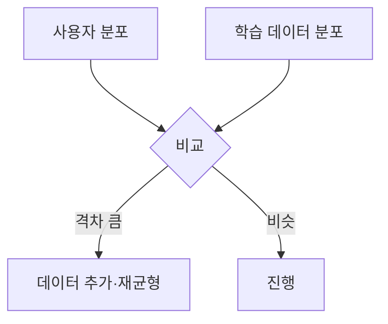

# 대표성 점검

> 학습 데이터가 **실제 사용자 집단의 다양성과 문화적 맥락을 반영하는지** 확인하는 점검이다.

## 쉽게 말하면
설문조사를 20대 서울 거주자에게만 하고 전 국민 의견이라 하면 안 되는 것과 같다. 모델도 누구의 데이터를 봤는지에 따라 누구에게 잘 작동하는지가 정해진다.

## 자세히
(Google PAIR "Data Collection + Evaluation" 챕터를 직접 읽었다.)
- **원칙(PAIR)**: 학습 데이터는 그것을 쓸 사람들의 **다양성과 문화적 맥락**을 반영해야 한다.
- **균형이 현실 비율과 다를 수 있음(PAIR 예)**: 음성 인식 모델은 비원어민 영어 화자가 소수여도 학습 데이터의 **약 50%**를 비원어민으로 구성해야 할 수 있다.
- **라벨러 점검(PAIR)**: 주석자가 최종 사용자와 비슷한지, 날짜 형식·측정 단위 같은 문화 차이가 라벨 품질에 영향을 주지 않는지 본다.
- **입력 조건(PAIR)**: 입력 데이터가 실제 환경과 비슷해야 하며, 깨끗한 고해상도 데이터만으로 학습하지 말고 어느 정도 **노이즈**를 허용한다.
- **참고(PAIR)**: 전형적 학습/시험 분할로 60%/40%가 예시된다.

## 그림으로 보기

## 예시
- 사내 번역 AI를 도입하기 전에 학습 데이터의 언어·직무·지역 구성을 표로 만들어 실제 사용자 부서 비율과 비교한다(제안).

## 헷갈리는 것과 비교
| 개념 | 차이 |
|---|---|
| 대표성 | 사용자 집단을 반영하는지 |
| 균형 | 범주 비율을 맞춤(현실 비율과 다를 수 있음) |
| [데이터 연쇄](#data-cascade) | 불일치가 늦게 드러나는 결과 |

## 더 읽을거리
- [Google PAIR — Data Collection + Evaluation](https://pair.withgoogle.com/chapter/data-collection/) — 직접 읽음.
