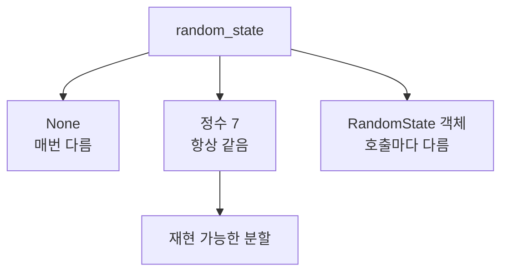

# 재현 가능한 분할

> 데이터 분할을 다시 똑같이 만들려면 분할기의 `random_state`에 정수를 고정하거나 분할 인덱스를 파일로 저장한다. 시드를 None으로 두면 실행할 때마다 분할이 달라져 점수를 비교할 수 없다.

## 쉽게 말하면
카드를 섞어 조를 짜고 나서 "그 조 편성을 다시 보여 달라"고 하면, 섞은 기록이 없으면 불가능하다. 섞기 전에 "시드 0으로 섞는다"고 약속하거나 조 편성표를 사진으로 남겨 두면 언제든 같은 조를 다시 만들 수 있다.

## 자세히
- **규칙(scikit-learn 공통 함정 문서, 열람)**: 정수를 주면 `fit`·`split`을 몇 번 불러도 항상 같은 결과다. `None` 또는 `RandomState` 객체를 주면 호출할 때마다 결과가 다르다. `None`이 모든 `random_state`의 기본값이다. 문서는 재현을 위해 `random_state=None`을 모두 없애라고 하고, 분할기에는 정수가 "가장 안전하고 선호된다"고 한다.
- **직접 확인한 것(20개 표본, 시험 20%)**: `ShuffleSplit`을 `random_state=None`으로 두 번 돌리면 시험 인덱스가 달랐고, 정수 7로 두 번 돌리면 같았다. 정수 시드를 준 `KFold` 객체를 두 번 `split`해도 같았다. 반면 `RandomState(0)` 객체를 넘긴 `ShuffleSplit`은 같은 객체로 `split`을 두 번 부르면 결과가 달랐다. 객체가 호출마다 난수를 소비하기 때문이다.
- **비교할 때 함정(문서)**: 분할기에 `RandomState` 객체를 주면 두 모델이 서로 다른 분할에서 평가돼 폴드별 비교가 성립하지 않는다([비교용 k 고정](#fixed-k-for-comparison)). 해결은 `KFold(shuffle=True, random_state=0)`처럼 정수를 쓰는 것이다.
- **추정기와 분할기는 다르게(문서)**: 모델의 난수는 폴드마다 달라야 결과가 모델 난수에 덜 민감하므로 `RandomState` 객체나 None이 나을 수 있고, 분할기는 정수가 낫다. 전역 `np.random.seed(0)`는 권장하지 않는다.
- **분할 저장(해석)**: 라이브러리 버전이 바뀌면 같은 시드도 다른 분할을 낼 수 있으므로, 중요한 실험은 `train_idx`, `test_idx`를 `np.save`나 CSV로 저장하고 사용한 scikit-learn 버전을 적는다.

## 그림으로 보기

## 예시
- `cv = KFold(5, shuffle=True, random_state=0)`를 모듈 맨 위에서 한 번 만들어 모든 모델이 같은 `cv`를 쓴다.
- 교육 활용: 시드를 None·정수·객체로 바꿔 세 번씩 돌려 결과가 같은지 표로 확인한다.

## 헷갈리는 것과 비교
| 개념 | 차이 |
| --- | --- |
| `random_state=정수` | 항상 같은 분할·모델 |
| `random_state=None` | 매번 다름 |
| `RandomState` 객체 | 호출할 때마다 난수 소비 |
| [ShuffleSplit vs KFold](#shuffle-split-vs-kfold) | 분할기 선택 |

## 더 읽을거리
- [scikit-learn: Common pitfalls — Controlling randomness](https://scikit-learn.org/stable/common_pitfalls.html) — random_state 규칙과 권장 사항
