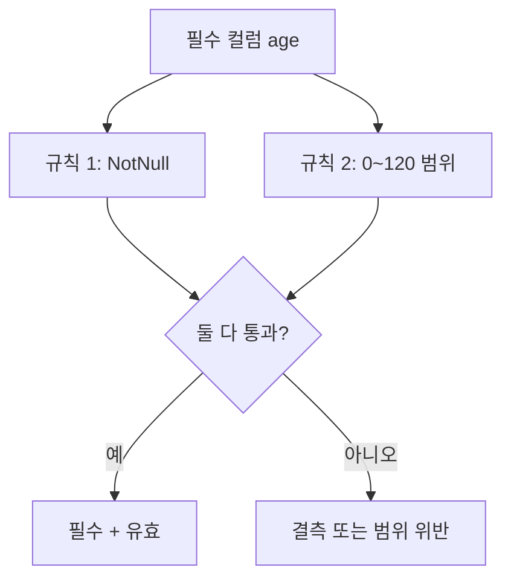
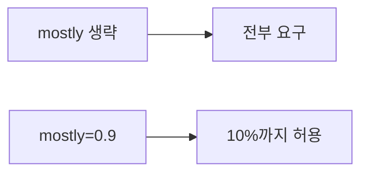

# 필수 컬럼 규칙 조합

> 어떤 컬럼이 **반드시 채워져 있고 값도 올바르길** 원한다면, `NotNull`(채워짐)과 값 검사(범위·형식)를 **둘 다 걸어야** 한다는 설계 원칙이다. 값 기반 검사는 빈 값을 건너뛰기 때문이다.

## 쉽게 말하면
입국 심사에서 "여권 유효기간이 6개월 이상인지"만 확인하면, 여권 자체를 안 가져온 사람은 "검사할 값이 없다"며 통과할 수 있다. "여권 지참 필수"와 "유효기간 확인" 두 규칙이 짝을 이뤄야 한다.

## 자세히
(이 세션에서 great_expectations 1.25.0(+pandas)을 가상환경에 설치해 **직접 실행한 결과**. 공식 문서 페이지는 본문이 비어 있어 문서가 아닌 실행에 근거한다. 버전·백엔드(pandas/SQL/Spark)에 따라 다를 수 있다.)
- **실행으로 확인한 `mostly` 동작**(5행 데이터)
  | 검사 | 데이터 | 결과 |
  |---|---|---|
  | `NotBeNull(age)` | 결측 2/5 (40%) | **False** |
  | `NotBeNull(age, mostly=0.6)` | 같은 데이터 | **True** (60% 이상 채워짐) |
  | `NotBeNull(email, mostly=0.8)` | 결측 1/5 (20%) | **True** |
  | `NotBeNull(email, mostly=0.9)` | 같은 데이터 | **False** |
  | `BeBetween(score, 0~100)` | 값 500 하나 | **False** (위반 20%) |
  | `BeBetween(score, 0~100, mostly=0.8)` | 같은 데이터 | **True** |
- **조합 설계(제안)**
  1. **필수 컬럼**: `ExpectColumnValuesToNotBeNull(column)`을 먼저 둔다(전부 채워야 하면 `mostly` 생략).
  2. **값 규칙**: 그 위에 `ExpectColumnValuesToBeBetween` 같은 값 기반 규칙을 둔다. 결측은 거기서 걸러지지 않는다. → [결측과 범위 검사의 차이](#gx-null-vs-range)
  3. **부분 허용**: 일부 결측·이상을 허용할 때만 `mostly`로 비율을 **명시**하고, 비율의 근거를 문서화한다.
  4. **결과 기록**: 두 규칙의 `unexpected_percent`·`missing_percent`를 함께 저장. → [결측 비율 모니터링](#missing-percent-monitoring)
- **함정**: `mostly`를 느슨하게 잡으면(예: 0.6) 결측 40%도 "성공"이 된다. 기본값(전부 통과 요구)에서 시작해 필요할 때만 낮춘다.
- **한계**: 이 실험은 pandas 5행 데이터이며, 대용량·SQL 백엔드에서 NULL 처리가 다른지는 확인하지 못했다.

## 그림으로 보기

## 예시
- 회원가입 데이터: `email` NotNull(mostly=0.99) + 형식 정규식, `age` NotNull + 0~120 범위.
- 교육 활동: 결측이 섞인 표에 규칙 하나만 걸었을 때와 두 규칙을 걸었을 때 결과를 비교.

## 헷갈리는 것과 비교
| 개념 | 차이 |
|---|---|
| NotNull | 값이 채워져 있는지 |
| 범위 검사 | 값이 있는 행의 범위만 |
| `mostly` | 통과 비율 허용치. 느슨하면 결측도 통과 |
| [결측 비율 모니터링](#missing-percent-monitoring) | 결측 추세를 숫자로 추적 |

## 더 읽을거리
- [Great Expectations 문서](https://docs.greatexpectations.io/docs/) — Expectation 개요(수치는 직접 실행 결과, 문서 본문은 근거 아님).
