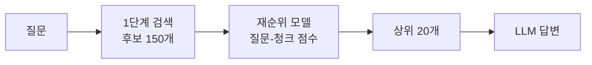
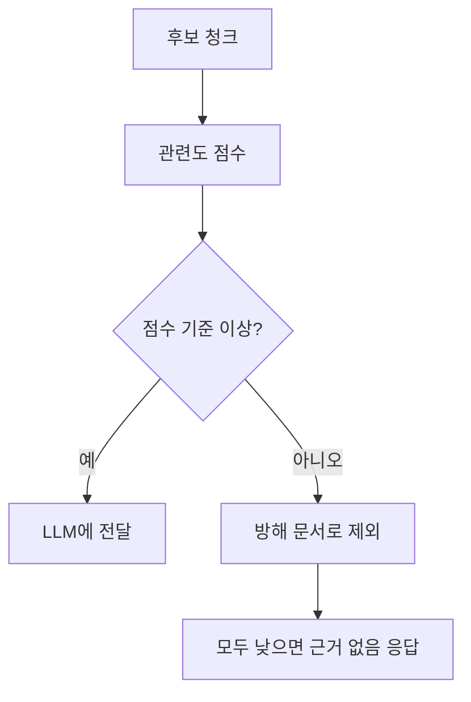

# RAG 재순위

> RAG 재순위는 검색으로 넓게 가져온 후보 중 질문과 비슷해 보이지만 답이 없는 방해 문서를 뒤로 밀고, 진짜 근거가 될 문서만 LLM에 넘기도록 순서를 다시 매기는 단계다. 기본 개념은 [리랭킹](#reranking)에 있고, 이 글은 방해 문서를 줄이는 쓰임에 초점을 둔다.

## 쉽게 말하면
도서관 사서가 키워드로 책 150권을 일단 꺼내 온다. 그중 표지 제목만 비슷하고 내용은 딴판인 책이 섞여 있다. 두 번째 사서가 질문과 책을 하나씩 맞대어 읽고 가장 맞는 20권만 책상에 올린다. 방해 책이 줄어서 답을 쓰는 사람이 덜 헷갈린다.

## 자세히
- **2단계 구조(Anthropic Contextual Retrieval 글, 열람)**: 1단계로 후보 청크 150개를 넓게 가져오고, 재순위 모델이 질문과 각 청크의 관련성을 채점해 상위 20개만 모델에 넘긴다. 저자는 Cohere 재순위기를 시험했다. Voyage도 제공하나 시험하지 않았다고 쓴다.
- **효과(같은 글, 저자 실험)**: 문맥 임베딩 + 문맥 BM25에 재순위를 더하자 상위 20개 청크의 검색 실패율이 5.7%→1.9%로 67% 줄었다고 보고한다. 해당 글 자체의 데이터셋 결과이므로 다른 자료에서 그대로 재현된다는 보장은 없다.
- **비용**: 실행 시간에 한 단계가 늘어 지연이 조금 생긴다. 청크 점수는 병렬로 계산한다. 더 많은 청크를 재순위하면 성능이 오를 수 있으나 비용·지연도 오르므로 직접 설정을 시험하라고 권한다.
- **Cohere Rerank 문서(열람)**: 질의와 문서 목록을 받아 관련도 순으로 돌려준다. Rerank 5는 문서마다 0~1의 보정된 점수를 주며, 질의+문서가 합쳐 32,768토큰까지 들어가고 더 긴 문서는 나눠 처리한다. 반정형 데이터(JSON·표)는 YAML 문자열로 넘기라고 안내한다. 텍스트 전용이고 관련성 판단을 바꾸는 지시는 지원하지 않는다.
- **방해 문서와의 연결(해석)**: 점수 기준선(threshold)을 두면 상위 문서도 점수가 낮을 때 "근거 없음"으로 처리해 [근거 없으면 거부](#abstain-when-no-evidence)로 이어갈 수 있다. Cohere 문서도 임계값을 다른 검색이나 "모르겠다" 응답 트리거로 쓰는 용례를 든다.
- **한계**: 재순위는 후보 안에서만 고른다. 1단계에서 정답이 빠졌다면 살릴 수 없다. 그래서 후보 수(예: 150)를 넉넉히 잡는다.

## 그림으로 보기

## 예시
- 사내 규정 챗봇: 벡터 검색으로 50개를 가져온 뒤 재순위로 상위 5개만 프롬프트에 넣는다. 비슷한 제목의 폐지된 규정이 뒤로 밀린다.
- 코드: 후보 문서 리스트와 질의를 재순위 API에 넘기고, 반환된 점수가 임계값 미만이면 답변 대신 "관련 문서를 찾지 못했습니다"를 출력한다.

## 헷갈리는 것과 비교
| 개념 | 차이 |
| --- | --- |
| [리랭킹](#reranking) | 일반 개념 글. 이 글은 방해 문서 대응 쓰임 |
| [방해 문서](#distractor-documents) | 줄여야 할 대상 |
| 1단계 검색(벡터·BM25) | 빠르게 넓게 가져옴. 재순위는 느리지만 정밀 |

## 더 읽을거리
- [Anthropic: Contextual Retrieval](https://www.anthropic.com/news/contextual-retrieval) — 150→20 재순위와 실패율 5.7%→1.9%
- [Cohere: Rerank](https://docs.cohere.com/docs/rerank) — 입력 형식·점수·사용 사례
