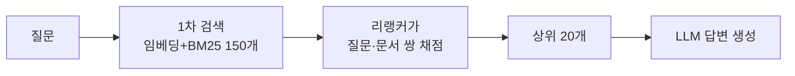
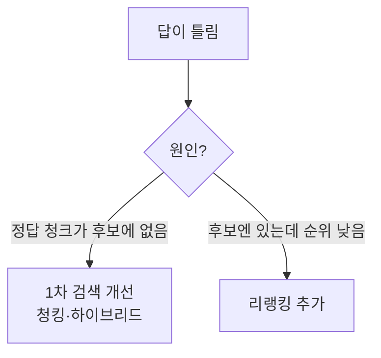

# 리랭킹 (Reranking)

> 리랭킹은 검색으로 넓게 가져온 후보 문서들을, 더 정밀한 모델로 **질문과의 관련도를 다시 채점해 순서를 재정렬**하고 상위 몇 개만 LLM에 넘기는 2단계 검색 기법이다.

## 쉽게 말하면
채용에서 서류 심사(빠르고 거칠게 150명 → 후보 추리기)를 하고, 면접관이 한 명씩 깊이 보고 최종 20명을 고르는 것과 같다. 1차는 속도, 2차는 정확도를 맡는다.

## 자세히
- 1단계(retriever): 임베딩 검색·BM25처럼 수만~수백만 청크에서 빠르게 후보를 뽑는다. 질문과 문서를 **따로** 인코딩하므로 빠르지만 미세한 관련도는 놓친다.
- 2단계(reranker): 질문과 문서를 **함께** 입력해 점수를 내는 모델(크로스 인코더형 등). 정확하지만 느려서 후보 수십~수백 개에만 쓴다.
- Anthropic Contextual Retrieval 글(2024, 열어서 확인)의 수치: 상위 20개 검색 실패율 기준선 5.7% → 컨텍스트 임베딩 3.7%(−35%) → +컨텍스트 BM25 2.9%(−49%) → **+리랭킹 1.9%(−67%)**. 설정은 후보 약 150개를 리랭킹해 상위 20개를 모델에 전달. 실험은 그 회사 데이터셋 기준이므로 내 데이터로 재측정해야 한다.
- 비용·지연이 추가되므로 후보 수와 최종 top-K를 조절한다(Anthropic은 5·10·20 중 20이 최선이었다고 보고).
- 리랭커 호출은 외부 API(Cohere Rerank, Voyage 등)나 오픈 모델을 쓴다(제품은 빠르게 바뀌므로 최신 문서 확인).

## 그림으로 보기

## 예시
사내 규정 챗봇에서 "연차 이월 규정"을 물으면 1차 검색이 연차·휴가·이월 관련 청크 150개를 가져오고, 리랭커가 "이월" 조항을 1위로 올린다. LLM은 상위 몇 개만 읽어 토큰도 절약된다.

## 헷갈리는 것과 비교
| 개념 | 차이 |
|---|---|
| 리랭킹 | 후보를 정밀하게 재정렬 |
| [하이브리드 검색](#hybrid-search) | 키워드+의미 검색 결과를 합쳐 후보를 만듦 |
| [임베딩 검색](#semantic-vs-keyword-search) | 질문·문서를 따로 벡터화, 빠름 |
| [RAG](#rag) | 리랭킹은 RAG 파이프라인의 한 단계 |

## 더 읽을거리
- [Anthropic: Introducing Contextual Retrieval](https://www.anthropic.com/news/contextual-retrieval) — 리랭킹 포함 실패율 감소 수치(열어서 확인).
