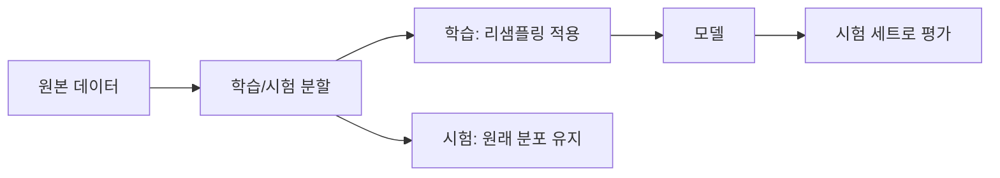
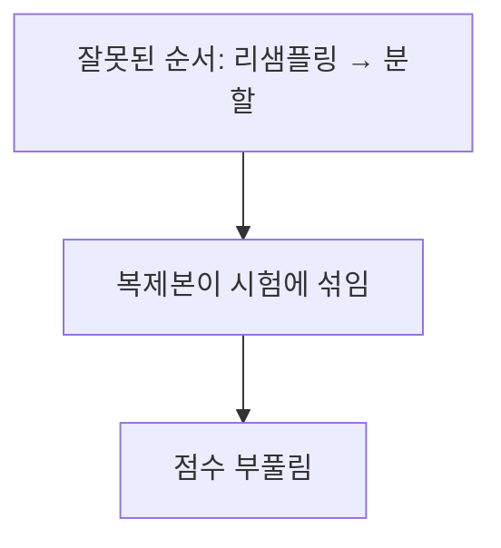

# 분할 후 리샘플링

> 오버샘플링·언더샘플링은 반드시 학습/시험 분할을 먼저 한 뒤 학습 쪽에서만 적용해야 한다. 먼저 불린 뒤 나누면 같은 표본의 복제본이 시험 세트에 섞여 점수가 부풀려진다.

## 쉽게 말하면
연습문제를 복사해 불린 다음에 시험문제를 뽑으면 연습문제와 같은 문제가 시험에 나온다. 점수는 높지만 실력은 아니다.

## 자세히
(scikit-learn 문서와 imbalanced-learn Pipeline 문서를 하위 에이전트가 읽은 노트 기준.)
- **sklearn**: "항상 데이터를 먼저 학습·시험으로 나누라"와 "시험 데이터에 `fit`을 호출하지 말라"가 권고다.
- **imbalanced-learn Pipeline**: 샘플러(오버/언더샘플링)는 **`fit` 때만 적용**되고 `predict`·`transform` 때는 건너뛴다. 교차검증 안에서 리샘플링을 쓰려면 이 Pipeline을 써야 한다.
- **누수 논리(저자 추론, 문서에 명시 없음)**: 오버샘플링으로 복제본·합성 표본이 생긴 뒤 분할하면 원본과 거의 같은 표본이 학습과 시험에 나뉘어 들어가 성능이 낙관적으로 나온다.
- **절차(제안)**: ① 층화 분할 ② 학습 세트에만 리샘플링 ③ 시험 세트는 원래 분포 유지 ④ 교차검증은 폴드마다 학습 폴드에서만 리샘플링.

## 그림으로 보기

## 예시
- imblearn `Pipeline([("smote", SMOTE()), ("clf", clf)])`을 `cross_val_score`에 넣어 폴드마다 학습 쪽에만 SMOTE 적용.
- 교육 활용: 순서를 바꿔 점수가 얼마나 부풀려지는지 비교 실험.

## 헷갈리는 것과 비교
| 개념 | 차이 |
|---|---|
| 분할 후 리샘플링 | 올바른 순서 |
| 데이터 누수 | 시험 정보가 학습에 새는 일반 문제 |
| [class_weight](#class-weight-balanced) | 복제 없이 가중 — 누수 위험 낮음 |

## 더 읽을거리
- [scikit-learn: Common pitfalls (데이터 누수)](https://scikit-learn.org/stable/common_pitfalls.html) — 분할 먼저.
- [imbalanced-learn Pipeline](https://imbalanced-learn.org/stable/references/generated/imblearn.pipeline.Pipeline.html) — fit 때만 샘플링.
