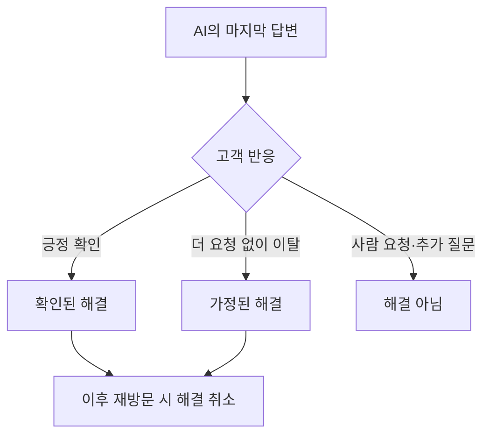

# 해결률 (Resolution Rate)

> AI 챗봇이 **사람 개입 없이 문의를 실제로 해결한 대화의 비율**. "사람에게 안 넘어갔다"만 세는 [deflection](#deflection-rate)과 달리, 고객의 확인이나 이탈 같은 해결 신호를 기준으로 삼는다. 정의는 제품마다 다르다.

## 쉽게 말하면
식당에서 "주방에 안 보낸 손님 비율"이 아니라 "음식을 받고 만족해서 돌아간 손님 비율"을 세는 것이다. 단, 만족했는지 직접 묻지 않으면 "말없이 나갔다"를 만족으로 칠지가 갈림길이 된다.

## 자세히
출처: Intercom Fin 해결(resolution) 도움말(본문 확인, 2026-11-18)과 가격 관련 검색 요약. 한 벤더의 정의이므로 업계 표준이 아니다.
- **해결로 세는 조건(Intercom)**: Fin의 마지막 답변 뒤 고객이 ①**확인**한다("고마워요", "도움이 됐어요") → 확인된 해결(confirmed) ②도움을 더 요청하지 않고 **대화를 떠난다** → 가정된 해결(assumed).
- **시간 창**: 열어 본 도움말에는 가정된 해결의 고정 시간 창이 적혀 있지 않았다. 검색 요약에는 제3자 글이 24시간 침묵 규칙을 말하고 Intercom 가격 문서에도 24시간 문구가 있다는 서술이 있어 자료가 엇갈린다. 현행 도움말로 직접 확인이 필요하다.
- **세지 않는 경우**: 인사에만 답한 경우, Fin이 되묻기만 하고 대화가 자동 종료된 경우(해결 상태 기록 없음), Fin이 모른다고 하고 사람이 답한 경우, 고객이 사람을 요청하거나 절차가 실패한 경우.
- **재방문**: 해결로 센 대화에 고객이 돌아와 다시 도움을 구하면 그 해결은 "차감되어 과금되지 않는다"(청구 기간을 넘어도).
- **해결률 정의**: Fin이 사람 개입 없이 해결한 대화의 비율이라고만 쓰여 있고 계산식은 없다.
- **가격 맥락(검색 요약)**: Intercom은 2026-03-12부터 과금 단위를 해결에서 "결과(outcome)"로 바꿨고, 결과당 US$0.99라고 전해진다. 가정된 해결도 과금 대상이어서 비용을 부풀릴 수 있다는 비판이 있다. 이는 검색 요약이므로 현행 가격표를 확인해야 한다.
- **측정 권고(제안)**: ①확인된 해결과 가정된 해결을 분리해 보고 ②재문의율과 함께 본다([재문의율](#reopened-as-ticket)) ③측정 창을 바꾸면 추세가 왜곡된다([측정 창 72시간](#measurement-window)).

## 그림으로 보기

## 예시
- 이번 달 대화 10,000건 중 Fin이 확인된 해결 3,200건, 가정된 해결 1,800건 → 해결률 50%(가상 값). 확인된 해결만 보면 32%이므로 둘을 분리해 보고하면 판단이 달라진다.
- 교육 활용: 챗봇 벤더 비교표에서 "해결"의 정의 칸을 따로 만들어 채우게 한다.

## 헷갈리는 것과 비교
| 개념 | 차이 |
|---|---|
| 해결률 | 해결 신호를 기준으로 센 비율 |
| [응대 전환율 deflection](#deflection-rate) | 사람에게 안 닿은 비율 |
| [재문의율](#reopened-as-ticket) | 해결 뒤 같은 주제로 다시 문의 |
| CSAT | 고객이 직접 준 만족도 |

## 더 읽을거리
- [Intercom: Fin AI Agent resolutions](https://www.intercom.com/help/en/articles/8205718-fin-ai-agent-resolutions) — 확인·가정된 해결, 제외 조건, 재방문 차감
