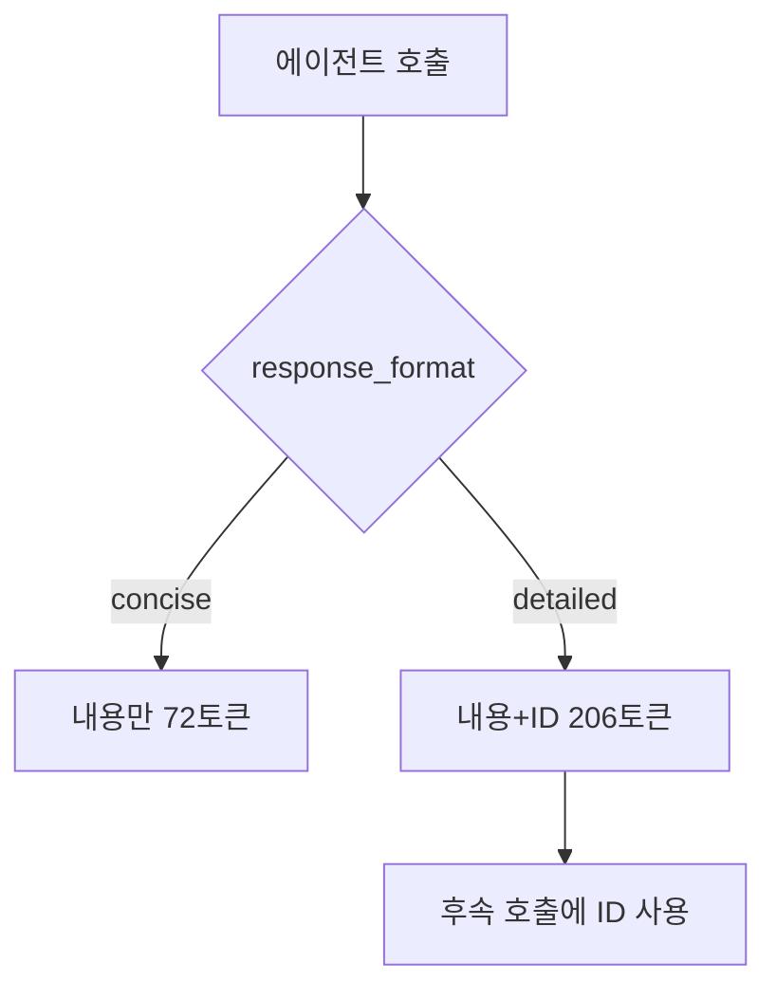
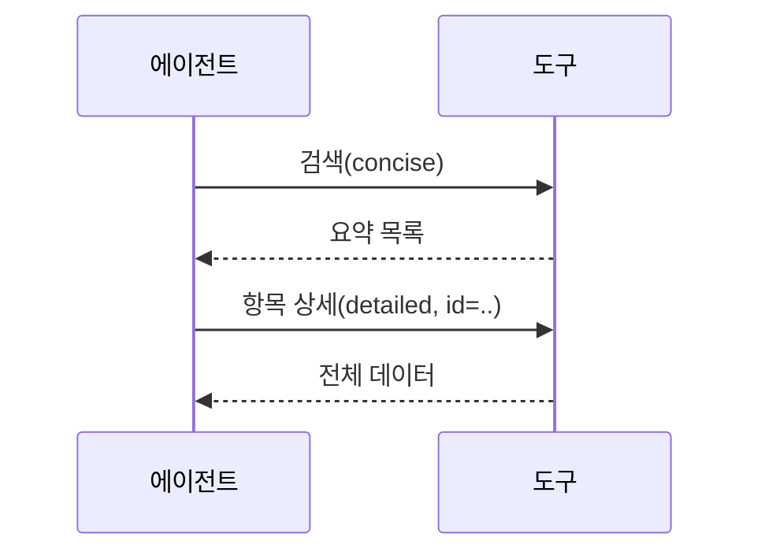

# concise·detailed 응답

> 도구에 `response_format` 같은 인자를 두어 에이전트가 "짧은 응답(concise)"과 "상세 응답(detailed)" 중 고르게 하는 설계. 컨텍스트 토큰을 아끼는 방법이다.

## 쉽게 말하면
식당 직원에게 "요약만" 또는 "자세히"를 고르게 해 주는 것과 같다. 대부분은 요약으로 충분하고, 다음 행동에 번호표(ID)가 필요할 때만 상세를 요청한다.

## 자세히
Anthropic의 「Writing tools for agents」 기준:
- `response_format` enum(`"concise"`/`"detailed"`)을 제안. Slack 예시에서 상세 206토큰, 간결 72토큰으로 약 1/3.
- 상세 응답에는 `thread_ts`·`channel_id`·`user_id` 같은 ID가 들어 있어 후속 도구 호출에 필요하다. 간결 응답은 내용만 준다.
- 더 세밀하게 필요하면 형식을 늘릴 수 있다(GraphQL 식).
- 컨텍스트를 많이 먹을 응답은 페이지 나누기·범위 선택·필터·잘라내기를 기본값과 함께 제공한다. Claude Code는 도구 응답을 기본 25,000토큰으로 제한한다.
- 잘렸다면 도구가 필터·페이지 사용을 안내해야 한다.

## 그림으로 보기



## 예시
도구 정의 일부:
```json
"response_format": {"type":"string","enum":["concise","detailed"],"default":"concise",
 "description":"detailed는 후속 호출용 ID를 포함"}
```
## 헷갈리는 것과 비교
| 개념 | 차이 |
| --- | --- |
| response_format | 응답 상세도 선택 |
| 페이지네이션 | 많은 결과를 나눠 받기([MCP 페이지네이션](#mcp-pagination)) |
| [도구 설명 설계](#mcp-tool-description-design) | 이 인자를 어떻게 설명할지의 상위 주제 |

## 더 읽을거리
- [Anthropic: Writing tools for agents](https://www.anthropic.com/engineering/writing-tools-for-agents) — 응답 형식·토큰 효율 가이드
