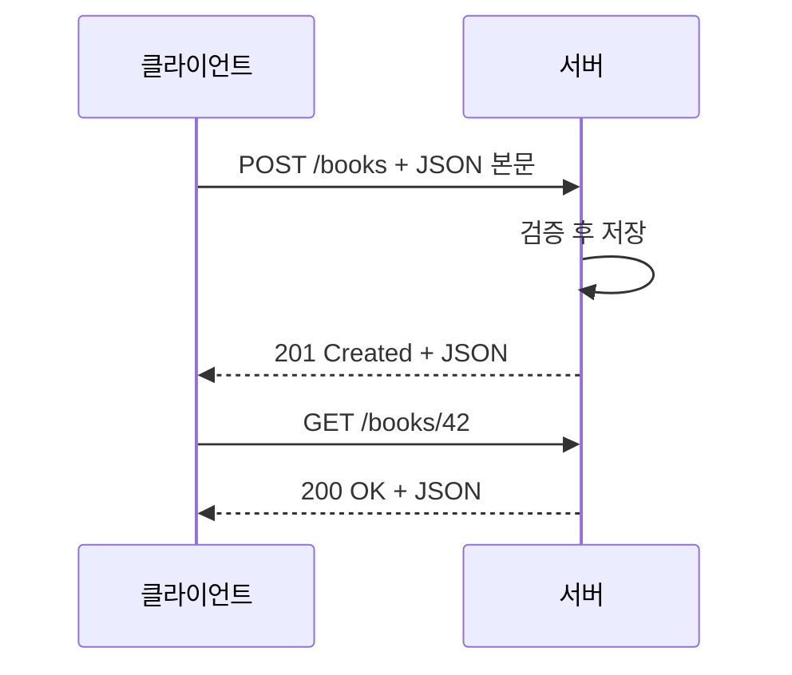
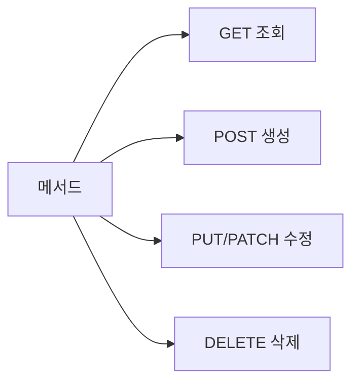

# REST와 JSON

> REST는 "URL로 자원(resource)을 가리키고, HTTP 메서드로 무엇을 할지 말하는" API 설계 관례이고, JSON은 그 요청·응답에 가장 흔히 쓰는 텍스트 데이터 형식이다.

## 쉽게 말하면
식당 주문을 떠올리면 된다. 메뉴판의 항목(`/books/42`)이 자원이고, "주세요(GET)·추가해 주세요(POST)·바꿔 주세요(PUT/PATCH)·빼 주세요(DELETE)"가 동사다. 주방과 손님이 주고받는 주문서 양식이 JSON이다. 양식이 정해져 있으니 AI가 만든 프런트엔드와 백엔드도 서로 말이 통한다.

## 자세히
- **자원 + 메서드**: `GET /books/42`(조회), `POST /books`(생성), `PUT /books/42`(전체 교체), `PATCH /books/42`(일부 수정), `DELETE /books/42`(삭제). 주소에는 명사, 동작은 메서드에 둔다.
- **안전·멱등**: GET은 서버 상태를 바꾸지 않고(safe) 여러 번 보내도 결과가 같다(idempotent). PUT·DELETE도 멱등, POST는 아니다 — 결제 POST를 재시도하면 중복 결제가 날 수 있다.
- **상태 코드 계열**: 2xx 성공(200, 201 생성, 204 내용 없음), 3xx 이동, 4xx 클라이언트 잘못(400, 401, 403, 404, 422), 5xx 서버 오류(500, 503). 
- **JSON 규칙**: 객체 `{}`와 배열 `[]`, 키는 반드시 큰따옴표 문자열, 값은 문자열·숫자·true/false·null·객체·배열. 주석과 `undefined`는 없다. 헤더는 `Content-Type: application/json`.
- **fetch 함정**(MDN): `fetch()`는 네트워크가 끊길 때만 거부(reject)되고 404·500도 정상 응답으로 돌려준다. `response.ok`를 직접 확인해야 한다.

## 그림으로 보기



## 예시
```js
const res = await fetch("/api/books", {
  method: "POST",
  headers: { "Content-Type": "application/json" },
  body: JSON.stringify({ title: "Dune", year: 1965 }),
});
if (!res.ok) throw new Error(`HTTP ${res.status}`);
const book = await res.json();
```
AI에게 시킬 때: "이 앱의 API를 REST 관례로 정리해 줘. 자원별 URL, 메서드, 성공/실패 상태 코드, 요청·응답 JSON 예시를 표로."

## 헷갈리는 것과 비교
| 개념 | 차이 |
| --- | --- |
| [API](#api-basics) | 약속 전반. REST는 그중 웹 API 설계 스타일 |
| [멱등성](#idempotency) | 같은 요청을 반복해도 결과가 같은 성질 |
| PUT vs PATCH | PUT은 전체 교체, PATCH는 일부 수정 |
| 401 vs 403 | 401 인증 안 됨, 403 권한 없음 ([인증과 인가](#access-control)) |
| JSON vs 객체(JS) | JSON은 문자열 형식, 객체는 메모리 안의 값 — `JSON.stringify/parse`로 변환 |

## 더 읽을거리
- [MDN: Network requests (fetch)](https://developer.mozilla.org/en-US/docs/Learn_web_development/Core/Scripting/Network_requests) — fetch와 `response.ok`, JSON 파싱
- [MDN: HTTP 개요](https://developer.mozilla.org/en-US/docs/Web/HTTP/Guides/Overview) — 요청·응답 구조와 메서드
