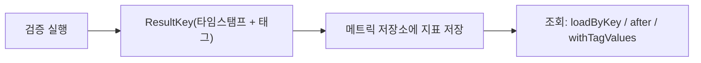
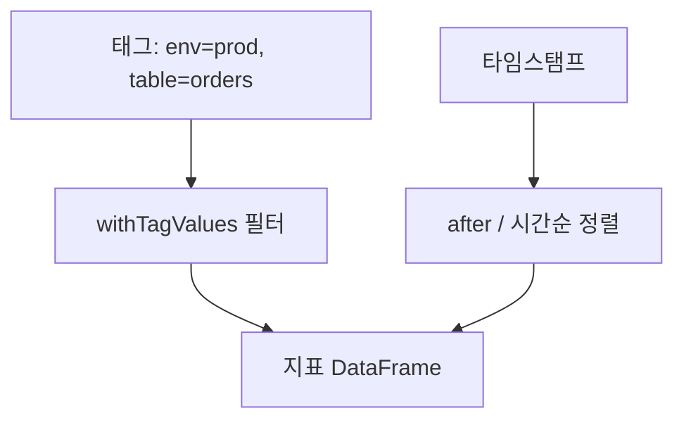

# ResultKey와 태그

> Deequ의 **ResultKey**는 저장되는 데이터 품질 지표 한 묶음의 **색인 키**로, **타임스탬프(보통 데이터셋 날짜)와 임의의 키-값 태그**로 구성된다. 이 키로 "그 날짜의, 그 태그를 가진 지표"를 나중에 정확히 찾아 비교한다.

## 쉽게 말하면
검사 보고서를 보관함에 넣을 때 겉면에 "날짜"와 "라벨(예: 주문 테이블, 운영 환경)" 스티커를 붙이는 것과 같다. 나중에 "지난주 운영 환경 보고서만 꺼내 줘"라고 찾을 수 있다.

## 자세히
(Deequ 저장소의 메트릭 저장소 예제 문서(`metrics_repository_example.md`)와 이상 탐지 예제 문서를 WebFetch로 직접 읽어 확인. Deequ를 직접 실행하지는 않았다. 코드는 문서의 Scala 예시다.)
- **구성(문서)**: `ResultKey(타임스탬프, 태그 Map)`. 첫 인자는 **타임스탬프**로 JSON 출력에서는 `dataset_date`로 나온다. 둘째 인자는 **태그**(임의의 key-value `Map`).
  ```scala
  val resultKey = ResultKey(System.currentTimeMillis(), Map("tag" -> "repositoryExample"))
  ```
- **저장(문서)**: `VerificationSuite`에 `useRepository(repository)`와 `saveOrAppendResult(resultKey)`를 붙여 실행하면 검사 지표가 그 키 아래 저장된다. 저장소로는 JSON을 로컬 디스크(문서는 HDFS·S3도 지원한다고 설명)에 쓰는 `FileSystemMetricsRepository`가 있고, 이상 탐지 예제는 `InMemoryMetricsRepository`를 쓴다.
- **조회(문서)**: 
  - 키로 조회: `repository.loadByKey(resultKey).get.metric(Completeness("productName")).get`
  - 시간 필터: `repository.load().after(타임스탬프).getSuccessMetricsAsJson()`
  - **태그 필터**: `repository.load().withTagValues(Map("tag" -> "repositoryExample")).getSuccessMetricsAsDataFrame(spark)` → Spark DataFrame으로 받아 분석
  - 이상 탐지 예제에서는 `load().forAnalyzers(Seq(Size())).getSuccessMetricsAsDataFrame(session)`.
- **시간 키의 역할(문서)**: 이상 탐지 예제에서 어제 실행을 `ResultKey(현재시각 − 24시간)`으로 저장해 두고, 오늘 실행 때 저장된 이전 값과 비교한다. 문서는 키의 타임스탬프가 지표를 **시간순으로 정렬**하게 한다고 설명한다.
- **태그 설계(제안)**: 환경(`env=prod`), 테이블명, 파이프라인 실행 ID, 데이터 버전 등을 태그로 넣어 이후에 필터링한다. 같은 태그 조합이 아니면 서로 다른 시계열로 취급해야 비교가 의미 있다.
- **한계**: 문서에서 태그 중복·동시 쓰기 같은 세부 동작은 확인하지 못했다. 저장소 구현별(S3·HDFS) 제약도 문서 수준으로만 확인했다.

## 그림으로 보기



## 예시
- 매일 `orders` 테이블 검증을 `ResultKey(오늘 00:00, Map("env"->"prod","table"->"orders"))`로 저장해, 한 달치 완전성 추이를 태그로 필터해 그래프로 그림.
- 교육 활동: 세 번의 검증을 서로 다른 날짜·태그로 저장했다고 가정하고 "운영 환경의 지난 2회"를 찾는 질의를 말로 써 보기.

## 헷갈리는 것과 비교
| 개념 | 차이 |
|---|---|
| ResultKey | 지표 한 묶음의 날짜+태그 키 |
| 메트릭 저장소 | 키별 지표를 보관·조회하는 저장소 |
| [동적 규칙 last()](#dynamic-rules-last) | 과거 지표와 비교하는 규칙(다른 도구 표기일 수 있음) |
| [검증 지표 저장소](#validation-metrics-store) | GX 쪽의 비슷한 아이디어 |

## 더 읽을거리
- [Deequ metrics repository 예제](https://github.com/awslabs/deequ/blob/master/src/main/scala/com/amazon/deequ/examples/metrics_repository_example.md) — ResultKey, 저장·조회 API(직접 확인).
- [Deequ anomaly detection 예제](https://github.com/awslabs/deequ/blob/master/src/main/scala/com/amazon/deequ/examples/anomaly_detection_example.md) — 시간 키로 어제 값과 비교하는 흐름(직접 확인).
