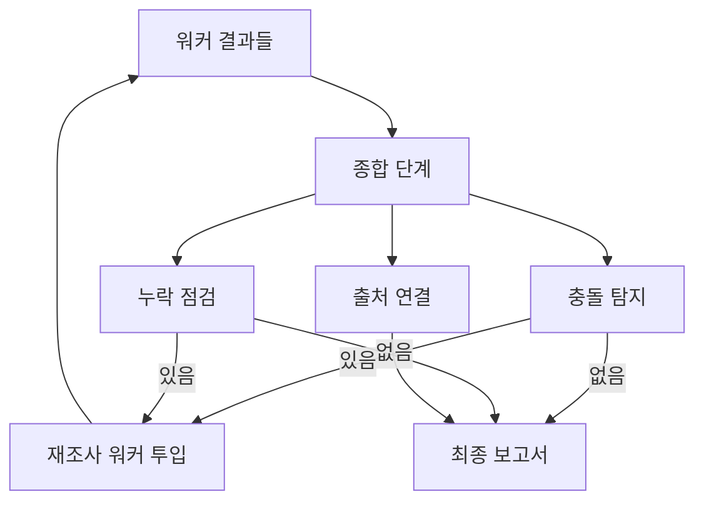

# 결과 종합 단계

> 오케스트레이터-워커 구조에서 **여러 워커가 가져온 결과를 합쳐 하나의 답으로 만드는 단계.** 단순히 이어 붙이는 것이 아니라 **충돌·누락·근거 없는 주장**을 점검하고, 부족하면 **추가 조사를 다시 시킨다.**

## 쉽게 말하면
조사원 세 명이 각자 보고서를 내면 팀장이 읽고 "A는 2025년이라 했고 B는 2026년이라 했네 → 다시 확인", "예산 항목이 아무도 안 채웠네 → 추가 조사", "출처 없는 건 보류"처럼 정리한 뒤에야 최종 보고서를 쓴다.

## 자세히
(Anthropic Engineering, 멀티 에이전트 연구 시스템 글 요약 + 직접 실행)
- **리드 에이전트의 역할**: 워커의 결과를 모은 뒤 **추가 연구가 필요한지 판단**하고, 필요하면 새 하위 에이전트를 만들거나 전략을 바꾼다. 컨텍스트가 잘려도 이어 가도록 **계획을 메모리에 저장**한다.
- **"전화 게임" 방지**: 워커가 산출물(보고서·코드 등)을 **외부 저장소에 저장하고 가벼운 참조만** 리드에게 넘기면, 여러 번 전달하며 정보가 변질되는 일과 토큰 낭비를 줄인다. 구조화된 산출물에 특히 효과적이라고 한다.
- **출처 연결**: 연구가 끝난 뒤 별도의 **CitationAgent**가 문서와 보고서를 보고 각 주장의 출처를 붙인다.
- **누락 보완**: 하위 에이전트는 자기 도구 결과를 평가해 **빠진 것을 찾아 다음 질의를 고친다.** 충분한지의 최종 판단은 리드가 한다. 문서는 **충돌하는 결과를 해소하는 구체적 방법은 기술하지 않는다**(이 글에서 아래 규칙은 일반 설계 제안이다).
- **직접 만든 종합 점검 예**(워커 3개의 주장 딕셔너리를 규칙으로 점검, LLM 없음): 필수 항목 5개 중 ① **충돌**: `시행연도`가 국내정책 워커 "2025", 해외사례 워커 "2026"로 다름, ② **누락**: `평가방식`을 아무도 채우지 않음, ③ **출처 없는 워커**: 해외사례. → 후속 조치 `충돌 항목 재조사`, `['평가방식'] 추가 워커 투입`, `['해외사례'] 출처 보강`.
- **종합 단계 체크리스트**:
  1. 요구 항목 대비 **누락 점검**(완전성).
  2. 워커 간 **충돌 탐지**와 재확인(출처 비교, 1차 출처 우선).
  3. 주장별 **출처 연결**, 출처 없는 주장은 보류·표시.
  4. 불확실성 표기(확인된 사실/추정 구분).
  5. 최종 문서를 **평가 기준**으로 점검.
- **평가 방식**(문서): LLM 심사자가 **사실 정확성·인용 정확성·완전성·출처 품질·도구 효율**을 기준으로 0.0~1.0 점수와 합격/불합격을 내는 단일 프롬프트가 가장 일관되고 사람 판단과 가까웠다고 한다. 그래도 사람 테스트가 극단 사례를 잡는 데 필수였다.
- 한계: 이 글의 점검 코드는 구조 시연이며 실제로는 의미 비교(같은 사실의 다른 표현)가 필요해 LLM이나 규칙의 도움을 받는다.

## 그림으로 보기


## 예시
```python
conflicts = [k for k in keys if len({w.claims.get(k) for w in workers if k in w.claims}) > 1]
missing   = [k for k in required if not any(k in w.claims for w in workers)]
if conflicts or missing:
    spawn_followup_workers(conflicts, missing)
```
- 프롬프트: "세 워커 결과를 비교해 (1)서로 다른 주장 (2)빠진 필수 항목 (3)출처 없는 주장을 표로 정리하고, 추가 조사 계획을 제안해 줘."

## 헷갈리는 것과 비교
| 개념 | 차이 |
|---|---|
| 결과 종합 | 충돌·누락·출처를 점검해 합침 |
| 단순 연결 | 결과를 이어 붙이기만 함 |
| [워커의 컨텍스트 분리](#worker-context-isolation) | 워커가 일하는 방식 |
| [오케스트레이터-워커](#orchestrator-workers) | 이 단계를 포함한 상위 패턴 |

## 더 읽을거리
- [Anthropic: How we built our multi-agent research system](https://www.anthropic.com/engineering/multi-agent-research-system) — 리드 에이전트·CitationAgent·평가 방식.
