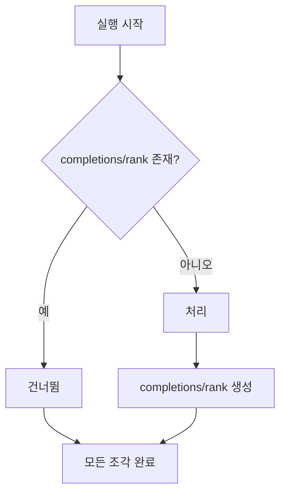

# 재시작 가능한 데이터 파이프라인

> 대용량 처리가 중간에 죽어도 **끝난 조각은 건너뛰고 못 끝낸 조각만 다시 돌리도록** 완료 기록을 남기는 설계다. 수천 개 작업을 쓰는 데이터 정제에서 필수다.

## 쉽게 말하면
책 100권을 스캔하다 정전이 났을 때, 어디까지 했는지 모르면 처음부터 다시 한다. 권마다 "완료" 도장을 찍어 두면 도장 없는 책만 다시 스캔하면 된다.

## 자세히
- datatrove(0.10.1)의 방식: 데이터를 `tasks`개 조각(rank)으로 나누고, 조각 처리가 끝나면 `logging_dir/completions/<rank 5자리>` 파일을 만든다. `skip_completed=True`(기본값)이면 재실행 때 이 파일이 있는 조각은 건너뛴다.
- 직접 실험: 입력 JSONL 4개를 tasks=4로 처리한 뒤 `completions/00002`만 지우고 같은 코드를 다시 실행했다. 로그에 `Skipping 3 already completed tasks`가 찍히고 rank=2만 다시 처리됐다(마지막에 `4/4 tasks completed`).
- 전제: 조각 처리는 **멱등**이어야 한다. 같은 조각을 두 번 돌려도 결과 파일을 덮어쓰기만 하고 중복 쌓지 않아야 한다. 이 실험에서 출력은 조각별 파일(`00002.jsonl.gz`)이라 덮어써졌다.
- 단계 사이도 이어진다: 한 실행기가 다른 실행기에 `depends`로 묶이면 앞 단계의 미완료 조각이 끝날 때까지 기다린다(소스의 "Dependency job still has N tasks. Waiting..." 로그 문구).
- 주의: 코드나 설정을 바꾼 뒤에도 옛 완료 표시가 남아 있으면 건너뛴다. 설정을 바꾸면 `logging_dir`을 새로 쓰거나 완료 파일을 지워야 한다(제안, 이 동작은 skip_completed 정의에서 추론).
- Jobs 실행기는 완료 표시를 원격 경로의 `completions/`에 저장해야 재실행 시 이어진다(소스 docstring).

## 그림으로 보기

## 예시
- 8,000 task짜리 정제 작업이 밤새 7,800개에서 노드 장애로 멈췄다면 재실행은 남은 조각만 돌린다.
- 교육: "체크포인트" 개념을 게임 저장에 빗대 설명한다.

## 헷갈리는 것과 비교
| 개념 | 차이 |
|---|---|
| 재시작 가능(이 글) | 조각 단위 완료 표시 |
| 모델 체크포인트 | 학습 중 모델 가중치 저장 |
| 멱등성 | 같은 입력에 같은 결과, 재실행의 전제 |
| [실행기 종류](#pipeline-executor-types) | 완료 표시를 쓰는 틀 |

## 더 읽을거리
- [huggingface/datatrove](https://github.com/huggingface/datatrove) — skip_completed·completions 동작(설치해 실행, 소스 읽음).
