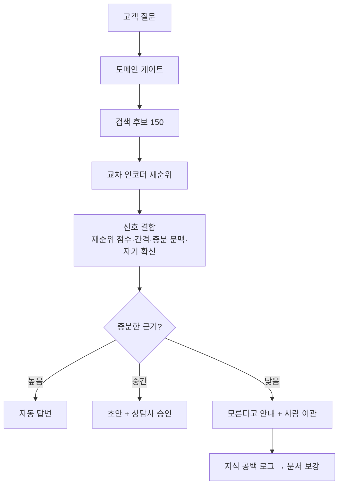

# 검색 점수 기반 이관

> RAG 상담 AI가 **검색된 근거 문서의 유사도 점수**로 "답할지, 모른다고 하고 사람에게 넘길지"를 정하는 방식. 단순한 점수 크기 임계값은 신뢰하기 어렵고, 점수 간격·재순위 점수·충분한 근거 분류 같은 신호를 겹쳐 쓰는 편이 낫다는 보고가 나오고 있다.

## 쉽게 말하면
도서관 검색대는 질문과 전혀 상관없는 책이어도 "가장 가까운 책 5권"을 내놓는다. 그 5권으로 답을 지어내게 하면 자신 있게 틀린 답이 나온다. 그래서 "가까운 책이 정말 답을 담고 있는가"를 따로 확인하고, 아니라면 사람에게 넘긴다.

## 자세히
출처: arXiv 2609.15578 "The Magnitude Mirage" 초록(확인), Tian Pan 블로그 "Retrieval Emptiness Problem"(본문 확인), 검색 요약, 2026-11-18. 블로그의 일부 수치(2~3배, 10포인트)는 방법론이 충분히 적히지 않아 참고 수준이다.
- **문제**: 벡터 검색은 순위 도구라 관련 문서가 없어도 가장 가까운 k개를 반환한다. 프롬프트가 "문맥을 써서 답하라"고 하면 모델이 엉뚱한 문서로 답한다. 블로그는 근거가 충분할 때 환각 약 10%가 불충분할 때 66%까지 올랐다는 연구를 인용한다(Gemma, 사실형 QA, 재인용).
- **점수 크기만으로는 약하다(Magnitude Mirage)**: 논문은 원점수 크기를 기권 신호로 쓰는 것이 의미 매칭을 넘는 추론형 질의에서 무너진다고 주장한다. 11개 검색 구조, 28개 데이터셋(BEIR 의미 매칭, BRIGHT 논리 추론, TEMPO 시간 추론)에서 **점수 간격(s1−sk)**과 점수 크기·분산 변형이 기권 AUROC를 최대 0.16 개선했다고 한다. 분포 신호 사이의 차이보다 "크기를 버리는 것"의 이득이 5~10배 크다는 서술. 별도 추론·재학습·지연이 필요 없다.
- **고정 임계값의 한계(블로그)**: 0.7 같은 값은 관례일 뿐 임베딩 모델과 코퍼스마다 다르다. 질의 유형별 분포가 달라 전역 임계값 하나는 부적절하다. 유사도는 공유 어휘를 재지 관련성을 재지 않는다.
- **설계안(블로그)**: ①넓게 가져와 좁게 분류 — 후보 약 150개 → 교차 인코더로 상위 30개 재순위 → LLM에 3~8개 ②도메인 게이트(범위 밖 질의 사전 차단) ③신호 결합 — 재순위 점수와 다음 순위와의 간격, 충분한 문맥 분류기, 모델 자기 확신(표본 일관성·로그 확률), 질의 유형 사전확률.
- **운영(제안)**: 높은 신호 → 자동 답변, 중간 → 판정 단계 또는 초안+승인, 낮음 → "확인해서 안내드리겠습니다" + 사람 이관. 이관된 건을 "지식 공백 로그"로 쌓아 문서를 보강한다([지식 공백 이관](#knowledge-gap-escalation)).
- **평가(블로그)**: 답이 없는 질의 평가셋을 만들고 거절률·불충분 문맥에서의 환각률·커버리지 손실을 따로 추적. 과도한 거절도 위험이므로 사용자 피드백을 받는다.
- **한계**: 임계값은 라벨 붙은 보류 질의로 경험적으로 찾아야 한다. 교차 인코더는 느리다. 논문 초록에는 절대 AUROC 값이 없다.

## 그림으로 보기


## 예시
```python
def route(scores, reranker_scores, sufficient_ctx_prob):
    gap = scores[0] - scores[1]
    if sufficient_ctx_prob > 0.9 and reranker_scores[0] > 0.8 and gap > 0.1:
        return "auto"
    if sufficient_ctx_prob > 0.6:
        return "draft_then_approve"
    return "handoff"   # 임계값 숫자는 자사 라벨 표본으로 정한다
```
교육 활용: "유사도 0.8 이상이면 답한다"는 규칙을 받으면 질의 유형별 점수 분포와 정밀도·재현율 곡선을 요구하도록 연습.

## 헷갈리는 것과 비교
| 개념 | 차이 |
|---|---|
| 검색 점수 임계값 | 점수 크기로 기권 판단(취약) |
| 점수 간격 | 1위와 다음 순위의 차이로 판단 |
| [신뢰도 보정과 이관](#confidence-calibration-handoff) | 모델의 말한 확신을 보정해 이관 |
| [RLHF 과신](#rlhf-overconfidence) | 확신 신호가 왜 믿기 어려운지 |

## 더 읽을거리
- [The Magnitude Mirage (arXiv 2609.15578)](https://arxiv.org/abs/2609.15578) — 점수 크기 대 점수 간격의 기권 성능
- [Tian Pan: Retrieval Emptiness Problem](https://tianpan.co/blog/2026/04/16/rag-retrieval-abstention-empty-corpus) — 기권 신호 결합과 평가 방법
