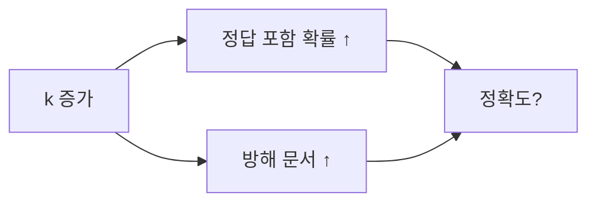

# 검색 개수 top-k

> RAG에서 **검색기가 프롬프트에 넣는 문서 수**다. 많이 넣으면 정답 포함 확률(재현율)은 오르지만 방해 문서도 함께 늘어 모델 성능이 떨어질 수 있다.

## 쉽게 말하면
도서관에서 책을 3권만 가져오면 정답 책이 빠질 수 있고, 30권을 가져오면 비슷하지만 답 없는 책에 파묻힌다. 몇 권이 적당한지는 실험으로 정해야 한다.

## 자세히
(Power of Noise 논문과 RAFT 논문을 직접 읽었다.)
- **top-k 정확도(논문)**: 검색 결과 상위 k개 안에 정답이 있는 비율. BM25는 k=1,2,4,10에서 0.2966, 0.4105, 0.5237, 0.6663, Contriever는 0.2502, 0.3569, 0.4784, 0.6085.
- **너무 많으면(Power of Noise)**: 검색 문서가 지나치게 많으면 방해·비관련 문서가 늘어 **급격히 성능이 떨어진다**. 이 연구의 질문들에서는 **3~5개**가 가장 효과적이었다.
- **RAFT의 관점**: 테스트에서 top-k를 써서 재현율을 확보하므로 모델이 **무관한 텍스트를 가려내야** 한다. RAFT는 방해 문서가 섞인 학습으로 이에 대비하며, golden만 학습하면 방해에 약해진다.
- **한계(해석)**: 최적 k는 모델의 컨텍스트 길이·문서 길이·데이터에 따라 달라진다. 이 논문들의 수치는 7B급·NQ 등 특정 조건이다.

## 그림으로 보기

## 예시
- k를 3, 5, 10으로 바꿔 같은 질문 세트로 정확도를 비교([한 번에 한 변수](#one-variable-at-a-time) 원칙).

## 헷갈리는 것과 비교
| 개념 | 차이 |
|---|---|
| top-k | 가져오는 문서 수 |
| [재순위](#reranking-for-rag) | 가져온 문서를 다시 정렬 |
| [무작위 문서](#power-of-noise) | 채우기용 무관 문서 |

## 더 읽을거리
- [Cuconasu et al. (2024)](https://arxiv.org/abs/2401.14887) — 직접 읽음.
- [RAFT 논문](https://arxiv.org/abs/2403.10131) — 방해 문서 강건성(직접 읽음).
