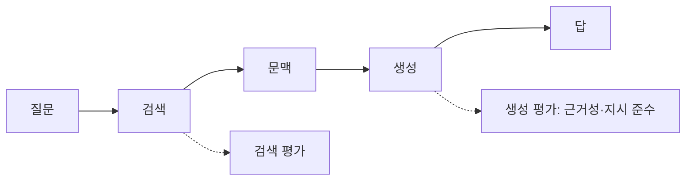

# 검색 평가 vs 생성 평가

> RAG를 **검색(문맥을 가져오는 단계)**과 **생성(그 문맥으로 답하는 단계)** 두 구성요소로 나눠 따로 평가하는 방식이다.

## 쉽게 말하면
사서(검색)가 맞는 책을 가져왔는지와 학생(생성)이 책대로 답했는지를 따로 채점한다. 둘이 섞이면 어디가 문제인지 모른다.

## 자세히
(Google Cloud 블로그를 직접 읽었다. 블로그는 검색 지표의 구체적 이름을 제시하지 않는다.)
- **구성요소(블로그)**: (1) 최근접 이웃 매칭의 **검색 정확도** (2) LLM에 제공하는 **문맥**.
- **검색 쪽 변경(블로그)**: 임베딩 모델, 청킹, 메타데이터. **생성 쪽 변경**: 모델·프롬프트 선택, 전달 문맥.
- **생성 지표(블로그)**: 응답 근거성(groundedness), 장황함, 지시 준수, 답변 품질. 어떤 검색 지표를 쓸지는 사용자가 골라야 한다.
- **연결 글**: 충실도는 생성 평가([충실도](#groundedness-metric))이고 검색 품질과 구분한다([문맥 품질 vs 충실도](#context-quality-vs-faithfulness)).

## 그림으로 보기

## 예시
- 오답 분석에서 "정답 문서가 검색 결과에 있었나?"를 먼저 보고, 있었는데도 틀리면 생성 단계를 점검(제안).

## 헷갈리는 것과 비교
| 개념 | 평가 대상 |
|---|---|
| 검색 평가 | 가져온 문맥의 질 |
| 생성 평가 | 답의 근거성·품질 |
| [ALCE](#alce-benchmark) | end-to-end |

## 더 읽을거리
- [Google Cloud — Optimizing RAG retrieval](https://cloud.google.com/blog/products/ai-machine-learning/optimizing-rag-retrieval) — 직접 읽음.
