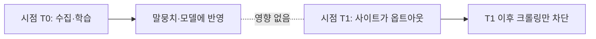
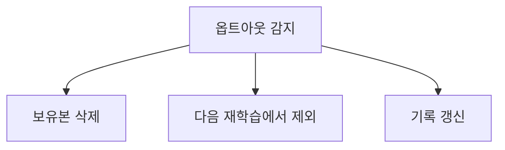

# 소급 불가 옵트아웃

> 웹사이트가 robots.txt나 약관으로 AI 학습용 수집을 **지금부터 막아도, 이미 수집·학습된 데이터에는 효과가 없는 경우가 많은** 공백이다. 옵트아웃은 "앞으로"의 약속이지 "과거 철회"가 아니다.

## 쉽게 말하면
도서관에 "앞으로 복사 금지" 팻말을 붙여도 이미 복사해 간 책은 되돌릴 수 없다. 팻말이 붙은 뒤에 오는 사람만 막는다. AI 학습에서는 한 번 모델에 배운 내용을 빼내는 것까지 어렵다.

## 자세히
(Common Crawl FAQ, OpenAI 크롤러 문서, 기계 언러닝 서베이 초록, Consent in Crisis 초록을 직접 열어 확인. 법률 자문이 아니다.)
- **크롤러 쪽 공식 설명의 범위**: Common Crawl 자주 묻는 질문은 CCBot을 robots.txt로 막으면 크롤링이 멈추고 사이트의 robots.txt를 **주기적으로 계속 확인**한다고만 설명하며, 이미 수집한 데이터 삭제는 이 페이지에서 언급하지 않았다(옵트아웃 등록부 안내 링크는 있었으나 열어 보지 못함). OpenAI 크롤러 문서는 GPTBot을 robots.txt로 막는 것이 사이트 내용이 생성형 AI 기반 모델 학습에 쓰이지 않아야 한다는 신호라고 설명한다. 검색에 대해서는 robots.txt 수정 후 시스템이 조정되기까지 약 24시간이 걸릴 수 있다고 쓰지만, **GPTBot 차단이 이미 수집·학습된 내용에 적용되는지는 문서에 없다.** 즉 "소급 적용 여부를 문서가 밝히지 않는다"는 사실만 확인했고, 실제 처리 방식은 확인하지 못했다.
- **이미 만들어진 말뭉치는 그대로(Consent in Crisis 초록)**: 이 연구는 AI 학습 말뭉치 C4 토큰의 약 5%가 이제 완전히 수집 금지 상태이고, 이용약관까지 포함하면 약 45%가 제한된다고 보고한다. 사이트의 허용 의사는 바뀌었지만 이미 배포된 말뭉치는 과거 시점의 스냅샷이라는 뜻이다(말뭉치 파일 자체가 소급 갱신되지 않는다는 점은 연구 초록에서 확인한 것이 아니라 정적 스냅샷이라는 성격에서 오는 해석).
- **학습된 모델에서 지우기(기계 언러닝 서베이 초록)**: 데이터베이스에서 지워도 모델이 배운 것은 지워지지 않는다. 데이터 삭제 요구(잊힐 권리)를 모델에도 반영하려는 기계 언러닝이 연구되지만, 공통 틀과 자원이 없어 문제가 충분히 해결되지 않았다고 서베이가 밝힌다. 또 모델이 학습 데이터의 흔적을 간직할 수 있고, 공격으로 특정 데이터의 포함 여부를 알아낼 수도 있다고 한다.
- **조직이 할 수 있는 일(제안)**: ① 도메인별 허용 의사를 시점과 함께 기록해 "수집 당시에는 허용"을 증명([도메인별 허용 의사 기록](#domain-consent-registry)) ② 옵트아웃 변경을 감지하면 **자체 보유본에서 삭제하거나 이후 재학습에서 제외**하는 정책 ③ 학습에 쓴 데이터 목록(출처·날짜)을 남겨 삭제 요청에 대응 가능하게 하기 ④ 사이트 운영자라면 앞으로의 수집 차단과 별도로 기존 수집 데이터 삭제 요청 창구를 크롤러·데이터셋 운영자에게 직접 문의 ⑤ 모델 배포자는 향후 학습 때 옵트아웃을 반영하는 일정을 정해 공개.
- **한계**: 법적 의무는 관할과 데이터 유형(개인정보 여부)에 따라 다르다. 이 글은 기술적·운영적 공백을 정리한 것이다.

## 그림으로 보기

## 예시
- 사내 말뭉치 구축 후 6개월 뒤 한 신문사가 AI 학습 금지를 선언: 이미 만든 모델은 그대로지만 다음 학습분부터 제외하고, 보유 원문의 처리 방침을 법무와 정함.
- 교육 소재: "옵트아웃을 하면 내 글이 AI에서 지워질까?"를 질문으로 던지고 위 구조(수집 시점 대 선언 시점)로 설명.

## 헷갈리는 것과 비교
| 개념 | 차이 |
|---|---|
| 소급 불가 옵트아웃 | 과거에 수집·학습된 것은 철회가 안 닿음 |
| [도메인별 허용 의사 기록](#domain-consent-registry) | 허용 의사를 시점별로 장부화 |
| [Consent in Crisis](#consent-in-crisis) | 허용 의사 철회 추세 측정 |
| 기계 언러닝 | 학습된 모델에서 특정 데이터의 영향을 제거하려는 연구 |

## 더 읽을거리
- [Common Crawl FAQ](https://commoncrawl.org/big-picture/frequently-asked-questions/) — CCBot 차단과 robots.txt 주기적 재확인(직접 확인, 삭제 정책은 미기재).
- [OpenAI: Overview of OpenAI crawlers](https://developers.openai.com/api/docs/bots) — GPTBot robots.txt 설명(직접 확인, 소급 여부 미기재).
- [A Survey of Machine Unlearning (arXiv 2209.02299)](https://arxiv.org/abs/2209.02299) — 모델에서 데이터 영향을 지우는 문제(초록 직접 확인).
