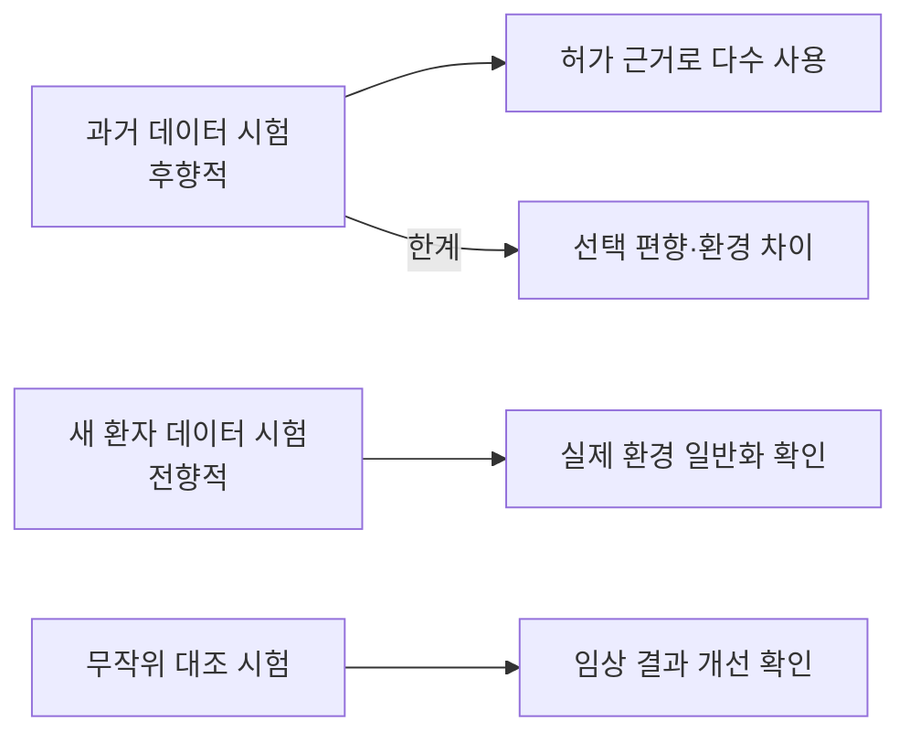

# 후향적 vs 전향적 연구

> 후향적(retrospective) 연구는 이미 모아 둔 과거 데이터로 모델을 시험하고, 전향적(prospective) 연구는 시험을 시작한 뒤 실제 진료 흐름에서 새로 들어오는 환자 데이터로 시험한다. 의료 AI 허가는 후향적 근거가 많다.

## 쉽게 말하면
후향적은 "지난 시험 문제로 모의고사", 전향적은 "당일 새 문제로 실제 시험"이다. 모의고사 점수가 높아도 실전에서 다를 수 있다.

## 자세히
- **UNC 연구(Nature Medicine, Chouffani El Fassi 외, 2024-08-26 발표; MedTech Dive 보도 확인)**: 1995~2022년 FDA 허가 AI 기기 521개 중 226개(약 43%)는 임상 검증 데이터가 공개되지 않았고, 검증 데이터가 있는 292개 중 후향적 144개, 전향적 148개(전체의 약 28%), 무작위 대조 시험(RCT)은 22개. 보도 기준이며 논문 본문은 열지 못했다.
- **스탠퍼드 연구(2021, 검색 보도)**: 2015~2020년 허가 130개 중 126개가 후향적 데이터로만 평가, 고위험 54개 중 전향적 평가 0개, 93개는 다기관 평가가 공개되지 않음, 공개된 71개의 평가 표본 중앙값 300. 매체마다 저널을 Nature/Nature Medicine으로 다르게 적어 확인이 필요하다. 위 UNC 연구와는 표본이 달라 비율을 비교하면 안 된다.
- **후향적 한계**: 선택 편향(데이터가 정리된 병원·환자), 영상 장비·프로토콜 차이, 실제 사용 흐름(의사가 AI를 보는 방식) 미반영.
- **전향적 장점**: 실제 환경 일반화, 워크플로 영향 확인. 비용·시간 큼. RCT는 임상 결과 개선까지 보는 가장 강한 설계.
- **허가와의 관계**: 510(k)는 predicate 동등성과 성능 데이터를 요구하며 전향적 연구를 일률적으로 요구하지 않는다([임상 근거](#clinical-validation-evidence)).

## 그림으로 보기

## 예시
- 유방촬영 AI를 과거 판독 이미지 10,000건에서 시험(후향적) 후, 선별 검진 센터에서 6개월간 실시간 보조로 암 검출률을 비교(전향적).

## 헷갈리는 것과 비교
| 개념 | 차이 |
|---|---|
| 후향적 | 과거 데이터 |
| 전향적 | 시작 후 수집 |
| RCT | 무작위 배정 비교 |
| [외부 검증](#external-validation) | 다른 병원·시기 데이터, 후향적일 수 있음 |

## 더 읽을거리
- [MedTech Dive: Nature Medicine 연구 보도](https://www.medtechdive.com/news/nature-ai-medical-devices-clinical-evidence/726449/) — UNC 연구 요약
- [AHA: Study finds new commercial AI devices often lack key performance data](https://www.aha.org/aha-center-health-innovation-market-scan/2021-04-20-study-finds-new-commercial-ai-devices-often) — 스탠퍼드 연구 보도(검색 결과로만 확인)
