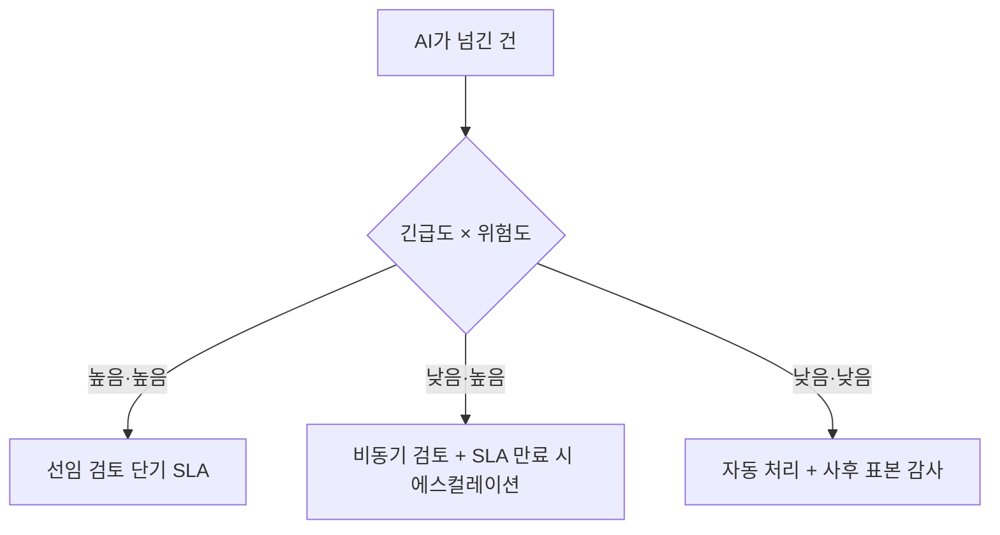
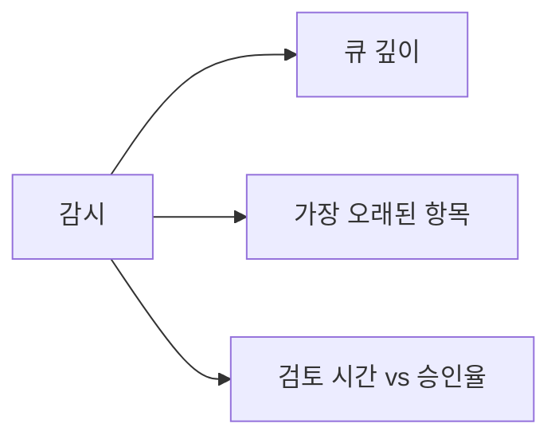

# 검토 큐 설계

> AI가 사람에게 넘긴 건을 어떤 순서로, 어떤 정보와 함께, 얼마나 빨리 처리할지 정하는 운영 설계. 큐가 막히면 "사람 검토"가 시스템에서 가장 느린 부품이 된다.

## 쉽게 말하면
병원 응급실 접수와 같다. 도착 순서가 아니라 위급도와 위험으로 먼저 볼 환자를 정하고, 대기실이 넘치면 대응 계획이 있어야 한다.

## 자세히
핵심 출처는 Tianpan의 "Human Bottleneck Problem"(2026-05-05, 열람, 개인 블로그)이며 수치는 글의 예시다.
- **용량 계획**: 하루 1만 건 × 30초 = 약 83 검토자-시간. 정규직 10명이면 약 80 가용 시간이라 포화에 가깝다. 활용률이 대략 50~60%를 넘으면 인력을 늘려도 이득이 줄고, 도착률이 처리율에 가까워지면 큐 길이가 끝없이 늘어난다(Little의 법칙).
- **SLA 분리**: 지연(첫 검토까지 시간, 예: P0 15분·P1 2시간·P2 최선)과 정확도(감사 표본으로 측정)를 분리한다. 정확도 미달은 용량이 아니라 보정 문제다. 실시간 경로에서 동기 검토는 지연 목표와 맞지 않아 사전 승인 템플릿, 섀도 모드+롤백 등의 대안이 필요하다.
- **포화 대응**: 큐는 조용히 쌓이므로 큐 깊이와 가장 오래된 항목 나이를 감시한다. 저위험·저긴급 건은 자동 처리하고 사후 감사 표본을 둔다. 2단계 분류(자동 1차로 안전/위험/애매 나누기)로 사람은 뒤 둘만 본다.
- **우선순위**: 긴급도와 위험도의 두 축. 확신(모델 불확실성), 위험(오류 결과), 참신성(분포 이동, 높은 확신이 믿을 수 없게 되는 경우)을 함께 쓴다.
- **고무도장 위험**: 검토 시간이 줄어드는데 승인율이 그대로면 검토자가 독립 평가 대신 확신 점수를 따라가는 신호. 공유 표본으로 정기 보정 세션을 하고 검토 결정을 학습에 되먹인다.
- **계측 지표**: 우선순위별 첫 검토 시간, 큐 깊이·오래된 항목 나이, 검토자별 활용률, 건당 검토 시간과 승인·거절율, 감사 표본 정확도, 평가자 일치도, 이관량 추세.
- **검색 요약에서 본 추가 관행(미확인)**: 큐 항목에 원 입력·모델 출력·감사 기록을 담고, AI 추천·사람 결정·사유를 변경 불가로 기록하며, 자동 승인 건의 무작위 5% 감사로 드리프트를 며칠 안에 잡는다는 경험칙. 이는 블로그 수준이며 직접 열어 확인하지 못했다.

## 그림으로 보기

## 예시
- 송장 이관: 금액 큰 건은 선임에게, 소액 저위험 건은 자동 처리 후 5% 표본 감사.
- 교육 실습: 하루 이관 5,000건×40초의 필요 검토자-시간을 계산하고 가용 인력 대비 활용률을 구한다.

## 헷갈리는 것과 비교
| 개념 | 차이 |
|---|---|
| 검토 큐 설계 | 넘어온 건의 처리 운영 |
| [이중 임계값 정책](#double-threshold-policy) | 어떤 건이 큐로 오는지 정함 |
| [위임 학습](#learning-to-defer) | 모델이 넘길 시점을 학습 |
| 능동 학습형 검토 | 정보량 큰 건을 우선 검토 |

## 더 읽을거리
- [Tianpan: The Human Bottleneck Problem](https://tianpan.co/blog/2026/05/05/human-in-the-loop-throughput-bottleneck-ai-systems) — 용량·SLA·고무도장(개인 블로그, 열람)
