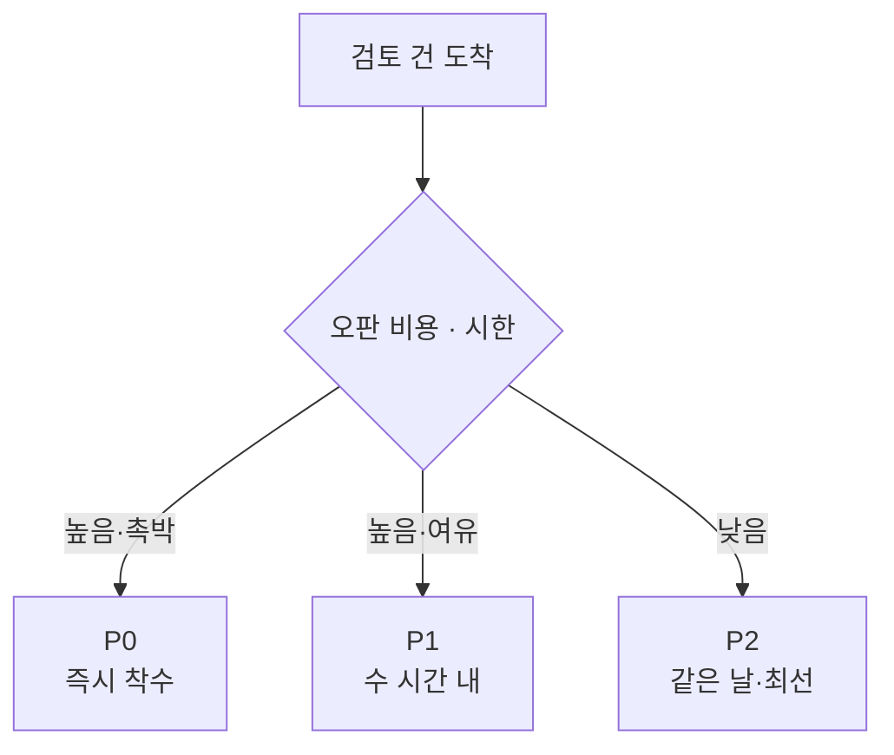
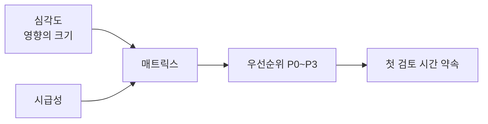

# 검토 SLA 등급

> 검토 SLA 등급은 사람이 검토할 건을 위험·긴급도에 따라 P0·P1·P2처럼 나누고, 등급마다 "첫 검토까지 걸리는 시간"을 약속하는 규칙이다. 모든 건을 같은 속도로 처리하다 큐가 막히는 것을 막는다.

## 쉽게 말하면
응급실 분류와 같다. 심정지 환자는 즉시, 골절은 몇 시간 안에, 감기는 오늘 안에 본다. 건마다 기다릴 수 있는 시간을 미리 정해 두면 한정된 의사가 가장 급한 사람부터 본다.

## 자세히
- **출처의 성격**: 검토 큐 전용 표준은 찾지 못했다. 아래는 IT 장애 대응 분야의 등급 관행(Rootly 가이드, 열람)을 검토 큐에 옮겨 쓴 것이다. 같은 글도 이런 값은 업계 표준이 아니라 출발점이며, 이름보다 문서화된 기준이 중요하다고 쓴다.
- **심각도와 우선순위는 다른 축(Rootly)**: 심각도(SEV0~3)는 영향의 크기, 우선순위(P0~3)는 다른 일 대비 얼마나 급하게 움직이는지다. 보통 심각도를 먼저 정하고 시급성을 더해 우선순위를 도출한다. 같은 SEV2도 시급한 때는 P1, 한가한 때는 P3일 수 있다.
- **우선순위별 기대(Rootly 예)**: P0 "모든 일을 멈추고" 즉시·24시간 착수, P1 긴급·즉시 착수, P2 같은 영업일 안에 P0·P1 이후 착수, P3 정규 업무에 계획해 넣음.
- **검토 큐에 옮기기(해석)**: 위험(오판 비용)과 시한(고객 대기, 규제 기한)으로 등급을 정한다. [검토 큐 설계](#review-queue-design) 글의 예처럼 P0 15분·P1 2시간·P2 최선 노력 같은 값을 정하되 해당 값은 개인 블로그의 예시이므로 자기 업무에서 정한다.
- **등급이 행동을 바꾸는가**: 등급이 달라도 담당·대응 시간이 같으면 분류 일만 늘어난다는 지적이 있다(검색 요약, 본문 미열람). 등급 수를 적게 두고 각각 다른 행동에 연결한다.
- **SLA 만료 시 처리**: 시간 안에 못 보면 상위 담당자에게 올리거나 안전한 기본 동작(보류·거절)으로 처리하는 규칙을 함께 둔다(해석).
- **정확도와 분리**: 시간 약속은 "빨리 봤나", 정확도는 감사 표본으로 따로 잰다.

## 그림으로 보기

## 예시
- 금융 사기 탐지: 고액·실시간 거래는 P0(분 단위), 중간 금액은 P1(몇 시간), 소액 반복은 P2(익일 처리).
- 프롬프트 예: "아래 검토 건 목록을 오판 비용과 시한 기준으로 P0·P1·P2로 나누고 등급 기준 표를 만들어 줘."

## 헷갈리는 것과 비교
| 개념 | 차이 |
| --- | --- |
| [검토 큐 설계](#review-queue-design) | 상위 주제. 등급은 그 처리 순서 규칙 |
| 심각도(SEV) | 영향의 크기. 우선순위는 처리 긴급도 |
| [이중 임계값 정책](#double-threshold-policy) | 어떤 건이 사람에게 가는지. SLA는 간 뒤 얼마나 빨리 보는지 |

## 더 읽을거리
- [Rootly: Incident severity levels P1-P3 explained](https://rootly.com/incident-response/support-levels) — 심각도와 우선순위 구분, 응답 기대
