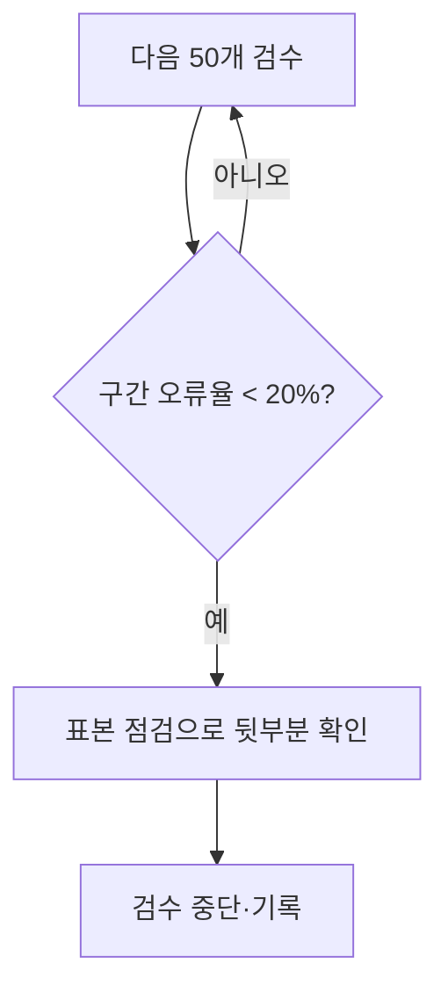
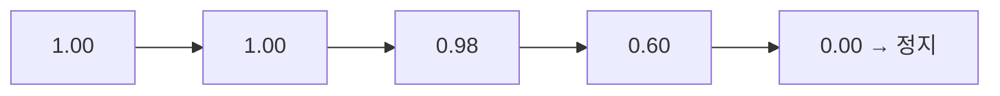

# 검수 정지 규칙

> 점수 순으로 오라벨 후보를 사람이 검수할 때 "어디서 멈출까"를 미리 정해 두는 규칙이다. 구간(배치)별 실제 오류 비율이 기준 아래로 떨어지거나, 예산이 바닥나거나, 정제 후 성능 개선이 멈추면 중단한다.

## 쉽게 말하면
의심스러운 순서로 쌓인 답안지 더미를 50장씩 검토하다가, 최근 50장에서 틀린 게 한 장도 안 나오면 나머지는 볼 필요가 적다. 언제 멈출지 규칙이 없으면 끝없이 보거나, 반대로 너무 일찍 그만둔다.

## 자세히
- **직접 해 본 실험(숫자 손글씨 1,797개, 라벨 약 10%(179개) 무작위 변경, 랜덤 포레스트 5겹 표본 외 확률의 self_confidence 낮은 순)**: 50개씩 구간으로 검수했을 때 구간별 실제 오라벨 비율은 0~50번째 1.00, 50~100번째 1.00, 100~150번째 0.98, 150~200번째 0.60, 200~250번째부터 0.00이었다. "구간 오류 비율이 20% 미만이면 정지" 규칙은 250개에서 멈췄고, 그때까지 전체 오라벨 179개 중 179개를 찾았다. 이 쉬운 합성 사례에서는 규칙이 이상적으로 동작했다. 실제 데이터는 오류 비율이 서서히 줄어 정지 지점이 모호하다.
- **정지 규칙의 종류(해석)**: ① 구간 오류율 기준(위 예, 기준은 비용 대비 가치로 정함) ② 예산 기준(검수 인원·시간 한도) ③ 성능 기준(정제 후 모델의 깨끗한 검증 점수 향상이 임계 이하) ④ 연속 구간 규칙(예: 연속 2개 구간이 모두 기준 미만이면 정지)으로 한 번의 운에 멈추지 않게 함.
- **현장에서의 주의**: 실제로는 전체 오라벨 수를 모르므로 구간 비율만으로 판단한다. 아직 검수하지 않은 뒷부분에 오류가 남아 있을 수 있다. 검수하지 않은 구간에서 무작위로 일부를 뽑아 확인(표본 점검)해 놓친 비율을 추정한다. [precision@k](#precision-at-k-review) 곡선이 정지 판단의 기반이다.
- **함정**: 오류가 특정 클래스 쌍에 몰린 경우 점수가 높은 구역에 오류가 남는다. 정지 규칙과 별개로 클래스별 오류율을 확인한다.
- **기록**: 어떤 규칙으로 어디서 멈췄는지와 이유를 남긴다([분할 기록 남기기](#split-report-logging)와 같은 습관).

## 그림으로 보기

## 예시
- 검수 인력 하루 200건: 50건 단위로 오류율을 기록하고 연속 두 구간이 10% 미만이면 중단, 남은 후보에서 30건 무작위 점검.
- 교육 활용: 구간 오류율 곡선을 그려 학습자마다 정지 지점을 정하고 이유를 비교한다.

## 헷갈리는 것과 비교
| 개념 | 차이 |
| --- | --- |
| 검수 정지 규칙 | 언제 멈출지 |
| [precision@k 검수 효율](#precision-at-k-review) | 상위 k개의 효율 측정 |
| [이중 검수](#double-annotation-review) | 검수 품질을 높이는 방법 |
| 표본 점검 | 검수하지 않은 구간의 오류 추정 |

## 더 읽을거리
- [Confident Learning (arXiv 1911.00068)](https://arxiv.org/abs/1911.00068) — 오류 순위 매기기와 정제 후 성능 개선
