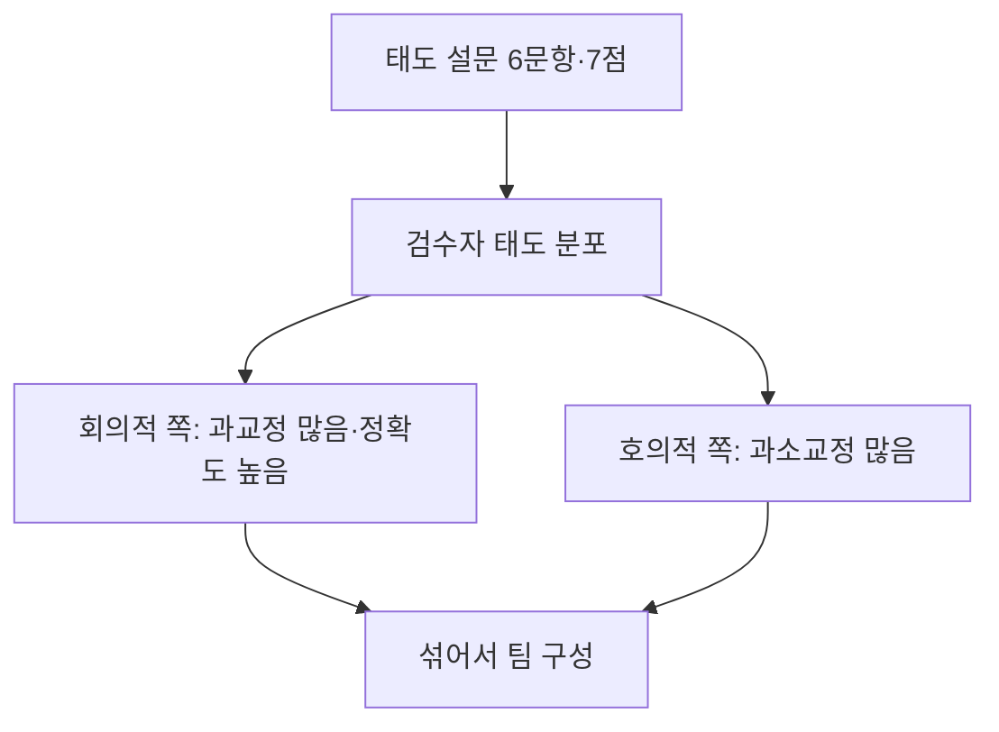

# 검수자 선발과 AI 태도 측정

> AI가 만든 결과를 사람이 검수할 때, 검수자가 **AI를 얼마나 좋아하고 믿는지(태도)**에 따라 오류를 잡는 정도가 달라지므로, 검수자 구성을 정할 때 이 태도를 측정해 한쪽으로 쏠리지 않게 하는 방법이다.

## 쉽게 말하면
번역 초안을 감수할 사람을 뽑을 때 "기계 번역을 믿는 사람"만 모으면 오역을 그냥 넘기기 쉽다. 반대로 "기계를 못 믿는 사람"만 모으면 멀쩡한 번역을 괜히 고칠 수 있다. 서로 다른 성향을 섞고, 사람들이 어느 쪽인지 알고 있어야 한다.

## 자세히
(Beck 등 2025, arXiv 2509.08514 PDF를 직접 읽어 확인.)
- **어떻게 측정했나(논문)**: 먼저 Prolific 참가자 3,200명을 모집해(완전 응답 3,187명) 자동화·AI에 대한 태도를 **6문항, 7점 리커트 척도**(Novotny 등 2025의 척도)로 묻고, 응답을 평균했다. 일주일 뒤 겉보기에 무관한 주석 과제에 초대했다. 미국 성인 인구의 연령·성별·인종 분포를 대표하도록 모집했다.
- **결과(논문)**: AI에 **부정적인 쪽(하위 두 사분위)**은 AI 사전 라벨을 더 자주 고쳤고, 그 때문에 **과교정(overcorrection: 맞는 것을 고침)**도 더 많았다. **호의적인 쪽**은 **과소교정(undercorrection: 틀린 걸 못 고침)**이 많았다. 부정적인 쪽이 전체 정확도는 더 높았는데, 틀린 AI 라벨을 무비판적으로 믿지 않아서라고 저자들은 해석한다. 태도가 성능의 가장 강한 예측 변수였고 인구통계보다 컸다. (조사에 응하지 않은 NA 그룹이 절반 이상이어서 해석에 한계가 있다.)
- **저자들의 권고**: 이상적으로는 **사전에 태도를 측정해 다양한 검수자 구성**을 고른다. 하지만 어떤 태도가 관련 있는지 미리 모르는 경우가 많아 현실적 차선은 **인구통계를 계속 수집하고 크고 다양한 검수자 집단**을 두는 것이다. 예를 들어 AI 연구자는 AI에 호의적일 가능성이 높아, 자동 시스템을 직접 평가할 때 오류를 놓칠 수 있다. 또한 검수자 간 불일치나 낮은 정확도를 단순 노이즈로 보지 말고 **문항의 난이도·모호성 신호**로 볼 수 있다.
- **실무 적용(제안, 논문의 직접 권고 아님)**: ① 검수 팀 구성 때 짧은 태도 설문(논문처럼 6문항 척도)을 쓰되 개인 평가·채용 용도로 쓰지 않는다(개인정보·공정성 문제) ② 회의적 검수자와 호의적 검수자를 한 문항에 겹쳐 배정해 의견 차를 본다 ③ 과소교정과 과교정을 각각 추적해 균형을 본다 ④ 결과는 팀 구성 조정에만 쓰고 개인 낙인으로 쓰지 않는다.
- **한계**: 한 과제(기업 배출량 표 주석)와 한 사회(미국 크라우드 참가자) 결과라 직접 일반화하기 어렵다.

## 그림으로 보기

## 예시
- 기업 AI 요약 결과를 사내 검수자 10명이 확인하는 프로젝트에서, 자주 쓰는 사람과 회의적인 사람을 섞고, 문항별 불일치가 큰 항목을 따로 모아 규칙을 보완.
- 교육 소재: "AI를 믿는 정도가 검수 결과를 바꾼다"를 활용해 AI 협업 교육의 자기 점검 설문으로 사용.

## 헷갈리는 것과 비교
| 개념 | 차이 |
|---|---|
| 검수자 선발·태도 측정 | 누가 검수하느냐를 설계 |
| [회의적 검수자 효과](#skeptical-reviewer-effect) | AI에 회의적일수록 오류를 더 잘 잡는 현상 |
| [사전 라벨 자동화 편향](#automation-bias-prelabel) | 검수자가 모델 제안을 과신 |
| [오류 수정 강제의 역효과](#forced-correction-backfire) | 검수 UI 설계 쪽 요인 |

## 더 읽을거리
- [Bias in the Loop: How Humans Evaluate AI-Generated Suggestions (arXiv 2509.08514)](https://arxiv.org/abs/2509.08514) — 태도 설문·사분위별 결과·선발 권고(PDF 직접 확인).
