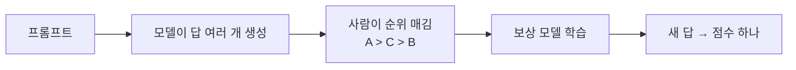

# 보상 모델

> 같은 질문에 대한 여러 답을 사람이 매긴 순위로 학습해, 어떤 답이든 "사람이 얼마나 좋아할지"를 점수 하나로 내놓게 만든 모델. RLHF에서 심사위원 역할을 한다.

## 쉽게 말하면
피겨 스케이팅 심사위원을 AI로 만든다고 하자. 선수마다 절대 점수를 주면 심사위원마다 기준이 달라 들쭉날쭉하다. 그래서 "A 연기가 B보다 낫다"는 순위만 모아 놓고, 그 순위를 가장 잘 재현하는 점수 계산기를 훈련시킨다. 이 계산기가 보상 모델이다. 이후 선수(언어 모델)는 이 계산기의 점수를 높이는 연기를 연습한다.

## 자세히
- **데이터**: 프롬프트마다 모델이 여러 답을 생성하고, 사람이 **점수 대신 순위**를 매긴다. 절대 점수는 "보정이 안 되고 잡음이 많다"는 이유다(Hugging Face RLHF 글). 비교 결과는 Elo 같은 방식으로 하나의 스칼라 보상 신호로 바꿀 수 있다.
- **출력**: 텍스트를 넣으면 스칼라 점수 하나가 나온다.
- **규모(2022~23년 사례)**: OpenAI는 175B 정책 모델에 6B 보상 모델, Anthropic은 10B~52B, DeepMind는 70B Chinchilla를 썼다. 선호 데이터는 약 5만 건 규모가 흔했다.
- **위치**: InstructGPT(2022)의 3단계 중 2단계 — ①[SFT](#sft) → ②보상 모델 → ③PPO 강화학습. 이 방식으로 1.3B InstructGPT 출력이 175B GPT-3보다 선호되었다(논문 주장).
- **위험**: 정책 모델이 점수만 높게 받는 꼼수(보상 해킹)를 찾을 수 있다. 그래서 원래 모델에서 너무 멀어지지 않게 제약을 둔다.
- **대안**: [DPO](#dpo)는 이 모델을 따로 만들지 않고 선호 쌍으로 바로 학습한다.

## 그림으로 보기

## 예시
- 고객센터 요약 모델: 상담 요약 세 개를 팀장이 순위 매기면, 그 선호를 흉내 내는 보상 모델이 생긴다. 이후 수천 건을 사람 없이 점수화할 수 있다.
- 평가용으로도 쓴다: 여러 후보 답 중 보상 점수가 가장 높은 것을 고르는 best-of-n.

## 헷갈리는 것과 비교
| 개념 | 차이 |
|---|---|
| [RLHF](#rlhf) | 보상 모델을 쓰는 전체 절차. 보상 모델은 그 한 부품 |
| [DPO](#dpo) | 보상 모델 없이 직접 학습 |
| LLM 심판(judge) | 프롬프트로 일반 LLM에게 채점시키는 것. 보상 모델은 선호 데이터로 따로 훈련됨 |

## 더 읽을거리
- [Training language models to follow instructions (InstructGPT, arXiv 2203.02155)](https://arxiv.org/abs/2203.02155) — SFT→보상 모델→RL 3단계 원전
- [Illustrating RLHF (Hugging Face)](https://huggingface.co/blog/rlhf) — 순위 데이터·보상 모델 크기 설명
