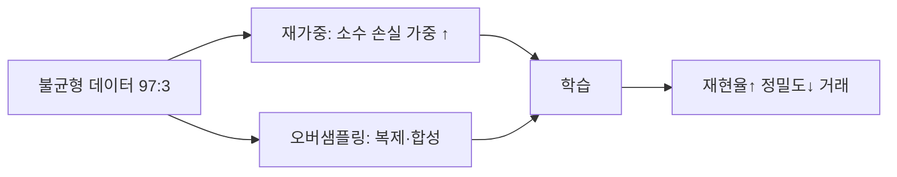
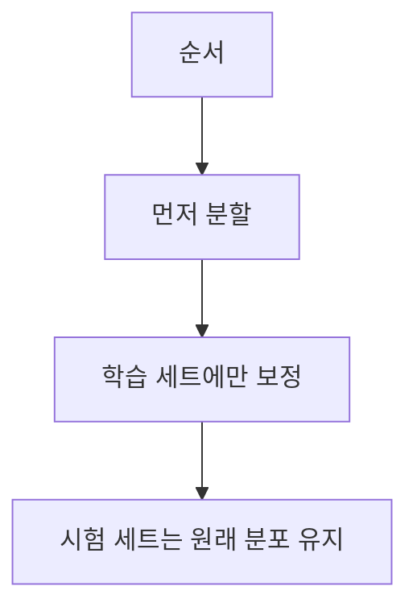

# 재가중·오버샘플링

> 과소 대표된 집단이나 희귀 클래스가 학습에서 무시되지 않도록, 그 샘플의 손실 가중치를 키우거나(재가중) 그 샘플을 복제·합성해 더 많이 보이게(오버샘플링) 하는 보정 기법이다.

## 쉽게 말하면
반에서 소수의 학생만 쓰는 제2외국어 문제를 시험에 거의 안 냈더니 그 학생들만 계속 점수가 낮은 상황이다. 그 과목 문제에 더 큰 배점을 주거나(재가중), 그 문제를 더 자주 풀게 하면(오버샘플링) 그 학생들이 약점을 극복한다.

## 자세히
(SMOTE 논문 arXiv 1106.1813 초록을 직접 열어 확인하고, 직접 실험을 실행.)
- **재가중**: 소수 클래스 샘플의 손실 가중치를 키운다. scikit-learn에서는 `class_weight="balanced"` 또는 `sample_weight`로 지정.
- **오버샘플링**: 소수 샘플을 복제(무작위)하거나 합성(SMOTE)한다. SMOTE(Chawla 등, 2002)는 소수 샘플을 단순 복제하는 대신 **합성 샘플을 만들고** 다수 클래스 **언더샘플링**과 결합해, 다수 클래스만 언더샘플링할 때보다 **ROC 공간에서 더 나은 분류 성능**을 낼 수 있다고 주장하며, Ripper의 손실 비율이나 Naive Bayes의 클래스 사전확률 조정보다도 낫다고 보고한다(C4.5·Ripper·Naive Bayes, AUC와 ROC 볼록 껍질로 평가; 초록).
- **직접 실험(합성 이진 데이터 2만 개, 양성 약 3%, 로지스틱 회귀, 양성 시험 274건)**
  | 방법 | 재현율 | 정밀도 | 정확도 |
  |---|---|---|---|
  | 보정 없음 | 0.000 | 0.000 | 0.965 |
  | `class_weight="balanced"` | 0.675 | 0.070 | 0.679 |
  | 무작위 오버샘플링 | 0.675 | 0.070 | 0.680 |
  보정 없이는 모두 음성으로 예측해 정확도 0.965인데 양성은 하나도 못 잡았다. 재가중과 무작위 오버샘플링은 거의 같은 결과(재현율 0.675)로 양성을 잡지만 **정밀도가 7%로 낮아 정확도는 0.68**로 떨어진다. 즉 보정은 정확도 대신 재현율을 얻는 거래다. 이 선형 모델과 데이터에서는 두 방법이 사실상 동등했다(복제 오버샘플링은 가중치와 수학적으로 가깝다).
- **함정(제안)**: ① **분할 후** 학습 세트에만 적용(복제본이 시험에 들어가면 [증강본 그룹 누수](#augmentation-group-leak)와 같은 누수) ② 보정하면 예측 확률이 왜곡되므로 [확률 보정](#pred-probs-calibration) 재점검 ③ 정확도가 아닌 재현율·정밀도·집단별 지표로 평가 ④ 합성 샘플은 실제와 다른 분포를 만들 수 있다 ⑤ 라벨 오류가 있는 소수 샘플을 복제하면 오류도 증폭.
- **공정성에서(제안)**: 과소 대표된 집단의 샘플 가중치를 높여 집단별 성능 격차를 줄일 수 있지만, 편향된 라벨 문제([대리 변수](#proxy-variables))는 가중치로 해결되지 않는다.

## 그림으로 보기



## 예시
```python
from sklearn.linear_model import LogisticRegression
m = LogisticRegression(max_iter=2000, class_weight="balanced").fit(X_train, y_train)
# 또는 소수 클래스 복제
import numpy as np
rng = np.random.default_rng(0)
pos = np.where(y_train == 1)[0]; neg = np.where(y_train == 0)[0]
idx = np.r_[neg, rng.choice(pos, len(neg), replace=True)]
m2 = LogisticRegression(max_iter=2000).fit(X_train[idx], y_train[idx])
```

## 헷갈리는 것과 비교
| 개념 | 차이 |
|---|---|
| 재가중 | 손실 가중치 조절(데이터 수는 그대로) |
| 무작위 오버샘플링 | 소수 샘플 복제 |
| SMOTE | 소수 샘플 사이를 보간한 합성 샘플 |
| 언더샘플링 | 다수 클래스를 줄임 |
| [증강](#data-augmentation) | 변형으로 데이터 다양화(라벨 보존 변환) |

## 더 읽을거리
- [SMOTE: Synthetic Minority Over-sampling Technique (arXiv 1106.1813)](https://arxiv.org/abs/1106.1813) — 합성+언더샘플링 주장(초록 확인).
