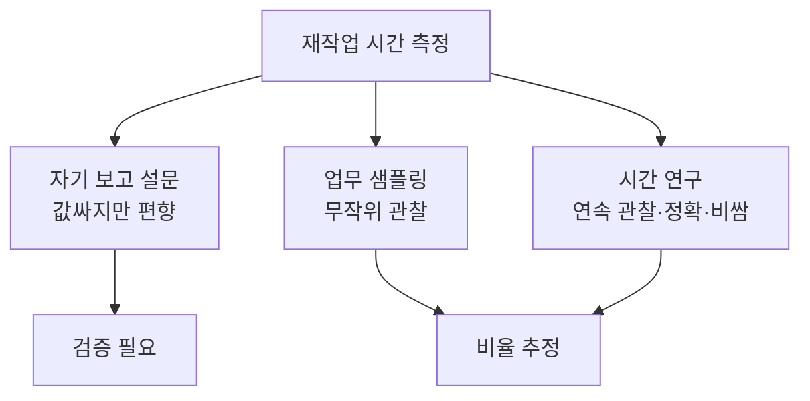
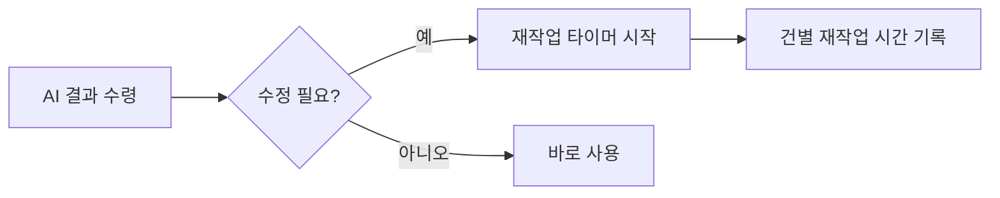

# 재작업 시간 실측

> 재작업 시간 실측은 AI가 넘긴 건의 이관·재확인·재접촉에 사람이 실제로 얼마나 시간을 쓰는지 추정이 아니라 측정으로 알아내는 일이다. ROI의 절감 효과가 재작업으로 얼마나 상쇄되는지 판단하는 근거다.

## 쉽게 말하면
"AI 덕분에 하루 한 시간 절약"이라는 직원의 말과, AI가 쓴 초안을 고치느라 쓴 시간을 합산한 기록은 다를 수 있다. 느낌이 아니라 시계로 재야 순이익이 보인다.

## 자세히
방법별로 정확도와 비용이 다르다. 이번 조사에서 AI 보조 업무의 재작업을 직접 측정한 연구는 찾지 못했고, 일반 작업 측정 방법과 자기 보고의 한계를 아래에 정리한다.
- **자기 보고는 틀릴 수 있다(UK 시간 사용 조사 연구, PMC6609582, 열람)**: 영국 조사에서 "보통 근로 시간"의 자기 응답이 시간 일기 값보다 2000년에 약 2.5시간(38.3 대 35.8), 2015년에 약 0.8시간 컸다. 방향은 근무 시간에 따라 달랐다. 짧게 일하는 사람은 과소, 길게 일하는 사람은 과대 응답이 많았고 가장 정확한 응답은 주 30~40시간 근무자였다. 불규칙한 일정과 이중 직업에서 오차가 컸다. 근로 시간 조사라는 다른 맥락이지만 "응답이 시간 일기와 어긋난다"는 점은 재작업 시간 설문에도 시사점이 있다(해석).
- **업무 샘플링(Wikipedia, 열람)**: 무작위 시각에 관찰해 활동 범주별 시간 비율을 통계적으로 추정하는 기법이다. 관찰 수 n = pq/σP²(p는 해당 활동 비율, σP는 원하는 표준오차). 문서의 예 p=0.2·σP=0.02면 400회 관찰이다. 몇 주 이상의 기간이 필요하고 활동이 뚜렷한 범주로 나뉘는 업무에 맞는다. 신뢰수준 배수는 문서에 없다.
- **시간 연구 대 업무 샘플링(미 해군대학원 자료의 검색 요약, 본문 미열람)**: 시간 연구는 연속 관찰이라 정확하지만 인력이 많이 들고 관찰자가 행동에 영향을 줄 수 있다. 업무 샘플링은 순간 스냅샷이라 값싸고 단순하나 관찰자가 업무를 알아야 한다고 한다.
- **가상 계산(직접)**: 재작업이 근무 시간의 약 15%라고 보고 95% 신뢰로 ±3%p 안에 맞추려면 z²pq/e² = 1.96²×0.15×0.85/0.03² ≈ 545회, ±2%p면 약 1,225회 관찰이 필요하다(표준 이항 공식으로 직접 계산).
- **AI 업무에 쓰는 법(해석)**: 이슈 관리 도구에 "AI 결과 수정" 같은 작업 유형 표식을 두고 건별 시작·종료 시각을 기록하거나, 하루 몇 번 무작위 알림으로 "지금 하는 일이 AI 결과 재작업인가?"를 묻는 간이 샘플링을 쓴다. 로그 기반 측정 방법(프로세스 마이닝 등)은 이번 조사에서 근거를 확인하지 못했다.
- **측정 효과(해석)**: 측정 자체가 행동을 바꿀 수 있으므로 기간을 충분히 잡고 설명 없이 평소처럼 일하게 한다.

## 그림으로 보기

## 예시
- 상담 요약 AI: 2주간 상담원에게 "요약 수정" 작업 표식과 시간 기록을 쓰게 해 건당 평균 수정 시간을 얻고, AI가 아껴 준 작성 시간에서 뺀 순절감을 계산한다.
- 교육 활용: 설문 응답 시간과 실제 로그 시간을 비교해 자기 보고의 오차를 체험하는 실습.

## 헷갈리는 것과 비교
| 개념 | 차이 |
| --- | --- |
| [건당 처리 비용](#handling-time-cost) | 상위 주제. 재작업 시간은 그 입력값 |
| 업무 샘플링 | 비율을 추정하는 통계 관찰법. 건별 시간은 직접 못 줌 |
| 시간 연구 | 건별 시간을 정밀하게 잼. 비용이 큼 |
| [재접촉률](#recontact-rate) | 같은 문제로 다시 연락하는 비율. 재작업 일부 |

## 더 읽을거리
- [Wikipedia: Work sampling](https://en.wikipedia.org/wiki/Work_sampling) — 절차와 관찰 수 공식
- [Improving Stylised Working Time Estimates with Time Diary Data (PMC6609582)](https://pmc.ncbi.nlm.nih.gov/articles/PMC6609582/) — 자기 보고 대 시간 일기
