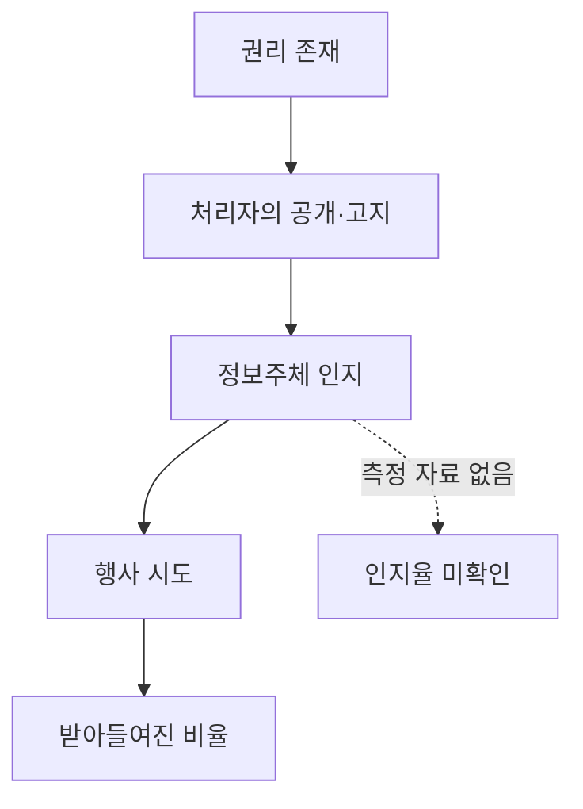

# 권리 인지율

> 정보주체가 자동화 결정에 대한 설명·거부·재처리 권리가 있다는 사실을 아는 정도. 한국에서 이를 직접 재 수치는 이번 조사에서 찾지 못했다.

## 쉽게 말하면
소화기가 있어도 어디 있는지 모르면 불이 났을 때 못 쓴다. 권리도 있다는 걸 알아야 쓸 수 있고, 그래서 인지율이 권리의 실효성을 가늠하는 첫 척도다.

## 자세히
- **확인된 것**: 두 번의 검색(국민 인식조사, 시행 1년 현황)에서 자동화 결정 권리의 인지율·행사 건수를 낸 개인정보위·KISA·금융감독원 자료를 찾지 못했다(2026-11-18 기준). 확인된 사실은 제37조의2가 2024-03-15 시행되었다는 것이다.
- **간접 단서**: 정보 비대칭 때문에 평가 사실 자체를 모르는 경우가 많다는 해설이 있다([권리 행사 장벽](#exercise-barriers)). 이는 인지율이 낮을 가능성을 시사할 뿐 수치는 아니다.
- **측정 방법(제안)**: 개인정보 실태조사에 문항 추가, 신용평가 안내문에 권리 고지 여부 점검, 처리방침 공개 사항 표본 조사.
- **제도 측**: 처리자는 자동화 결정 사실·목적·처리 절차·권리 행사 방법을 공개해야 한다고 해설된다([개인정보 보호법 자동화 결정 대응권](#pipa-automated-decision)). 공개의 질이 곧 인지율을 좌우한다.
- 이 노드는 추후 공식 조사 자료가 확인되면 수치로 갱신해야 한다.

## 그림으로 보기

## 예시
- 신용평가 거절 안내문에 "설명 요구 가능" 문구와 신청 링크가 있으면 인지 경로가 생긴다.
- 교육 활용: 직원·고객 교육에서 "내 데이터를 쓰는 AI 결정에는 이런 권리가 있다"를 짧은 카드로 알리는 것이 인지 개선의 한 방법.

## 헷갈리는 것과 비교
| 개념 | 차이 |
|---|---|
| 권리 인지율 | 아는 비율 |
| [권리 행사 장벽](#exercise-barriers) | 알아도 못 쓰는 이유 |
| [설명요구 이용 현황](#explanation-request-trend) | 실제 사용량 |

## 더 읽을거리
- [법률신문 해설](https://www.lawtimes.co.kr/news/articleView.html?idxno=194236) — 처리자 공개 의무와 권리 구조
- [뉴시스 2023-11-22](https://www.newsis.com/view/NISX20231122_0002531002) — 사업자의 사전 공개 의무에 관한 개인정보위 설명
