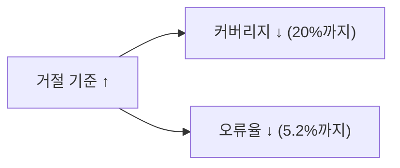
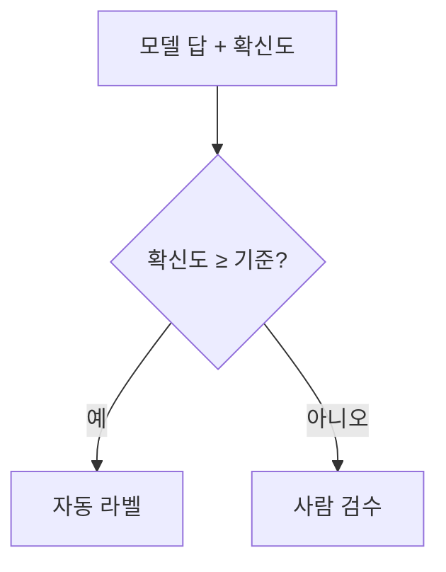

# 위험-커버리지 트레이드오프

> 위험-커버리지 트레이드오프는 모델(또는 LLM 라벨러)이 확신이 낮은 항목을 "모르겠음"으로 거절하면 남은 항목의 오류율(위험)은 낮아지지만 자동 처리하는 비율(커버리지)이 줄어드는 맞바꾸기 관계다.

## 쉽게 말하면
자신 있는 문제만 답하고 나머지는 "패스"하는 시험에서, 패스를 많이 하면 정답률은 오르지만 푼 문제 수는 줄어든다. 얼마까지 패스를 허용할지가 설계 문제다.

## 자세히
- **연구 근거(Geifman & El-Yaniv, arXiv 1705.08500 초록)**: 이미 학습된 신경망에 대해 사용자가 목표 위험 수준을 지정하면, 테스트 때 그 수준을 높은 확률로 만족하도록 필요한 만큼 판정을 보류하는 선택적 분류기(reject option)를 만든다. 불확실한 입력을 거절하면 위험이 줄지만 커버리지(분류하는 입력 비율)가 줄어든다. CIFAR·ImageNet 실험에서 ImageNet top-5 오류 2%를 99.9% 확률로 보장하면서 테스트 커버리지를 거의 60%로 유지했다고 보고한다.
- **직접 시뮬레이션(가정: 확신도 c가 0.5~1.0에서 균등하게 분포하고 확신도만큼 맞는 잘 보정된 모델, 20만 항목)**:

| 거절 기준(확신도 이상만 처리) | 커버리지 | 처리한 항목의 정확도 | 오류율 |
| --- | --- | --- | --- |
| 0.5(전부 처리) | 1.000 | 0.750 | 0.250 |
| 0.6 | 0.800 | 0.800 | 0.200 |
| 0.7 | 0.600 | 0.849 | 0.151 |
| 0.8 | 0.400 | 0.899 | 0.101 |
| 0.9 | 0.201 | 0.948 | 0.052 |

  기준을 0.9로 올리면 오류율이 25%에서 5.2%로 줄지만 자동 처리는 20%뿐이고 나머지 80%는 사람에게 간다. 확신도가 실제 정확도와 맞지 않으면(미보정) 이 곡선이 나빠진다([LLM 확신도 보정](#llm-confidence-calibration)).
- **라벨링 운영(해석)**: ① 사람 검수 비용(건당 단가)과 자동 오류 비용을 비교해 기준 결정 ② 골드에서 곡선을 그려 목표 오류율(예: 5%)을 만족하는 기준 선택 ③ 거절된 항목은 [판정 인터페이스](#adjudication-interface)로 보냄 ④ 시간이 지나 분포가 변하면 곡선을 다시 측정한다([LLM 라벨 사후 점검 주기](#llm-labeler-recheck-schedule)).

## 그림으로 보기

## 예시
- 목표 오류율 10% 이하이면 위 표에서 기준 0.8(커버리지 40%)을 고르고 나머지 60%는 사람이 라벨링한다.
- 교육 활용: 기준에 따른 커버리지·오류율 표를 직접 만들고 비용 가정으로 최적점을 찾는다.

## 헷갈리는 것과 비교
| 개념 | 차이 |
| --- | --- |
| 위험 | 처리한 항목의 오류율 |
| 커버리지 | 자동 처리한 비율 |
| [LLM 확신도 보정](#llm-confidence-calibration) | 확신도가 정확도를 반영하는지 |
| [LLM 자기 일관성](#llm-self-consistency) | 일치도를 확신 신호로 사용 |

## 더 읽을거리
- [Selective Classification for Deep Neural Networks (arXiv 1705.08500)](https://arxiv.org/abs/1705.08500) — reject option과 위험-커버리지
