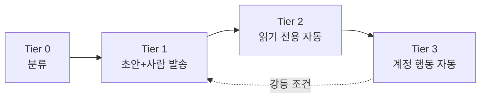
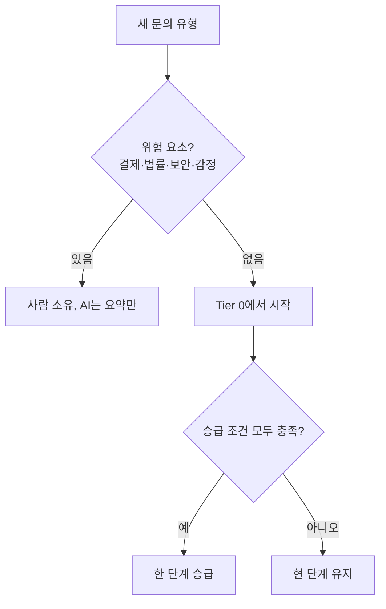

# 문의 위험 등급화

> 고객 문의 유형(intent)마다 위험도를 매겨, 위험이 낮은 것부터 AI가 맡고 높은 것은 사람이 쥐게 하는 설계. 자동화 범위를 "전부 아니면 전무"가 아니라 문의별 단계로 정한다.

## 쉽게 말하면
신입에게 일을 맡기는 순서와 같다. 처음엔 서류 분류만, 다음엔 답장 초안, 익숙해지면 단순 안내는 혼자, 마지막에 환불 같은 돈 문제를 맡긴다. 그것도 문의 종류별로 따로 승진시킨다.

## 자세히
- **4단계(Fini 가이드 예시, 문의 하나마다 적용)**
  - Tier 0 분류·라우팅 — 지표: 라우팅 정확도
  - Tier 1 초안 작성, 사람이 수정·발송 — 지표: 초안 수락률
  - Tier 2 읽기 전용 문의는 AI가 직접 발송 — 지표: 문의별 오답률
  - Tier 3 계정 변경(환불 등)까지 자동 — 지표: 무단 행동률
- **승급 조건(같은 가이드)**: 검토 표본 200건 이상, 단계별 정확도 기준(Tier 0→1은 라우팅 90% 초과, 1→2는 수정 없는 수락 60% 초과), 최근 3주 오류율 안정, 모든 표본이 승인된 출처 문서에 매핑, 문제 시 회의 없이 내릴 담당자 지정. 하나라도 어긋나면 그 조건이 할 일이 된다.
- **강등 조건**: 오답률이 2주 연속 기준 초과, 72시간 내 재문의 급증, 규제·금전·안전 사고 1건, 지식베이스 변경, 담당자 퇴사.
- **위험 요소**(출처 종합): 결제·법률·보안, 개인정보, 규제 대상 결정, 정책 예외, 감정이 격한 상황은 사람이 쥔다.
- 주의: 위 숫자(200건, 90%, 60%)는 한 벤더의 예시 기준이며 표준이 아니다. 반론으로, 금전 위험만 보면 감정적 위험을 놓친다는 블로그 주장도 있다(비공식 관찰).

## 그림으로 보기

## 예시
- "영업시간 알려 주세요": 출처 문서가 명확 → Tier 2까지 빠르게 승급 가능.
- "환불해 주세요": Tier 1에서 오래 머물다 조건 충족 후에야 Tier 3 검토.
- 교육 실습: 자기 회사 문의 10종을 골라 위험도와 시작 단계를 표로 정해 본다.

## 헷갈리는 것과 비교
| 개념 | 차이 |
|---|---|
| 문의 위험 등급화 | 문의 유형별 자동화 깊이를 정함 |
| [이관 트리거 신호](#escalation-triggers) | 대화 도중 사람에게 넘기는 실시간 신호 |
| [응대 전환율 deflection](#deflection-rate) | 등급화 이후 성과를 재는 지표 |
| [챗봇 vs 어시스트 도입 순서](#ai-chatbot-vs-assist) | 상위 주제 |

## 더 읽을거리
- [Fini: AI email support automation tiers](https://www.usefini.com/guides/ai-email-support-automation-tiers) — 4단계·승급·강등 기준(벤더)
- [Lorikeet: 자동화하면 안 되는 이슈](https://www.lorikeetcx.ai/articles/what-types-of-customer-issues-should-never-be-automated) — 열어 봤으나 본문에 내용이 없었음(검색 요약만 근거)
