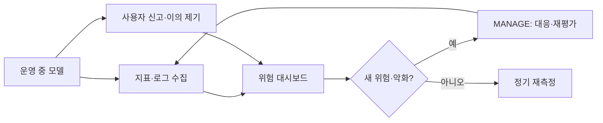

# 위험 추적

> 배포 후에도 AI 위험을 계속 관찰해, 처음 예상한 위험·예상 못 한 위험·새로 나타난 위험을 실제 성능 기반으로 따라가는 활동(NIST AI RMF MEASURE 3).

## 쉽게 말하면
건강검진 한 번으로 끝내지 않고 매년 같은 항목을 재서 변화를 보는 것과 같다. 모델은 입력 데이터·사용자·환경이 바뀌면 시간이 지나며 성능과 위험이 달라진다.

## 자세히
출처: NIST AI RMF 핵심 함수 페이지(2026-11-15 확인).
- **3.1**: 기존·예상 못 한·새로 나타나는 위험을 실제 성능 기반으로 추적하는 방법을 둔다.
- **3.2**: 측정이 어렵거나 지표가 아직 없는 위험은 대체 추적 방식을 쓴다(예: 정기 전문가 검토, 사례 기록).
- **3.3**: 최종 사용자·영향받는 공동체가 문제를 신고하고 결과에 이의 제기할 수 있는 피드백 채널을 만든다.
- **MEASURE 4와 연결**: 측정 방식이 배치 맥락에 맞는지, 결과가 수명주기 전반에서 의도한 성능을 반영하는지, 개선·악화를 이해관계자와 현장 데이터로 문서화.
- **운영 신호 예(일반 실무, 이 페이지 목록 아님)**: 입력 분포 변화(드리프트), 오류율·거부율, 사용자 신고, 사고 건수, 유형별 편향 지표.
- 첫 지표 선정과 평가 방법은 [TEVV](#tevv), 신고 채널 설계는 [PAIR 오류와 부드러운 실패](#pair-errors-graceful-failure)와 이어진다.

## 그림으로 보기

## 예시
- 상담 챗봇: 주간 오답 신고율, 사람 이관율, 신규 질문 유형 비율을 추적. 신고 채널에서 "정책이 낡았다"는 반복 신고가 나오면 지식 갱신 작업을 연다.
- 지표가 없는 위험(예: 미묘한 편향 표현)은 월 1회 표본 50건을 전문가가 검토.

## 헷갈리는 것과 비교
| 개념 | 차이 |
|---|---|
| 위험 추적 | 운영 중 지속 관찰 |
| 출시 전 시험 | 시점 평가 |
| 사고 보고 | 사고 발생 후 기록·공유 |

## 더 읽을거리
- [NIST AI RMF Core](https://airc.nist.gov/airmf-resources/airmf/5-sec-core/) — MEASURE 3 조항 원문
